# v2 Phase 3 report: richer code art, tunnel view, cutaway prep

10 November 2026. Branch `v2-phase3`, into `v2`. Test area only. **Spent: $0.** No pod was created.

## 1. The short version

- **Gate G2 is recorded:** method A (all code) for the whole city, in the owner's words "A, enrich in code
  (Recommended)". B and C are stopped. (`research/v2/DECISIONS.md`, `PLAN_V2.md` section 7.)
- **A is richer.** The Bock and the valley cliffs are now bedded sandstone, walls are coursed stone, the ground has
  paving, setts, lawns and garden flowers, trees are lobed crowns in many greens, and buildings have more colours,
  stone surrounds round every window and door, ashlar and banded ground floors. All of it is code, from the data or
  from seeded rules. It is closer to v1 but not at v1's richness yet (section 6).
- **Every gate passes:** 56 of 56 build stages, 248 gate entries (247 before the painted cathedral; the new one is
  K3's "no side too small to measure"). No threshold was changed.
- **Tunnel view is built** (`?xray`, a button, or X held): X1–X8 pass.
- **Landmark cutaways are built** for the cathedral, the palace and the abbey: the cut from the 3D model, shown
  in place in the viewer (`?cutaway`). The cathedral's interior is painted (since 13 November, section 9, "In the
  map"); the palace and the abbey have a placeholder interior. The Bock casemates' cutaway is not built.
- **Two quotes are in the ledger, not approved:** q0012 (cathedral, at most $0.54) and q0013 (the other three, at
  most $0.90). (q0013 was dropped on 13 November, unspent: section 10.)
- **Added 13 November:** the cathedral's painting was tried once, for $0.43. The interior style works; no painting
  passed the checks. Section 9 has the run, the free fixes and the new quote q0015 (not approved).
- **Added later on 13 November:** q0015 ran ($0.47, four paintings, none passes). The light check was then looked
  into at $0 and corrected; the best painting still fails it. The placeholder stays (section 9).
- **Added last on 13 November: the cathedral's painting is in the map.** The owner took `cathedral-open_1` by
  eye ("Take it on my eye (Recommended)"). For painted cutaways the light check is now a reported number; the other
  checks stay gates, and the owner's eye (K7) is recorded per landmark. $0. Section 9, "In the map".
- **Added after that on 13 November, three decisions of the owner (section 10):** a cutaway's opening is lit by
  the sky only; churches have church facades, in code; quote q0013 is dropped. $0, no pod. 57 of 57 stages, 273
  gate entries, 0 fail, no threshold changed.
- **Added at the end of 13 November (section 11):** the building beside St Michael's is a house again ("Back to
  a house"), and church outsides got one more round of code art ("One more round"): windows sized to the wall,
  tracery, buttresses, a portal and a rose on the entrance front, belfry openings, a clearer glow at night. $0, no
  pod. 57 of 57 stages, 278 gate entries, 0 fail, no threshold changed.
- `data/v2/test/release/current.json` points at the final A build (`7c39be2ef469`), which holds the painted
  cathedral cutaway, the sky light rule's settings and the church facades of both rounds.

## 2. What changed in the look

Before/after sheets, each at day, golden hour and night (top row before, bottom row after), under 1 MB each:

| Place | File |
|---|---|
| Grund | `v2/docs/img/test_phase3_grund.jpg` |
| The Bock | `v2/docs/img/test_phase3_bock.jpg` |
| Neumünster Abbey | `v2/docs/img/test_phase3_abbey.jpg` |
| Facade close-up (2:1) | `v2/docs/img/test_phase3_facade.jpg` |

Made with `python -m v2.build.sheets <before release> <after release>`: screenshots of the real viewer, so the code
lighting is what is shown.

| Layer | Added | Code |
|---|---|---|
| 1 Ground | A **rock** class on the scene's cliff cells: level sandstone beds with ledges, joints and a tone per block. Stone slabs on paved land, setts on squares, gravel on car parks and rail ground, patchy lawns with flecks, flowers in gardens, mown stripes on pitches. | `v2/layers/detail.py`, `render.py` |
| 2 Relief | Cliffs keep only the form shading (the rock is drawn in layer 1). Built walls are coursed masonry; OSM cliffs and embankments are bedded rock. | `render.py` |
| 3 Water | A paler band of shallows, 0.8 m wide, along the banks. Water stays flat. | `render.py` |
| 4 Transport | Setts on pedestrian streets, paths and steps; a fine grain on asphalt. | `render.py` |
| 5 Buildings | Each building in its own tone. 13 facade colours (was 8), 7 roof colours (was 4). Ashlar on stone buildings, a banded ground floor on some, a faint mottle on render. A stone surround, lintel with keystone and sill at every window; a surround and lintel at every door. Windows with a cross or six panes, each window's glass its own tone. Gravel on flat roofs. The cathedral, palace and abbey get their real materials from a small data file. | `art_a.py`, `v2/data/structures/landmark_styles.json` |
| 7 Trees | Broadleaf crowns are a core with five to seven lobes and one on top; conifers are three tiers. Each tree has its own depth of green and leans warm or cool. A lighter ink line where lobes meet. | `render.py` (`crown_lobes`) |
| 14 Look | The saturation cap went from 0.62 to 0.68, so the richer colours are not flattened. Ink is unchanged. | `v2/config/light.json` |

- Nothing is baked: every pattern is a function of the pixel's place on its surface and a hash, never of the sun.
- No shape of a crown goes beyond the tree's measured width or height (unit test).
- Nothing that moves is drawn.
- Day light: the light pass is unchanged. The pictures differ because the art changed.

**One change to how roofs are drawn, forced by a gate.** With the new roof colours one tiled roof failed the
no-baked-shadows gate (6.5% against 5%). The cause was the roof lines, not light: at 0.125 m a pixel, tile rows of
0.34 m filled more than half the pixels of a roof face, so a face seen square on came out darker than one seen at a
grazing angle. Roof courses are now 0.45 m (tile) and 0.5 m (slate) and fade out on faces too foreshortened to hold
them. The worst building is now at 4.0% (Phase 2: 4.97%).

**Tile coding.** Ground and transport tiles are lossy WebP at quality 96 (was 90), because they now carry fine
detail. Their bytes grow about 1.5 times. Layers 5–7, relief and water stay lossless.

## 3. Gates

From `v2/docs/results/g3_test.json` (`python -m v2.build test g3`). Thresholds are the build's own.

| Brief or check | Result | Limit | Phase 2 (A) |
|---|---|---|---|
| Build | **56 of 56 stages** | all | 50 of 50 |
| #5 No baked shadows (L5.1): materials over 5% | **0 of 226**; worst 4.0% (buildings), ground 1.4%, structures 2.7% | 0 | 0; worst 4.97% |
| L1.2 ground, north vs south slopes | **0.8%** | ≤ 2% | 0.04% |
| #6 Line score, building edges (L5.2) | **96.33%** | ≥ 95% | 98.05% |
| #6 Line score, window rows | **99.84%** | ≥ 95% | 99.30% |
| #9 No cars (OWL), all 7 layers | **0 detections** | 0 | 0 |
| Seams, layers 5–7 and relief | **0.0** | ≤ 3 | 0.0 |
| Seams, ground / water / transport | **2.65 / 1.50 / 1.40** | ≤ 3 | 2.48 / 1.50 / 1.75 |
| #4 Layer independence (C1a, C1b) | **0, 0** | 0 | 0, 0 |
| C1c built tile vs renderer | **2.21** | ≤ 3 | 2.62 |
| Layer checks L1.1, L2.1, L2.2, L3.1, L4.1, L4.3, L4.6, L8.1–L8.3, P-1 | **all pass** (L4.1 100%) | | pass |
| #7 Cars on drawn road / transit on track | **99.974% / 100%** | ≥ 99.5% | pass |
| #8 Depth test at portals and bridges (C4) | **0 mismatches** | 0 | 0 |
| Vehicle height jumps | **0.33 m, 0.05 m** | ≤ 0.5 m | pass |
| Viewer: layer off leaves no trace (7 layers) | **0 pixels** each | 0 | 0 |
| Viewer: shadows match the reference at 10:00, 13:00, 16:00 | **98.6%, 99.6%, 97.2%** | ≥ 97% | pass |
| Look pass applied twice (V7) | **0** | ≤ 1 | 0 |
| Speed: first view / panning (desktop) | **0.096 s / 91 fps** (13 Nov build; 0.086 s / 95 fps on 10 Nov) | ≤ 0.5 s / ≥ 60 | 0.094 s / 94 fps |
| Data checks, no patching, ledger | **all pass** | | pass |

Three numbers moved towards their limits and are worth knowing:
- **Building edges, 98.05% to 96.33%.** It fell when the roof lines became soft (98.2% to 96.7% between two
  builds that differed only in that). I did not find out why in detail. It passes with 1.3 points to spare.
- **Shadows at 16:00, 97.2% against 97%.** The viewer's shadows are compared with a reference; lobed crowns have
  more edge. It passes with little room.
- **Ground seams, 2.65 against 3.** This is the lossy coding, not a seam in the drawing.

## 4. Tunnel view (X1–X8)

`?xray` in the address, the "Tunnel view" button, or X held. The city fades to 35% and the tunnels show at their
real path and depth from the transport graph, darker per 10 m of depth, with vehicles moving inside.
Spec as built: `v2/docs/specs/tunnel-view.md`. Pictures: `v2/docs/img/test_xray_day.jpg`, `test_xray_night.jpg`,
`test_xray_casemates.jpg`. 193 tubes, 5.2 km: 166 tunnel edges, 1 passage, 26 casemate galleries.

| Check | Result | Limit |
|---|---|---|
| X1 Tunnels in the right place | 0 edges under 99% within 1 px | 0 |
| X2 Right depth | 0.51 cm; cover matches the graph (0.0 m) | ≤ 1 cm; ± 0.5 m |
| X3 Vehicles only inside tunnels | 0 wrong pixels; over a simulated day 0 others drawn, 0 lost, 0 outside their tube | 0 |
| X4 The fade | off after on: 0 pixels differ; faded city vs reference 0.65/255; seams 0.08 | 0; ≤ 1; ≤ 3 |
| X5 Layer toggles | 0 pixels of each of the 7 layers; tunnels unchanged (0.6/255) | 0; ≤ 1 |
| X6 Portals agree | 0.49 px over 36 portals | ≤ 1 px |
| X7 Casemates | from their data; at least 1.02 m of rock above; 0 pixels outside tunnel view | ≥ 1 m; 0 |
| X8 Speed | 1 frame to toggle; 94.5 fps panning | ≤ 1; ≥ 60 |

- With `?xray` absent, the viewer's frame is identical to before the feature (0 pixels at 5 views, day and night).
- **Reported, not gated (X3e):** 555 vehicle samples are partly behind their own tube's floor. A vehicle is a level
  box, and the René Konen tunnel's profile dips steeply (about 18%) at one place.
- **The casemates are an approximate hand model**, not a survey (`v2/data/structures/casemates.json`): one main
  gallery of 110 m and 25 side galleries, from published descriptions.
- X8 was measured on this laptop, headless. No phone was measured.

## 5. Landmark cutaways (free part) and the quotes

Spec as built: `v2/docs/specs/landmark-cutaways.md`. `?cutaway` (or `?cutaway=cathedral,palace`), or the
"Cutaways" button. Pictures: `v2/docs/img/test_cutaway_<cathedral|palace|abbey>_placeholder.jpg` (whole beside
cut) and `..._viewer.jpg` (in the map). The cathedral's two show its placeholder, as it was until 13 November; the
painted cathedral in the map is `test_cutaway_cathedral_map.jpg` and `..._map_wide.jpg` (section 9).

- **Built for three:** Notre-Dame Cathedral, the Grand Ducal Palace, Neumünster Abbey. The cuts are data
  (`v2/data/structures/cutaways.json`); the slice, the cut faces and the inside faces come from the 3D model; the
  interior is a plain code placeholder (the palace and the abbey) or the adopted painting (the cathedral, since
  13 November); the inputs for a painting are written by the build.
- **Checks:** K0–K6 on the tiles, 46 gates pass; in the browser, 42 gates pass. The table is of 10 November
  (placeholders); the painted cathedral's numbers are in section 9, "In the map".

| Check | Cathedral | Palace | Abbey |
|---|---|---|---|
| K1 cut outline within 1 px (≥ 95%) | 100% | 100% | 99.78% |
| K1 cut pixels outside the model | 0 | 0 | 0 |
| K2 interior pixels outside the opening; mask covered | 0; 100% | 0; 100% | 0; 100% |
| K5 depth vs the model (≤ 1 cm) | 0.5 cm | 0.5 cm | 0.5 cm |
| K5 vehicles and labels depth-tested in the viewer | 0 wrong | 0 wrong | 0 wrong |
| K6 off means off (pixels differing) | 0 | 0 | 0 |
| K4 no cars or people on the inputs | 0 | 0 | 0 |

- K2 and K3 pass trivially on a placeholder, because it is flat colour inside its own mask. On the painted
  cathedral they are real tests (K3 2.0%).
- **Not done:**
  - **The Bock casemates' cutaway** (a cut through rock). Its gallery data exists.
  - **The opening's own shadow** (the `?hour` part of K3). The shadow map still holds the whole building, so the
    opened interior is in shade at every hour. It was left out rather than faked. (Since 13 November the opening
    is lit by the sky only and takes no cast shadow: section 10.)
  - K7 is the owner's.

**Quotes (not approved, nothing committed, no pod):**

| Quote | Job | Expected | Worst case |
|---|---|---|---|
| q0012 | Cathedral interior, the first, alone: 1 view × 4 candidates | $0.24 | **$0.54** |
| q0013 | Palace, abbey and casemates, only after the cathedral is approved: 3 views × 4 candidates | $0.35 | **$0.90** |
| Total | | $0.59 | **$1.44** |

- Under the Phase 3 line ($8 cap, $0 spent). The earlier estimate was $1.21 expected, $1.88 worst case, for two
  views per landmark. There is one camera, so there is one view.
- Expected cost uses Phase 2's measured times: about 4 minutes of setup and 19 seconds a painting on one H100.
- **A risk to weigh before approving:** in Phase 2, v1's style model returned flat facades almost as it was given
  them. A cutaway interior asks the same model to invent rooms from a flat render. The cathedral alone ($0.54 at
  most) is the test of that.

## 6. What is left for G3

- **Richness against v1.** Closer, not there. Still plainer than v1: roofs (no chimneys or dormer windows beyond
  ACT's shapes, faint courses), no balconies or signs, flat-roof detail, bridges and viaducts unchanged, car parks
  without bays. The cathedral and other churches got house windows and shutters from the facade rule; since
  13 November they have church facades (section 10).
- **Palette, grade and ink:** one small change so far (saturation cap). The owner's eye at fixed views is the tuning.
- **Code vs AI night and golden hour comparison** (plan section 9): not done; no AI version exists.
- **Seasons:** the viewer has them from Phase 1 (`?season=`, `?snow`). Not tuned or reviewed in Phase 3.
- **Events as objects:** not started.
- **Cutaways:** the palace's and the abbey's paintings (no quote: q0013 was dropped, a fresh one comes later), the
  casemates' cutaway. The cathedral's painting is in the map, lit by the sky only (section 10).
- **Owner checks:** L2.5, L14.4, K7.

## 7. Open questions for the owner

1. **The look.** Is this the right direction, and what is most missing against v1?
2. **Rock** is drawn wherever the terrain is a cliff (60° or steeper with a 2.5 m drop), whatever OSM says. Right?
3. **Roof courses are larger than life** (0.45–0.5 m) and fade on foreshortened faces, to keep the shadow gate
   honest. Acceptable?
4. **Tile quality 96** for ground and transport: about 1.5 times their bytes. Fine for hosting?
5. **Landmark materials** are a hand-made data file (three buildings so far). Extend it to all landmarks?
6. **Tunnel view:** the graph's own Bock passages from OSM and the hand-modelled casemates are both drawn and
   disagree in height by up to 9 m. Show both, one, or align them?
7. **Tunnel view:** is the René Konen dip real, or an artefact of the graph's profile? Buses sink into the floor
   there.
8. **Tunnel view:** tubes are drawn whole, also beyond the area's outline. Clip them?
9. **Cutaways:** are the three cuts the right ones? The palace and abbey slices are large.
10. **Cutaways:** the interior is in shade at every hour until the opening's shadow is solved. Accept for now?
    (Answered on 13 November: "Light by sky only", section 10.)
11. **Cutaways:** while one is on, far zoom switches from the merged tiles to separate layers for the whole view.
    Accept, or switch cutaways off when zoomed far out?
12. **Quotes q0012 and q0013:** approve the cathedral first? (q0012 ran as q0014 and q0015, section 9; q0013 was
    dropped on 13 November, section 10.)

New tolerances added inside the new checks (none loosens a spec threshold; each is listed in its spec):
- Tunnel view: samples within 5 cm of a depth-tone step or of the portal line are set aside; vehicle boxes are
  grown by 1 px for edge rounding.
- Cutaways: pixels within 1 cm of the building's outside are neither required nor forbidden in the mask check; the
  mask probe is 7 cm; thicknesses are nominal (walls 0.8 m, roofs 0.4 m, slabs 0.3 m).

## 8. How to look

```sh
export ISOLUX_DATA=/Users/amirdaraee/00/projects/isometric-luxembourg/data
.venv/bin/python -m v2.view test          # http://localhost:5174/   (Ctrl-C stops it)
# add ?xray for the tunnel view, ?cutaway for the cutaways, ?hour=21.3 or ?hour=23.25 for golden hour and night
# the painted cathedral: http://localhost:5174/?cutaway=cathedral&x=60290&y=32990&z=2&hour=13&date=2026-06-24
```

## 9. The cathedral cutaway: first painting test (10 November), free fixes, second run, the light check, and into the map (13 November)

Branches `v2-phase3-cathedral` to `v2-phase3-cathedral4`, into `v2`. **Spent: $0.4256** (the first run) **and
$0.4672** (the second). Everything else cost $0. **The second run's `cathedral-open_1` is in the map since
13 November, taken on the owner's eye** (the last part of this section, "In the map"). The parts before it are
kept as they were written, when no painting had passed.

### The first run

- **Quotes.** q0012 (an H100, community cloud) was approved, but no H100 was free. Asked which GPU to use, the
  owner answered "A100 SXM, secure (Recommended)". q0012 was released unspent. q0014 replaced it: A100 SXM, secure
  cloud, $1.79/h, cap 0.25 h, worst case $0.45. The owner approved it.
- **Pod** `0r548l7stsvho6`, terminated. Ledger spend **$0.4256** (846 s). RunPod's balance fell by about $0.38; its
  billing line was not yet published, so the run is not reconciled yet.
- **Times, measured:** ssh after 128 s; setup done 497 s after the pod was created (the 56 GB model download is
  most of it); model loaded in 267 s; 23 s per painting.
- **The pod reached its time cap after 3 of 4 paintings.** `cathedral-open_1` was never painted. The quote had
  assumed Phase 2's 4 minutes of setup, measured on a pod that already held the model.
- Paintings: `<data>/v2/test/bakeoff/cutaways/painted_run1/`. Numbers: `v2/docs/results/cutaway_K1_run1.json`.
  Sheets: `v2/docs/img/test_cutaway_cathedral_candidates_run1.jpg` (the three candidates) and
  `test_cutaway_cathedral_paint_input_run1.jpg` (what the painter was given).

### What came back

- **The model paints a real interior** in the ink style: Gothic arches, stained glass, pews, a chequered floor. The
  Phase 2 risk (it returns the flat render as given) did not happen.
- The owner looked at the candidates on 13 November 2026 and said the interior style "looks good".
- **No candidate passes.** The table gives each check as first measured and as measured after the fixes below.

| Check (limit) | cathedral_0 | cathedral_1 | cathedral-open_0 |
|---|---|---|---|
| K1 section outline within 1 px (≥ 95%) | 98.8% | 98.4% | 99.2% |
| K2 interior pixels outside the mask (0) | 0 | 0 | 0 |
| K2 mask covered (≥ 99.5%), first measure | 97.5% | 99.7% | 95.8% |
| K2 mask covered, corrected measure | **99.997%** | **100%** | **99.97%** |
| K3 faces of one kind, turned different ways (≤ 5%) | 18.2% | 34.6% | 19.5% |
| Light across a face (≤ 5%), first measure | 96% | 213% | 281% |
| Light across a face, corrected: walls / roof / floor | 32% / 15% / 11% | 28% / 20% / 6% | 36% / 18% / 13% |
| Lines kept (≥ 95%; not in the spec) | 91.8% | 93.0% | 91.4% |
| of these, the section's lines | 99.9% | 98.6% | 97.3% |
| of these, the placeholder's own lines | 84.5% | 88.1% | 86.1% |
| K4 cars or people | 0 | 0 | 0 |

### What failed, why, and what was changed

1. **Coverage (K2).** The reported cause, unpainted strips at the opening's edge, was wrong. I measured where the
   "uncovered" pixels are: in `cathedral_0`, 819 of 900 are on the floor, half of them more than 23 px from the
   edge, and 10 are within 3 px of it. They are the **light squares of the chequered floor**, whose colour is within
   the tolerance of paper. The check called a pale floor slab unpainted.
   - Fix: a blank is a patch, not a pixel. A mask pixel is unpainted if it has the colour of paper, or of the
     painting's own background (two of the three paintings came back on white, not on paper), and lies in such a
     patch that holds a 7 × 7 px square (0.9 m). Pixels outside the mask count as blank for the patch, so a blank
     strip along the edge is found at any width.
   - The 99.5% limit is unchanged. All three paintings now pass K2.
   - One input was also changed: the "opening cleared" input now keeps the section (the cut faces), so the
     opening's rim is given to the painter. In `cathedral-open_0`, 99 section pixels had been left pale.
   - New tolerance: the 7 px patch. A pale slab lying on the very edge of the opening still counts as blank
     (0.2% in the unit test's worst case).
2. **Light across a face.** The old check fitted a plane to a face's luminance. A chequered floor, pews on one
   side or a window read as light.
   - Fix: light is measured on one material. The face's material is the colour of its light pixels, brightness
     set aside. In every 16 px square (2 m, every 4 px) that is at least two fifths that material, the lit level is
     the 90th percentile of the material's luminance. The result is the largest fall of that level between two
     squares. The limit stays 5%, K3's own.
   - Proved on synthetic images (`test_light_across_a_face_measures_light_not_what_is_drawn_on_it`): a flat face,
     a chequer, a navy chequer, lozenges, joints and a soft-edged chequer measure under 1%, also with pews
     standing on them. Every one of them fails with a gradient (40% and 10% from side to side) and with a cast
     shadow (6.5 m and 3.5 m across).
   - On the three real paintings it still fails all three. `cathedral_1` fails on the floor (5.7%), the roof
     (20%) and the walls (28%).
   - **Limits, stated in the code:** a shadow narrower than about 2.5 m is not measured (a thin shadow beside a
     pew). A shadow drawn in another colour than its surface (blue on cream stone) counts as another material.
     In `cathedral_1` the dark floor is navy, so this check does not catch it as shade; the prompt now forbids it.
   - The floors of `cathedral_0` and `cathedral-open_0` look evenly lit and still measure 11% and 13%. In
     `cathedral_0`, nine tenths of the floor's squares lie within 3.5% of each other. The extremes are where the
     painter drew the foot of the wall on what the model calls floor (a darker stone of the same colour), and
     beside pews. So this check can still fail an evenly lit floor for what is drawn at its edges.
   - The walls measure 28–36%. I did not look into each wall square; the painter draws arches and vaults in
     several tones of stone.
   - New tolerances: the 16 px square, the 4 px step, chroma within 0.03, the two-fifths share, the 90th
     percentile. No painting's verdict depends on them: all three fail at every setting I tried.
3. **K3** (unchanged, not loosened). It compares the median luminance of the inside walls turned different ways.
   In these paintings the median wall pixel is dark (about 90 of 255; the stone is about 210): more than half of
   each wall is window or ink. So K3 measures how much glass each wall has. The prompt now asks for narrow
   windows and the same pale sandstone on every wall.
4. **The prompt** (`v2/bakeoff/cutaway_paint.py`). It now asks for the interior "as a flat colour drawing", "lit
   evenly from every side, like a diagram", a pale floor "from edge to edge, also under and beside the pews and
   the columns", and "No cast shadows, no dark floor, no dark corners, no beams of light". Its effect is not known
   until a run.
5. **Lines kept.** This check is not in the spec. The lines that go missing are not the section's (97–100% kept;
   K1 covers them and passes). They are the placeholder's own construction lines: the floor against the wall
   (66–69% kept, the pews stand in front of it), wall corners (87–97%), the roof against the wall (82–92%). The
   placeholder is a hollow shell with nominal walls, so a painted interior legitimately covers these.
   - Not changed. The rule still fails all three. The numbers are now reported apart. See open question 13.
6. **Time.** The job is planned again from the measured times: 128 s to ssh, 62 s preflight and uploads, 307 s
   more of setup, 289 s model load, 4 × 23 s painting, 30 s to bring the results back and terminate: **908 s
   (15.1 min)**. The new cap is 0.45 h (27 min), 75% over that.
   - Still four candidates: two inputs × two seeds. In the first run the same seed gave nearly the same painting
     from both inputs, so the four now have four different seeds (1867–1870).
7. **The compose step.** `python -m v2.bakeoff adopt K1` puts the best passing candidate, cut to the mask, into
   `v2/data/structures/cutaway_paintings/`. The cutaway layer then draws it in place of the placeholder at the
   next build, and gates K1–K6 run on the painted tiles.
   - Refused while no candidate passes, so the placeholder stays today.
   - Only colour inside the opening changes. Depth, normals, ids and the mask stay the model's.
   - Tested with a synthetic painting on the real cathedral: 33,325 of 33,325 opening pixels painted, each from
     its own map pixel; 0 pixels changed outside the opening; 0 changes to depth, normals, ids or kinds; the
     painter's input stays the placeholder. Not looked at in the browser.

### The new quote (approved and run on 13 November: see "The second run")

| Quote | Job | Expected | Worst case |
|---|---|---|---|
| q0015 | Cathedral interior, second run: 1 view × 4 candidates, A100 SXM, secure cloud | $0.57 | **$0.99** |

- The A100 SXM's secure price is **$2.19/h** today (read 13 November; it was $1.79 on 10 November).
- Expected: 0.26 h. Worst case: the 0.45 h cap.
- Phase 3 line: $8 cap, $0.4256 spent, q0013 ($0.90) and q0015 quoted and not approved.
- **A risk to weigh:** the walls failed K3 and the light check by a wide margin, and the only lever tried is the
  prompt. A second run may bring better candidates and still no pass.

### Gates after the change

The cutaway layer's code changed, so its stage and everything after it were built again on the test area:
see `v2/docs/results/g3_test.json`. The tiles are identical to the build before (only `index.json` gained a field).

### Open questions added

13. **Lines kept:** make the gate "the section's lines" (K1, the spec's own check) and only report the
    placeholder's lines? Today's rule would fail any interior with pews or columns in front of a wall.
14. **K3 on a painted wall** compares medians, so it measures window area. Keep it as it is and ask the painter
    for less glass (done in the prompt), or define K3's "material" for paintings as the stone?
15. **The light check's limits:** it misses thin shadows and shadows drawn in another colour, and it can fail an
    evenly lit floor for a wall's foot or a pew drawn at its edge. Accept it as a gate with K7 (your eye) as the
    last check, or make it a reported number?
16. **GPU for the second run:** the secure A100 SXM is now $2.19/h. The community A100 SXM is $1.39/h (worst case
    about $0.63) if one is free. Quote q0015 is for the secure one, as last time.
17. **The chequered floor and the pews** are the painter's invention from my prompt, not from a reference of the
    real cathedral. Keep them?

### The two checks corrected (13 November, $0, before the second run)

The owner's answer to questions 13 and 14, on 13 November 2026: "Correct both, free (Recommended)". Both were
changed and committed before the second run, so the run is judged by definitions fixed in advance.

- **K3 on a painting measures the wall's stone only.** The material of a face is the colour of its light pixels,
  brightness set aside. Glass is another colour and is left out. Ink is left out: a pixel darker than one of its
  eight neighbours by a line step (12). Stone in shade keeps its colour and stays in. The limit is still 5%.
  - A side of a wall with under 150 px of stone to measure fails, so a wall cannot escape by having no stone.
  - Proved on synthetic walls (`test_k3_on_a_painting_measures_the_stone_not_the_glass_or_the_ink`): one wall 70%
    glass, the other 20%, the stone evenly lit: the old measure gives over 15%, the new one under 1%, a pass. The
    stone of one wall darker by 10%, 20% or 40%: fails, at that number. A whole wall in shade: fails. 3%: passes.
  - Limit: a shade drawn in another colour than the stone's is another material and is not measured here.
  - The built gate (`check_cutaways`, K3) uses the same measure on a landmark whose interior is painted. On the
    placeholders it is unchanged; all three still measure 0%.
- **Lines kept gates the cut's outline.** The gate is the share of the section's lines with a drawn step within
  1 px, at 95%. The placeholder's own lines (floor against wall, wall corners, roof against wall) are reported.
- Not changed: the light-across-a-face check, K1, K2, K4, the no-baked-light rule.

The three paintings of the first run, measured again (`v2/docs/results/cutaway_K1_run1.json`):

| Check (limit) | cathedral_0 | cathedral_1 | cathedral-open_0 |
|---|---|---|---|
| K3, every pixel of the wall (the old measure) | 18.2% | 34.6% | 19.5% |
| K3, the stone only (≤ 5%) | **12.2%** | **13.8%** | **10.7%** |
| Share of the wall that is stone | 21% | 27% | 21% |
| Lines kept, the section's (≥ 95%) | 99.9% | 98.6% | 97.3% |
| Lines kept, the placeholder's (reported) | 84.5% | 88.1% | 86.1% |
| Light across a face: walls / roof / floor (≤ 5%) | 32% / 15% / 11% | 28% / 20% / 6% | 36% / 18% / 13% |

- The lines gate now passes on all three.
- K3 still fails on all three, by less. The stone of the short wall that faces south-east is darker than the
  other two walls' (about 175 to 180 of 255 against 185 to 200). That is a painted tone difference between walls, which
  is what K3 is for.
- So no first-run painting passes with the corrected checks: K3 and the light check both fail.

### The second run (13 November)

- **Approval.** Asked "Quote q0015: second cathedral cutaway run on RunPod, A100 SXM secure, 4 candidates, expected
  $0.57, worst case $0.99 (Phase 3 has $7.57 of $8 left). Approve it?", the owner answered on 13 November 2026:
  "Approve, run after the check fixes (Recommended)". q0013 is not approved.
- **Before the pod:** the check fixes were committed (`9d01ea9`); the live price was $2.19/h, as quoted; the cap was
  1,592 s, which at $2.2105/h (GPU and disk) is $0.98.
- **Pod** `1zj2z6jzs0dz39`, terminated. It ran once, finished, and made all four paintings.
- **Spend: $0.4672** (761 s), against $0.57 expected and $0.99 worst case.
- **Reconciled.** RunPod's line for the first run is now published: $0.4258 billed, $0.4256 in the ledger. The
  second run's line is not published yet; RunPod's balance fell by $0.4663 for it. All pods together: $4.6062 by
  the balance, $4.6088 in the ledger. Recorded in the ledger.
- **Times, measured:** ssh after 23 s (128 s last time); model loaded in 279 s; 21.8 s per painting; 12.7 minutes
  in all (15.1 planned).
- Paintings: `<data>/v2/test/bakeoff/cutaways/painted/`. Numbers: `v2/docs/results/cutaway_K1.json`. Sheets:
  `v2/docs/img/test_cutaway_cathedral_candidates.jpg` (the four candidates) and
  `test_cutaway_cathedral_paint_input.jpg`.

**No candidate passes.** All four fail the light-across-a-face check; two also fail K3.

| Check (limit) | cathedral_0 | cathedral_1 | cathedral-open_0 | cathedral-open_1 |
|---|---|---|---|---|
| Seed | 1867 | 1868 | 1869 | 1870 |
| K1 section outline within 1 px (≥ 95%) | 99.2% | 98.8% | 99.2% | 97.7% |
| K2 interior pixels outside the mask (0) | 0 | 0 | 0 | 0 |
| K2 mask covered (≥ 99.5%) | 100% | 99.997% | 100% | 100% |
| K3, the stone only (≤ 5%) | **11.9%** | 3.5% | **24.8%** | 2.1% |
| K3, every pixel (the old measure, reported) | 27.6% | 33.9% | 3.5% | 45.1% |
| Light across a face, walls (≤ 5%) | **40.1%** | **23.5%** | **45.5%** | **15.8%** |
| Light across a face, roof (≤ 5%) | **11.5%** | **20.5%** | **40.3%** | **13.2%** |
| Light across a face, floor (≤ 5%) | **10.7%** | **7.9%** | **12.2%** | **17.7%** |
| Lines kept, the section's (≥ 95%) | 97.5% | 97.5% | 99.5% | 99.9% |
| Lines kept, the placeholder's (reported) | 86.1% | 81.2% | 95.2% | 87.5% |
| K4 cars or people (0) | 0 | 0 | 0 | 0 |
| An interior was painted | yes | yes | yes | yes |
| Verdict | fail | fail | fail | fail |

- The two check corrections did what they were for. The lines gate passes on all four. K3 passes on two, and on
  those two the old measure would have said 34% and 45%.
- What stops every candidate is the light check, by a factor of 1.6 to 9 over its limit.

**What I see in each** (looked at one by one, at four times the size):

- `cathedral_0`: pointed arches, tall blue windows with plain panes, a pale chequered floor, two blocks of
  brown pews. The arches are drawn in two tones of stone. No cast shadows on the floor, no dark floor, no people.
  The pews at the lower edge are cut through by the opening's edge.
- `cathedral_1`: the weakest. The walls are shaded: a darker ochre inside each arch and under the vault. There is
  a dark arched doorway. The pews are a jumble of dark red blocks with near-black gaps, and the floor is broken
  paving, not a chequer. No people.
- `cathedral-open_0`: bright stained glass in red, cyan and orange, a clean pale chequer, few pews. The left wall
  is a visibly darker yellow than the right one, which is what K3 measures (24.8%). No people.
- `cathedral-open_1`: the cleanest. Even cream walls and vault drawn in line, navy windows with coloured panes, a
  red door, two blocks of pews, a regular pale chequer from edge to edge. I see no cast shadow, no dark corner
  and no shading from one side. A slightly darker band runs along the foot of the walls. No people.
- No painting has a dark floor, a beam of light, a person or a vehicle. The new prompt removed the navy floor of
  the first run. Odd objects: the dark doorway in `cathedral_1`, the red door in `cathedral-open_1` (neither is in
  the model).
- Outside the opening the painter again drew what it was not asked for (pews spilling past the wall in
  `cathedral_0`, a beige ground slab in `cathedral_1`). The mask cuts all of it away.

**Not in the map.** `python -m v2.bakeoff adopt K1` refuses ("the placeholder stays"). Nothing was rebuilt, and no
viewer screenshot was taken, because there is nothing new to show. `release/current.json` is the A build
`e1f764e945d7`, unchanged.

**The light check is now the open point.** `cathedral-open_1` passes every other check and looks evenly lit to
me, yet measures 13% to 18%. I did not look into where its squares differ, and did not change the check: its
definition was fixed before the run. Its known limits are in question 15, which is still open.

### Open questions after the second run

13 and 14 are answered (the corrections above). 15, 16 and 17 stay open. New:

18. **The light check** (question 15 again, now the only thing between `cathedral-open_1` and the map): look at
    `cathedral-open_1` yourself. If it is evenly lit to your eye, should the light check become a reported number,
    with K3 and your eye (K7) as the gates? I would first measure, at $0, where it differs on this painting.
19. **q0013** (palace, abbey, casemates, $0.90 worst case): I recommend not approving it yet. Its quote is for an
    H100 on the community cloud at Phase 2's times, and no painting has passed for the cathedral, which the spec
    asks for first (rule 6).
20. **A third cathedral run** is not quoted. It makes sense only after question 18 is settled: the prompt has
    done what it can for floors and shadows, and two of four candidates already pass K3.

### The light check looked into (13 November, $0)

Branch `v2-phase3-cathedral3`. **Spent: $0.** No pod, no quote. **The painting is not in the map.**

The owner's choice on 13 November 2026, asked what should happen next: "Investigate the check, free
(Recommended)", described as "I measure where the light check differs on this painting. If it is drawn detail, I
fix the check at its cause and put the painting in the map; if it is real shading, I report back."

**The short answer.** On `cathedral-open_1` the light check was reacting to drawn detail and to one misplaced
region, not to light. I fixed the check at those causes. The corrected check still fails the painting (walls
8.5%, vault 6.0%, floor 9.9%; limit 5%), so it is not adopted. What is left is mostly detail the check still
cannot tell from the surface, plus a small real shade on one wall that is under the limit by itself.

**What the old numbers were** (`v2/docs/img/test_cutaway_cathedral_light_open1.jpg`, left panel; levels are
luminance, 0 to 255):

| Face | Old result | Darkest squares | Lightest squares | Kind |
|---|---|---|---|---|
| Walls | 15.8% | 203: the plain panel of the short wall | 242 and 238: squares that hold a white window sill | drawn detail |
| Vault | 13.2% | 200 to 202: plain webs | 231 and 223: squares that hold the pale ribs | drawn detail |
| Floor | 17.7% | 206: the wall under the left window, drawn about 20 px (2.5 m) below the model's floor line | 250: a highlight at a pew's edge | misplaced region, drawn detail |

- The old check took the lightest tenth of each square as the surface's lit level. That is right for a pattern
  (a chequer shows its light tile in every square). It is wrong where something lighter than the surface is drawn
  on it in some squares only: a sill, a moulding, a rib.
- On the floor, 88% of the squares were already within 5% of the lightest one. The chequer itself is even.

**What I measured apart from the check**, on plain wall only (pixels inside a fill, away from every line):

| Place | Luminance |
|---|---|
| Short wall between the two shafts, top | 203 |
| Short wall, middle | 206 |
| Short wall, foot | 207 |
| Long wall, first bay and the band under the windows | 211 (208 to 212) |

- **This is real shading, and it is small.** The short wall is 2% darker than the long wall (K3 measured 2.1%),
  and it darkens by 2% from its foot to its top. Its darkest patch against the long wall is 3.9%. All under 5%.
- I found no cast shadow, no dark corner and no dark floor.

**The check, corrected** (`light_across` in `v2/bakeoff/cutaway_paint.py`; the limit is still 5%):

- **The surface tone.** Per face, the luminance that most of its material is drawn in (within 5%). On a
  two-tone pattern it is the lighter tone, if that is at least half as common as the darker.
- **Lighter detail.** In a square where at least a tenth of the material is at the surface tone, what is lighter
  than that tone's band is a thing drawn on the surface. The square's level is the lightest tenth of the rest.
- **A square without the surface tone** is measured as before, by its lightest tenth. So a gradient, a cast
  shadow, a dark corner or a wall in a darker tone is measured as before.
- **A wall drawn past the model's line.** A square that does not hold its own face's tone, is at the
  neighbouring face's tone, and joins that face, is measured with that face.
- **Ink is left out**, as in K3: a pixel darker than a neighbour by a line step.
- New tolerances: the tone band is the limit itself (5%); "a tenth" is the same tenth as the lit level's; "half
  as common" for the lighter tone of a pattern.

**Its power, on synthetic images** (`v2/bakeoff/tests/test_bakeoff.py`):

- All earlier cases hold: six patterns evenly lit measure under 1%; each fails with a gradient of 40% or 10% and
  with cast shadows 6.5 m and 3.5 m across.
- New, passing: a wall with pale shafts, a white sill and a darker plinth band; a vault with pale ribs; a wall
  drawn 0.75 m and 2.5 m below the model's line. The old measure reads over 5% on the first two.
- New, failing: each of those with a gradient (40%, 10%, across or down), a cast shadow, half the wall 12%
  darker, a beam of light; the wall's foot strip darker than the wall (7%, 15%, 30%); the wall's tone on the floor
  away from the wall; a floor fading to the wall's tone at its foot (a dark corner).
- **Limits, stated in the code and tested:**
  - A thing drawn in a tone within 5% of the surface's (a pilaster 4% paler than its wall) is not told from the
    surface, and counts.
  - On a pattern, a shade exactly as deep as the pattern's contrast (within 5%) is measured while it covers the
    lesser part of the face. It reads as the pattern when it covers most of it (four fifths in the test).
  - As before: a shade narrower than 2.5 m, and a shade in another colour, are not measured.

**All seven paintings, old and corrected** (walls / vault / floor; limit 5%):

| Painting | Old | Corrected | Light check | Other failing checks | Verdict |
|---|---|---|---|---|---|
| Run 1 `cathedral_0` | 32% / 15% / 11% | 27.6% / 21.9% / 7.6% | fails | K3 12.2% | fail |
| Run 1 `cathedral_1` | 28% / 20% / 6% | 27.6% / 24.5% / 3.9% | fails | K3 13.8% | fail |
| Run 1 `cathedral-open_0` | 36% / 18% / 13% | 29.5% / 22.2% / 8.3% | fails | K3 10.7% | fail |
| Run 2 `cathedral_0` | 40.1% / 11.5% / 10.7% | 36.4% / 6.4% / 9.0% | fails | K3 11.9% | fail |
| Run 2 `cathedral_1` | 23.5% / 20.5% / 7.9% | 23.4% / 21.6% / 7.9% | fails | none | fail |
| Run 2 `cathedral-open_0` | 45.5% / 40.3% / 12.2% | 47.6% / 9.1% / 9.0% | fails | K3 24.8% | fail |
| Run 2 `cathedral-open_1` | 15.8% / 13.2% / 17.7% | **8.5% / 6.0% / 9.9%** | fails | none | fail |

- **No verdict moved.** The visibly shaded paintings fail as before, on their walls, by 23% to 48%.
- Two single faces moved a lot, and I checked why:
  - Run 1 `cathedral_1`, floor, 6% to 3.9%: the old excess was a highlight. Its dark floor is navy, another
    colour, which this check never measured (a known limit). Its walls and vault still fail, and K3 fails.
  - Run 2 `cathedral-open_0`, vault, 40.3% to 9.1%: the dark ochre squares in the vault's region are now
    measured with the walls, whose surface tone in that painting is that ochre. The walls measure 47.6%.

**What still fails `cathedral-open_1`** (the right panel of the image):

| Face | Corrected | Darkest | Lightest | What it is |
|---|---|---|---|---|
| Walls | 8.5% | 204: the short wall's panel | 222 to 223: shafts and jambs drawn 4% to 5% paler than the wall | detail within 5% of the wall's tone (the first limit above), on top of the short wall's real 2% to 4% |
| Vault | 6.0% | 199: two webs | 211 to 212: other webs, next to the ribs | webs drawn in slightly different tones |
| Floor | 9.9% | 223 to 231: a handful of squares at the foot of the left wall that mix wall, pew and a little floor | 247: the lightest tiles | the misplaced wall again, where a square holds a little floor; 90% of the floor's squares are within 3.5% |

- I stopped here. Passing this painting would need one more rule (a thing narrower than a square is detail even
  when its tone is near the surface's). I could not define that rule without also weakening the check on
  chequers, whose tiles are as narrow as a shaft. Adding it only to pass this painting would be tuning.
- Seventeen squares in the floor's region are now measured with the wall, as intended (green in the image).

**Nothing else changed.** No painting was adopted (`python -m v2.bakeoff adopt K1` still refuses). The cutaway
layer was not rebuilt. No viewer screenshot was taken. `release/current.json` is the A build `e1f764e945d7`.
Results: `v2/docs/results/cutaway_K1.json` and `cutaway_K1_run1.json` (both measured again with the corrected
check).

**Still not verified for a painted cutaway:** the compose step in the browser, night windows on the cut
building, and the interior under the viewer's light. They need a painting in the layer.

**The painter's inventions in `cathedral-open_1`**, not in the model: a red door in the long wall, two blocks of
pews, the chequered floor, shafts and capitals, stained glass.

### Open questions after the light check

15, 16 and 17 stay open. 18 is now this:

21. **`cathedral-open_1`:** by direct measure its plain walls differ by 2% to 4%, under the limit. The corrected
    check still reads 6% to 10%, from pale shafts, webs and a handful of squares at a wall's foot. Three ways on:
    - keep the check as the gate and paint again (a third run is not quoted; the prompt could ask for shafts and
      walls in one tone);
    - make the light check a reported number for this landmark and gate on K3 (2.1%) and your eye (K7);
    - have me try the width rule, with the risk named above.
22. **The short wall's shade** (2% darker, 4% at its top): acceptable in the map if the painting is taken?


### In the map (13 November, $0)

Branch `v2-phase3-cathedral4`. **Spent: $0.** No pod, no quote. **The painting is in the map.**

**The owner's decision** (question 21), 13 November 2026. Asked "The cleanest cathedral painting
(cathedral-open_1) still fails the corrected light check (6-10% against 5%) because of stone detail drawn in
several tones; its real shading on plain wall is 2-4%. Which way on?", the owner answered: "Take it on my eye
(Recommended)". That option read: "Put cathedral-open_1 into the map, free. For painted cutaways the light check
becomes a reported number; wall tone (2.1%), outline and no-people checks stay as gates. I show you the viewer by
day and night".

**The rule, as changed. Nothing wider.**

- For a painted cutaway interior, light across a face is a reported number. It is still measured for every
  candidate and written to the results and to the adopted painting's record, with its 5% limit.
- The gates stay: K1 (the section's outline and lines), K2 (nothing outside the mask, the mask covered), K3 (wall
  tone on the stone, 5%), K4 (no vehicles, no people), K5, K6.
- **K7, the owner's eye, is now a recorded gate.** `v2/data/structures/cutaway_acceptances.json` holds, per
  landmark: the job, the run, the candidate, the hash of that candidate's file, the question, the owner's words
  and the date.
- `python -m v2.bakeoff adopt K1` takes the candidate the owner accepted. It refuses a candidate that fails a gate,
  and one without a recorded acceptance of that very file. The build refuses a painting whose record lacks the
  candidate, the run or the acceptance.
- The no-baked-shadow rule of every other layer is untouched (L5.1: 0 of 226 materials over 5%, worst 4.0%, as
  before).
- **One consequence to know.** Without the light check, the second run's `cathedral_1` also passes the gates
  (K3 3.5%). It is the visibly shaded one (light 23.4%). Only K7 keeps it out: `adopt K1 --candidate cathedral_1`
  is refused because no acceptance of it is recorded.

**Adopted:** `cathedral-open_1` of the second run (q0015, seed 1870, pod `1zj2z6jzs0dz39`), cut to the mask:
`v2/data/structures/cutaway_paintings/cathedral.png` (99 KB) and `cathedral.json` (its record).

| Check of the candidate | `cathedral-open_1` | Limit | Kind |
|---|---|---|---|
| K1 section outline within 1 px | 97.7% | ≥ 95% | gate |
| K2 interior pixels outside the mask | 0 | 0 | gate |
| K2 mask covered | 100% | ≥ 99.5% | gate |
| K3 wall tone, the stone only | 2.05% | ≤ 5% | gate |
| K3 sides too small to measure | 0 | 0 | gate |
| Lines kept, the section's | 99.9% | ≥ 95% | gate |
| K4 vehicles, people | 0, 0 | 0 | gate |
| An interior was painted | yes | yes | gate |
| K7 the owner's eye | "Take it on my eye (Recommended)", 13 Nov 2026 | recorded | gate |
| Light across a face: walls / vault / floor | 8.5% / 6.0% / 9.9% | 5% shown | **reported** |

**Rebuilt** for the test area: the cutaway layer, the release and every check after them (`python -m v2.build test
g3`). **56 of 56 stages, 248 gates, 0 fail.** No threshold was changed. Release `f39c120ae255`.

| Gate on the painted tiles (cathedral) | Result | Limit | With the placeholder |
|---|---|---|---|
| K1a cut outline within 1 px | 97.2% | ≥ 95% | 99.07% |
| K1b cut and inside pixels outside the model | 0 | 0 | 0 |
| K2a painted interior pixels outside the opening mask | 0 | 0 | 0 |
| K2b mask covered | 100% | ≥ 99.5% | 100% |
| K2c, K2d, K2e the mask against the model and the paint input | 0; 99.997%; 0 | 0; ≥ 99.5%; 0 | the same |
| K3 wall tone on the stone | 2.0% | ≤ 5% | 0% |
| K3 sides too small to measure (new gate) | 0 | 0 | not run |
| K4 vehicles / people, on 6 paint inputs and cutaway tiles | 0 / 0 (highest score 0.014 / 0.008) | 0 | 0 / 0 |
| K5a, K5b, K5c depth | 0.5 cm; 0; 0 | ≤ 1 cm; 0; 0 | the same |
| K6b cutaway pixels where layer 5 shows another surface | 0 | 0 | 0 |
| In the browser: K6v off after on, 13:00 and 23:00 | 0, 0 | 0 | 0, 0 |
| K2v interior pixels outside the tiles' mask | 0 of 31,208 | 0 | 0 of 31,208 |
| K2v-frame, K2v-colour | 0 of 1,920,000; 0 of 788,607 | 0 | the same |
| K5v vehicles, labels | 0 of 174,232; 0 of 4,248 | 0 | the same |

- Every other number of the g3 set is the same as before, to the last digit, apart from the three speed
  measurements (first view 0.096 s, panning 91 fps and 92 fps in tunnel view).
- K1a fell from 99.07% to 97.2%: the painter's line along the cut is a little softer than the code's.

**Looked at in the viewer** (headless Chrome on this laptop, 1600 × 1000, 24 June). Sheets:
`v2/docs/img/test_cutaway_cathedral_map.jpg` (day, golden hour, night, and the cutaway off) and
`test_cutaway_cathedral_map_wide.jpg` (in place in the map, tunnel view, far zoom).

| What | Result |
|---|---|
| Cutaway off, this build against the build before (`e1f764e945d7`): pixels that differ | **0 of 1,600,000** in each of 6 frames: day and night at 1:1 and 2:1, far zoom, tunnel view |
| Opening pixels in view (1:1, unlit colours) | 35,545 |
| of these, exactly the painting's colour at its own map pixel | 31,208 |
| of these, hidden by a tree or a nearer building (same as with the cutaway off) | 4,337 |
| of these, anything else (a gap, a wrong colour) | **0** |
| The painting moved by 1 px any way: pixels that still match | under 2,400 (so it is not off by one) |
| Pixels the cutaway changes outside the cathedral's own outline (halo, bleed onto neighbours) | **0** |
| Pixels it changes outside the opening, inside the outline | 344: the ink line of the cut's rim on the kept shell, within 2 px of the opening. The placeholder had the same |
| Tunnel view with the cutaway on: pixels the cutaway changes | 31,564; it shows through the fade |

**The light on the interior** (lit level against the unlit colour, pale stone only):

| Hour | Walls | Vault | Floor | Kept outside stone, median |
|---|---|---|---|---|
| Day, 13:00 | 0.48 | 0.48 | 0.49 | 0.85 |
| Golden hour, 21:18 | 0.80 | 0.75 | 0.82 | 0.84 |
| Night, 23:15 | 0.28 | 0.24 | 0.30 | 0.31 |

- **By day the interior is in full shade**, at half its painted brightness. The cream stone reads grey-mauve and
  the pale chequer reads grey. It is legible, but dull beside the sunlit towers, and in the wide shot the opening
  is a dark hole. This is the missing shadow of the opening (question 10), not the painting.
- **At golden hour it is as bright as the outside** and warm. This is the hour at which it reads best. The earlier
  statement "in shade at every hour" is true of the sun's shadow; at 21:18 there is almost no direct sun left, so
  inside and outside are lit alike.
- **By night** it is a dim blue room, as dark as the walls outside. Nothing in it glows.
- **Night windows.** The windows that stood in the removed slice are not lit. The kept ones (towers, apse, the
  wings) are lit as before. The painted stained glass does not glow: it is colour, not a window of layer 10.

**What looks wrong, said plainly:**

- **Outside and inside disagree.** The kept outside of the cathedral has the facade rule's house windows with red
  shutters, lit like a block of flats at night. Next to it the interior shows tall pointed stained-glass windows.
  This is the most visible fault, and it is the outside's (section 6), not the painting's.
- **The pews are too big.** Each block is four or five benches, each several metres long and about as tall as a storey
  of the houses beside it. A nave of this size would hold many more, smaller rows.
- **The red door** is not in the model. In the map a tree stands in front of it; a few red pixels show.
- **Trees hide the lower right** of the opening: one block of pews and the door. About 2,100 of the opening's
  pixels are behind trees, 2,200 behind nearer buildings.
- **The interior is softer than the code art.** Its lines are smoothed where the code's are hard-edged. At 2:1
  it shows; at 1:1 it does not.
- **The opening is small:** 27 m by 20 m of one nave bay, seen from the east. No columns, no aisles, no choir.
- **Far zoom.** With the cutaway on, the view leaves the merged far tiles for the separate layers (question 11):
  914,742 of 1,600,000 pixels change, most by 4 of 255, and 31,816 by more than 30, nearly all outside the
  cathedral. The cathedral itself reads as a dark notch with blue windows.
- Seams: none found. The cut's red-brown rim is continuous, and the painting meets it without a gap.
- Not from this change: at the area's west edge a red-roofed block stands half outside the area with a dark sliver
  above it. It is there with the cutaway off too.

**Stopped afterwards:** both viewers and the browser. Nothing is left running.

**Not verified:** on a phone or with a real GPU window (headless only); with the simulation running (frames were
taken with `nosim`); the other seasons and snow on the painted interior; the palace's and the abbey's cutaways
beside it, beyond the gates.

### Open questions after the painting went in

21 is answered (taken on the owner's eye). 22 is answered by the same choice (the short wall's 2% to 4% shade is
in the map). 15, 16 and 17 no longer decide anything for the cathedral.

23. **K7 at fixed views.** You accepted the painting from its sheet. Look at it in the viewer by day, golden
    hour and night (section 8). If it does not hold up, removing `cutaway_paintings/cathedral.*` and the
    acceptance brings the placeholder back at the next build.
24. **The interior in shade by day** (question 10 again, now with a painting): accept, or have the opening lit?
    A cheap honest option is to light the opening's faces by the sky only (no sun shadow) at every hour, which is
    what golden hour looks like now. It needs your decision, since it is a light rule.
25. **The cathedral's outside** (house windows, shutters): fix it in code before the other landmarks are painted?
    It is free, and it is the most visible fault next to the painted interior.
26. **q0013** (palace, abbey, casemates): still not approved, and it should not be approved as written. It is
    quoted for a community H100 at Phase 2's times. A correct quote would be for the A100 SXM on the secure cloud
    ($2.19/h and $0.02/h disk when last read; the live price is read again first), at the second run's measured
    times: 23 s to ssh, about 6 minutes of setup, 279 s to load the model, 22 s a painting. For the palace and the
    abbey, 2 views × 4 candidates: about 14 minutes, expected about $0.52, worst case about $0.91 at the same
    75% margin. The casemates cannot be in it: their cutaway and paint input are not built. Each landmark also
    needs its own prompt (only the cathedral's exists), and both have floor slabs, which the painter has not been
    tried on. I recommend deciding 23 to 25 first. Phase 3 has $7.11 of $8 left.


## 10. Sky light in cutaways, church facades, q0013 dropped (13 November, $0)

Branch `v2-phase3-facades`, into `v2`. **Spent: $0.** No pod, no quote made, none approved.

The owner decided three things on 13 November 2026. Each is done as decided and nothing wider.

| Question | The owner's words | Done |
|---|---|---|
| 24 (and 10): the interior in shade by day | "Light by sky only" | The opening is lit by the sky only |
| 25: the cathedral's outside | "Fix facades first" | Places of worship have church facades, in code |
| 26: quote q0013 | "Drop q0013, requote later" | Released in the ledger, unspent; no new quote |
| 23: K7 at fixed views | The owner merged PR #10 after seeing its screenshots | Closed |

**Rebuilt** for the test area (`python -m v2.build test g3`): **57 of 57 stages, 273 gate entries, 0 fail** (248
before; the 25 new ones are F16 to F19, L5.7 and K3v-sky). No threshold was changed. Release `cc4d856c63d4`.

### 10.1 The opening is lit by the sky only

**The rule.** For the pixels inside a cutaway's opening (the cut and the inside faces): the hour's sky light at one
level, the same on every face. No cast shadow, from the building's own kept shell or from anything else. No sun,
no golden-hour fill and no moon by the face's direction. The hour's colour stays, and the night takes its share of
colour out as everywhere. Spec: `v2/docs/specs/landmark-cutaways.md` rule 3 and "In the viewer".

**Where.** In the viewer's light pass (`LIGHT_CUT_FS`, `v2/web/src/gl/shaders.ts`), which is used only while a
cutaway is on. The opening is told by the cutaway tiles' own `k`. No tile changed for it: nothing is baked.

**The numbers chosen** (`v2/config/light.json` "cutaway"). The light is the sky light (`sun.ambient` 0.58 times
the hour's sky colour) times a level:

| Hour | Sky light | Level | Light on the opening | Why |
|---|---|---|---|---|
| Day | 0.58, white | **1.47** | **0.85** | The kept outside stone's median at 13:00 was 0.85 (section 9). The plain sky light, 0.58, is still the shade's level |
| Golden hour | 0.78, warm | 1.08 | 0.84 | The outside stone's level at 21:18 |
| Night | 0.25, deep blue | 1.22 | 0.31 | The outside stone's level at 23:15 |

Between them the level moves with the sky's colour, without a step (unit test).

**Measured** (gate `check_cutaways_view`, 24 June, 1:1, with the look pass and the night lights off so that a pixel
is its colour times its light; lit level is lit over unlit luminance, pale surfaces, median):

| Cathedral | Interior, before | Interior, now | Kept outside stone |
|---|---|---|---|
| Day, 13:00 | 0.494 | **0.853** | 0.835 |
| Golden hour, 21:18 | 0.824 | **0.845** | 0.843 |
| Night, 23:15 | 0.304 | **0.306** | 0.270 |

- The palace's and the abbey's placeholder interiors measure the same (0.854, 0.844, 0.305 and 0.854, 0.843,
  0.309) beside outside levels of 0.89 / 0.86 / 0.29 and 0.90 / 0.86 / 0.29.
- At the cathedral view at 2:1 the interior's level by day lies between 0.851 and 0.854 for 90% of its pale
  pixels: one light. The outside stone in that tighter view measures 0.755 by day (more of it is turned from the
  sun), 0.843 at golden hour, 0.261 at night.
- The outside level differs from section 9's 0.85 / 0.84 / 0.31 because these frames have no window glow and no
  look pass, and frame another part of the building.

| Gate | What | Result |
|---|---|---|
| K3v-sky-even, 3 landmarks x 3 hours | Opening pixels that are not their unlit colour times the one sky light, by more than 1 of 255 | **0** of 31,208, 32,416 and 43,691 |
| K3v-sky-outside, 3 x 3 | Pixels the rule changes outside the opening (the same frame with `?off=cutlight`) | **0** in all 9 |
| K6v-off, 7 views | A view after the cutaway was on and off against one that never had it on | 0 |
| By hand, cathedral view at 2:1, day, golden hour, night, with and without the look pass | Pixels the rule changes outside the opening | **0** in all 6; it changes 112,671 to 124,832 inside |

Sheets: `v2/docs/img/test_cutaway_cathedral_skylight.jpg` (before and after at day, golden hour, night) and
`test_cutaway_cathedral_skylight_wide.jpg` (in the map at 1:2, and the cutaway off).

### 10.2 Church facades

**Which buildings**, from the data (`v2/data/scene/worship.py`; spec `v2/docs/specs/facades.md` rules 14 to 20):
OSM outlines tagged `building=church`, `cathedral` or `chapel`, or `amenity=place_of_worship` (a new fetch,
`fetch_osm_worship`, 52 elements over the commune); the landmark list's cards of category "church"; an entry in
`landmark_styles.json` with `"kind": "place_of_worship"`. Ten in the test area:

| Building | Source | Share of the ACT building | Church windows | House windows replaced |
|---|---|---|---|---|
| Notre-Dame Cathedral | `landmark_styles.json` (OSM maps it as a point only) | all | 65 | 259 |
| Sainte-Cunégonde, Clausen | OSM way 48994118 | 97% | 24 | 84 |
| Saint-Alphonse | OSM way 48995724 | 94% | 30 | 155 |
| Saint-Mathieu, Pfaffenthal | OSM way 51071557 | 91% | 15 | 61 |
| A church beside St Michael's, no name | OSM relation 11371126, `building=church` | 90% | 41 | 175 |
| Al Kapell, Rham plateau | OSM way 48994393, `building=chapel` | 97% | 14 | 64 |
| St Michael's | OSM way 48994777 | 69% | 9 | 40 |
| Trinity Church | OSM way 52469831 | 38% | 19 | 158 |
| St Jean du Grund (the abbey's church) | OSM way 32858724 | 14% of the abbey's building | 23 | 73 |
| The hospice's church, Pfaffenthal | OSM way 162041608 | 8% | 9 | 58 |

- 873 walls are church walls. 1,127 house windows and 20 shop fronts went; 249 church windows came.
- Where the church is part of a larger ACT building (the last four), only the walls in the OSM outline changed.
- Not taken: OSM nodes (prayer rooms in houses are mapped so) and one site relation (the abbey's cultural centre,
  tagged `amenity=place_of_worship`: a list of buildings, not an outline).
- The Saint-Quirin chapel has no ACT building.

**What they get.**
- **Windows:** one row of tall arched windows per wall, 1.3 m wide, from 2.6 m above the wall's bottom to 1 m
  under the eave, 9 m at most; one per bay of 4.5 m, and between buttresses one per gap. Round-headed; pointed on
  the cathedral (its entry in `landmark_styles.json`). Leaded dark glass with some stained panes, a stone frame.
  No shutters.
- **Walls:** stone (the kind "place_of_worship" in `landmark_styles.json`); the abbey's church keeps the abbey's
  white, its own entry. No floor cornices, no banded ground floor.
- **Doors:** planks under a round arch, no fanlight. No shop fronts.
- **Night:** a church is lit or dark as a whole. Lit, its windows show a dim stained-glass glow (0.42 of a house
  window's strength, no halo). On the three churches that are a church all over, the light the night pass adds
  went from a mean (87, 70, 43) of 255, warm, over 37,983 pixels to (54, 46, 42) over 9,392.
- ACT gives many church walls as triangles, which hold no tall window. A church's walls in one plane are joined
  first (489 joined walls).

**Gates.** F16 to F19 on the layout, L5.7 on the drawn tiles: 0 shutter pixels, 0 shop front pixels and 0 window
glass pixels in a house window's colour on the buildings that are a church all over (3 buildings, 258,160 pixels,
10,607 of them church glass). F3 (straight rows) holds on church walls: one sill line, one top line.

**Every other pixel is as it was.** Measured against the build before (`f39c120ae255`):

| What | Result |
|---|---|
| Tile files of ground, relief, water, transport, structures and trees, all zooms | all identical, byte for byte |
| Layer 5 tile files without a church pixel | 228 of 228 identical |
| Layer 5 tile files that differ | 50, every one holds a church |
| Viewer, cutaway off, day and golden hour: 16 frames at 1:2 to 2:1 (the churches, Grund, the Bock, the facade view, tunnel view) | 3,874 to 176,832 pixels differ per frame; **all on church buildings**, 0 elsewhere |
| The same by night: 13 frames | all on church buildings but for 0 to 701 pixels per frame within 3 m of one (the halos of the house windows that are gone); 0 further away |
| Night window list (`windows.bin`) | 19,318 of 19,727 rows unchanged at the same place; the 409 changed rows are all on a building with a church part; 97 church windows added at the end |
| Far zoom (the whole area, merged tiles) | 263,172 pixels differ by day; 12,222 on a church, the rest by 19 of 255 at most |

- The far zoom's merged tiles are lossy: 16 of them hold a church and were coded again, so their other pixels
  moved by a few levels. The 17 merged tiles without a church are identical.
- To keep it so, each church wall remembers how many openings the house rule had given it. A window's glass tone
  and a night window's seed go by the opening's place in the order of all openings; without the count every
  later window in the map would have changed tone and every later night window its chance to be lit.

Sheets: `v2/docs/img/test_church_facades.jpg` (the cathedral, St Michael's, St Jean du Grund; day and night, before
and after) and `test_church_facades_others.jpg` (the other five that the camera sees well).

### 10.3 q0013 is dropped

- Released in the ledger on 13 November, unspent and never approved. No replacement quote was made. A fresh quote
  for the palace and the abbey comes only after the church facades and the light rule are settled.
- **One change to the ledger's rule, needed for it.** `release` took only approved quotes; q0013 was never
  approved, and the command refused. It now also takes an unapproved quote: the quote can then no longer be
  approved or run. It cannot make a spend possible. Unit test and `v2/docs/specs/ledger.md` updated.
- Ledger: valid. Phase 3 line: $8 cap, $0.8928 spent, $0 committed, $7.1072 left.

### 10.4 Gates, with the numbers near their limits

| Check | Before | Now | Limit |
|---|---|---|---|
| Build stages | 56 of 56 | **57 of 57** (the new fetch) | all |
| Gate entries, failing | 248, 0 | **273, 0** | 0 |
| Line score, building edges | 96.33% | **96.35%** | ≥ 95% |
| Line score, window rows | 99.84% | 99.84% | ≥ 95% |
| Shadows at 10:00, 13:00, 16:00 | 98.6%, 99.63%, 97.18% | the same | ≥ 97% |
| Seams, ground / water / transport | 2.645 / 1.502 / 1.395 | the same | ≤ 3 |
| No baked shadows, worst material | 4.0% | 4.0% | ≤ 5% |
| K1a cathedral cut outline; K3 wall tone | 97.2%; 2.0% | the same | ≥ 95%; ≤ 5% |
| First view; panning | 0.096 s; 90.6 fps | 0.092 s; 92.2 fps | ≤ 0.5 s; ≥ 60 |

- The first build of this change failed the no-baked-shadows gate on one material: the glass of Saint-Alphonse,
  0.48 in shade against lit. The cause was the drawing, not light: stained panes were lighter and darker than
  plain ones, and a wall's few panes gave another median than the next wall's. Every pane is now as light as the
  plain glass and differs in colour only. The limit was not touched.
- The window-row score samples the sill of an arched window, not its top: an arch has no straight top.

### 10.5 What still looks wrong

- **The church windows are a rule, not the buildings' own.** Every wall gets the same tall window. The cathedral
  has no rose window, no tracery, no portals; its towers have one slit a side and no belfry openings. Low walls
  get small arched windows that read as oddly small beside the tall ones.
- **Stained glass by day is muted.** Every pane has the plain glass's brightness, to keep the shadow gate honest,
  so amber reads as brown. Inside the cutaway the painted glass is far brighter than the outside's.
- **Blank church walls.** Saint-Alphonse's upper nave wall and some of St Michael's walls are flagged as party
  walls and get nothing. St Michael's own walls show few church windows to the camera.
- **St Jean du Grund's nave windows do not glow at night.** That wall's outward direction is taken from the
  centre of the whole abbey building, which lies on the other side, so the night list leaves it out. The same
  was true of its house windows.
- **The unnamed church beside St Michael's** (OSM relation 11371126, noted there as "transformation into
  flats?") was a pink house and is now a stone church with tall windows. It is what the data says; it may be wrong.
- **Mixed buildings.** Trinity Church and the hospice's church are stone only on their church walls; the join
  with the rest of the building is abrupt.
- **Night:** at 23:15 about half the churches are dark by chance; the glow is in square panes and reads as
  coloured tiles at 2:1.
- **The interior's light is flat.** By day it is as bright as sunlit stone on every face, so the opening has no
  depth beyond the painting's own lines; at golden hour it is strongly yellow.
- From section 9, unchanged: the pews are too big, the red door, trees over the lower right, the soft painting.

### 10.6 Not verified

- On a phone or with a real GPU window (headless Chrome on this laptop only).
- With the simulation running (frames were taken with `nosim`).
- Other seasons and snow on the lit opening and on the church facades.
- The church rule outside the test area: the commune was not built.
- Whether each tagged building is a church in fact (no photographs were consulted).

### 10.7 Open questions

23 to 26 are closed (above). New:

27. **The unnamed church beside St Michael's** (OSM relation 11371126): keep it as a church, or enter it in a
    small exceptions list as a house? (Answered on 13 November: "Back to a house", section 11.)
28. **St Jean du Grund** keeps the abbey's white. Stone, as the other churches, or white?
29. **Stained glass by day:** muted so that the shadow gate holds. Accept, or give church glass its own measure
    in that gate so the panes can be bright?
30. **Night:** a church is lit as often as a home's window (55% in the evening, 18% late). Always lit, always
    dark, or as it is?
31. **The night level of the opening** (0.31, the outside's level) leaves the nave a dim blue room. Brighter at
    night, as if lit from inside?
32. **Window numbering.** Glass tones and night seeds go by an opening's place in the order of all openings,
    which is why church walls must remember the house rule's count. At Phase 4 the whole city is built anew: key
    them by building and wall then, and drop the count? Every window's tone would change once.
33. **Other landmarks' facades** (the palace and the rest of the landmark list) are not covered by this rule and
    were not touched. Which next, if any?
34. **A fresh quote for the palace and the abbey:** say when.


## 11. Church outsides, round two; the building beside St Michael's is a house (13 November, $0)

Branch `v2-phase3-churches`, into `v2`. **Spent: $0.** No pod, no quote made, none approved.

The owner decided two things on 13 November 2026 and accepted a third. Each is done as decided and nothing wider.

| Question | The owner's words | Done |
|---|---|---|
| 27: the church beside St Michael's | "Back to a house" | Entered in an exceptions list; it keeps the house rule |
| The church facades look correct but plain | "One more round" | One more round of code art on church outsides, by rule |
| The ledger's `release` takes an unapproved quote (section 10.3) | "Keep it" | Recorded; nothing to change |

**Rebuilt** for the test area (`python -m v2.build test g3`): **57 of 57 stages, 278 gate entries, 0 fail**
(273 before; the new ones are F21 to F24 and L5.8). No threshold was changed. Release `7c39be2ef469`.

### 11.1 The building beside St Michael's

- OSM relation 11371126 is tagged `building=church`, with the note "transformation into flats?". It had become
  a stone church with 41 tall windows.
- **The exceptions list:** `v2/data/structures/worship_exceptions.json`. One entry per OSM outline that is tagged
  as a place of worship and is not to be drawn as one: its id, the reason, the date, the owner's words. An
  outline listed there makes no building a church (`worship.py`). One entry so far.
- **Measured against the build before church facades** (`f39c120ae255`):

| What | Result |
|---|---|
| Layer 5 tiles that hold the building | 4 |
| Of them identical to that build, byte for byte | 2 |
| The other 2 | They also hold St Michael's, which is a church now |
| The building's own pixels in all 4 tiles | 99,669; **14 differ** |
| Where the 14 are | One patch of 5 by 8 pixels in tile `122_64`, each within 2 pixels of a St Michael's pixel |
| Its night windows | 51 rows, identical to that build's, at the same row numbers |

- The 14 pixels: a house window that the house rule had put on a St Michael's wall stood proud of this
  building's wall there. St Michael's has no house windows now, so 7 pixels show this building's wall again, and
  7 beside them lost that window's ink line.
- In the map it is a cream stone house with blue shutters, as it was in that build.

### 11.2 Church outsides: what the rule does now

Code: `v2/data/scene/church.py` (new: the layout), `facades.py`, `worship.py`, `v2/layers/art_a.py` (the
drawing), `v2/layers/data.py` and `v2/web/src/gl/shaders.ts` (night). Spec: `v2/docs/specs/facades.md` rules 21
to 30, `layer-05-buildings.md`, `layer-10-night.md` rule 5. Everything follows from the walls' outlines, their
heights and the church's footprint. Nothing is placed by hand.

- **Windows sized to the wall.** A tall window is 0.26 of its own height wide (1.0 to 2.6 m; it was 1.3 m
  everywhere) and up to 12 m tall (9 m before). From 1.5 m wide and 4.5 m tall it has **tracery**: a stone
  mullion, two lights with their own heads, a round top light. Narrower, it is a lancet.
- **Low walls.** The sill drops with the wall (0.3 of its height, 1.2 to 2.6 m). A wall too low for a window
  2.6 m tall gets **round windows** (1.1 m) if it is 3.4 m high or more, and nothing if it is lower. No small
  arches.
- **Buttresses** between the bays of a row of three windows or more, on walls 6 m high or more that are not a
  tower's, where the strip lies in the wall's outline. Where ACT models the buttresses itself (Sainte-Cunégonde,
  the cathedral's nave), none is added. A **string course** under the sills and a **corbel table** under the
  eave on every wall high enough, so tall walls without windows are not blank.
- **The entrance front**, one per church, is told from the data in this order:
  1. the wall that holds an OSM door tagged `entrance=main`;
  2. the end of the footprint's long axis where a tower stands (if only one end has one);
  3. the end opposite the apse, which is the end where the footprint narrows;
  4. the end with a wall onto a street;
  5. the largest wall that holds any door.
  At an end it is the outermost wall that faces out along the axis and can hold the portal.
- **The portal** is an arched doorway with two orders of stone, a tympanum and two plank leaves, on the ground
  in the middle of that front (or where the OSM door is). **A rose** stands over it where a circle of 2.2 m or
  more fits the wall; up to 5 m.
- **Belfry openings**, louvred, near the top of tower walls: one, or a pair on a wall 5 m long or more. A wall is
  a tower's when its top stands 8 m or more over the church's main eave and it is slender or stands on the roofs.
  No clock.
- **Free-standing walls.** A church wall is free where no other building's wall stands against it. What a
  neighbour's wall covers is cut out of its outline; the rest gets windows. Before, a wall with any neighbour
  along half the shorter wall's length was a party wall all over. 22 church walls were freed so.
- **The outward side** of a church wall is the side outside the building's footprint; where that does not tell,
  it points away from the centre of the church part, not of the whole building. 88 church walls were turned
  round, St Jean du Grund's nave wall among them.
- **A church that is most of its building is the church all over.** St Michael's OSM outline leaves out its
  tower, which kept house windows. Where the outline covers half the building's footprint or more, every wall is
  now the church's. This is wider than "walls wrongly treated as party walls"; it is listed as question 35.
- **Night.** A lit church shows the day's panes in the four stained colours, each lifted by the warm light behind
  it, with dark lead lines; the frame, mullion, tracery and spokes stay dark. Strength 0.8 of a house window's
  (0.42 before), no halo. Still lit or dark per church as a whole. Belfry openings and doors stay dark.
- **Stained glass by day.** Seven panes in ten are stained (four in ten before), at 85% of the palette's colour
  (50% before), and every pane is scaled to the plain glass's brightness. So the colour is richer and the
  brightness is one. The no-baked-shadows gate and its 5% limit were not touched; its worst material is
  4.0% (4.0% before).

**What each church got** (from `facades.json`; gate F25 reports it):

| Church | Entrance front, told by | Portal (w x h, m) | Rose | Tall windows: traceried / lancet | Round | Belfry openings (tower walls) | Buttresses | Party walls freed | Walls turned | Church windows before |
|---|---|---|---|---|---|---|---|---|---|---|
| Notre-Dame Cathedral | the OSM main entrance | 3.0 x 5.4 | 4.3 m | 42 / 20 | 2 | 14 (7) | 4 | 2 | 29 | 65 |
| Sainte-Cunégonde | the tower end | 1.7 x 3.0 | 2.4 m | 10 / 11 | 2 | 8 (4) | 0 | 0 | 15 | 24 |
| Saint-Mathieu | the tower end | 1.6 x 2.9 | 2.3 m | 7 / 9 | 5 | 8 (4) | 4 | 3 | 1 | 15 |
| Saint-Alphonse | the end onto a street | 2.8 x 5.1 | 5.0 m | 2 / 50 | 2 | 0 (0) | 17 | 9 | 8 | 30 |
| Hospice church | opposite the apse | 1.6 x 2.9 | none fits | 6 / 1 | 1 | 0 (0) | 5 | 0 | 2 | 9 |
| St Michael's | the tower end | 1.8 x 3.2 | none fits | 5 / 15 | 2 | 6 (4) | 8 | 8 | 2 | 9 |
| Al Kapell | the end onto a street | 2.2 x 4.0 | 2.2 m | 2 / 12 | 0 | 0 (0) | 0 | 0 | 4 | 14 |
| St Jean du Grund | the OSM main entrance | 3.4 x 6.1 | 5.0 m | 0 / 22 | 0 | 6 (4) | 1 | 0 | 16 | 23 |
| Trinity Church | the OSM main entrance | 3.4 x 6.1 | 5.0 m | 12 / 2 | 0 | 0 (0) | 12 | 0 | 11 | 19 |

- 780 walls are church walls (873 before, which counted the building that is a house again); 291 church windows
  (249 before); 1,006 house windows and 12 shop fronts replaced.
- Of the nine, three have an OSM main entrance (the cathedral, St Jean du Grund, Trinity Church). For the other
  six the front is a guess from the geometry.

### 11.3 Gates, with the numbers near their limits

| Check | Before | Now | Limit |
|---|---|---|---|
| Build stages | 57 of 57 | 57 of 57 | all |
| Gate entries, failing | 273, 0 | **278, 0** | 0 |
| Line score, building edges | 96.35% | 96.35% | ≥ 95% |
| Line score, window rows | 99.84% | 99.84% | ≥ 95% |
| Line score, church tracery (new) | - | 99.68% | ≥ 95% |
| Shadows at 10:00, 13:00, 16:00 | 98.6%, 99.63%, 97.18% | the same | ≥ 97% |
| Seams, ground / water / transport | 2.645 / 1.502 / 1.395 | the same | ≤ 3 |
| No baked shadows, worst material | 4.0% | 4.0% | ≤ 5% |
| OSM entrances placed as doors | 93.59% | 93.59% | ≥ 90% |
| K1a cathedral cut outline; K3 wall tone | 97.2%; 2.0% | the same | ≥ 95%; ≤ 5% |
| K6 (cutaway off) and K3v-sky (sky light), every entry | 0 | 0 | 0 |
| First view; panning | 0.092 s; 92.2 fps | 0.097 s; 91.7 fps | ≤ 0.5 s; ≥ 60 |

- **Panning depends on what else the laptop is doing.** The build before this last one measured 67.1 fps while
  other projects' tests ran on the laptop (load average 6 to 23 on 12 cores). Measured then by hand, back to
  back: the old release 77.6 fps, the new one 66.1. The final build, on a quieter machine, measured 91.7. The
  change adds nothing to a daytime frame; the night pass has 27 more window rows of 19,851.
- **Three builds were needed.** The first moved the night windows' row numbers: a church wall that was turned
  round no longer gave the dark rows that keep every other window's number, so 9,588 rows changed and other
  buildings' windows would have been lit differently. Fixed at the cause (`night_data` keeps those rows by the
  house rule's own frame; unit test). The second counted four OSM entrances as not placed, because the
  portal had replaced their doors (93.24%). The portal now keeps the door's source.
- The no-baked-shadows gate was kept honest by drawing, not by its limit: a buttress is the wall's own stone with
  dark outlines, not a strip of paler trim, because a wide strip of another stone inside the trim's material
  would move that material's median on one side of a church.

New and changed gates. None loosens a limit.

| Gate | What | Result |
|---|---|---|
| F3 (changed) | On a church wall, the windows of one kind have one sill line and one top line (it was one row per wall; a tower now has a row and belfry openings) | 0 walls off |
| F16 (changed) | Every church window is the rule's: its kind's width for its height and wall (it was "1.3 m wide") | 0 |
| F17 (changed) | None lower than its kind's least height (2.6 m for a tall window; it was 2.2 m), none into the eave | 0 |
| F21 (new) | One entrance front per church; a rose only over the portal, on its axis | 0 off; 9 of 9 have one portal |
| F22 (new) | Belfry openings only on tower walls, and above the main eave | 0 |
| F23 (new) | Buttresses upright, one width, one top line per wall, inside the outline, clear of openings, none on a tower | 0 |
| F24 (new) | No church wall's normal points into the footprint | 0 |
| L5.8 (new) | Tracery is straight: the mullions of traceried windows, scored as the line score is, same 95% limit | 99.68% of 931 seen samples |
| L5.7 | Now 6 churches are a church all over (3 before): shutter, shop front and house-glass pixels on them | 0, 0, 0 |

### 11.4 Every other pixel is as it was

Measured against the build before (`cc4d856c63d4`):

| What | Result |
|---|---|
| Tile files of ground, relief, water, transport, structures and trees, all zooms (5,658 files) | all identical, byte for byte |
| Layer 5 tiles at 1:1 | 168 identical; **21 differ, every one holds a church** |
| Differing layer 5 pixels | 125,866 on a church building (or the building that is a house again); **0 elsewhere** |
| Layer 8 (buffers) files | 1,196 identical, 152 differ (the tiles with a church: ids and depth of the openings) |
| Far zoom (merged, lossy) files | 71 identical, 34 differ (the merged tiles that hold a church were coded again) |
| Viewer, cutaway off, 14 frames by day (the nine churches and the house at 2:1, the cathedral at 3:2; Grund 1:2, the Bock 3:4, the abbey 1:1, the facade view 2:1) | 1,668 to 105,280 pixels differ per frame; **all on those buildings** but 162 pixels in 3 frames within 3 m of one; **0 further away** |
| The same by night, 14 frames | 1,666 to 145,811 differ per frame; all on those buildings but 5,917 within 3 m (the halos of house windows that came or went); **0 further away** |
| Night window list (`windows.bin`) | 19,651 of 19,824 rows unchanged at the same place; the 173 changed rows are all on those buildings; 124 church windows at the end (97 before) |

- "Those buildings": the nine churches and the building beside St Michael's.
- The 162 daytime pixels within 3 m are in the three frames that are not at a whole zoom step (3:2, 1:2, 3:4),
  at the buildings' edges, where a frame pixel straddles two map pixels.
- A frame pixel is told to be on a church from layer 8 (the nearest surface there is a church building's, in the
  old or the new build).
- Church windows facing the camera, by night rows: the cathedral 35 (34), Sainte-Cunégonde 11 (12), Saint-Mathieu
  10 (5), Saint-Alphonse 25 (9), the hospice's church 6 (9), St Michael's 10 (0), Al Kapell 8 (7), St Jean du
  Grund 11 (4), Trinity Church 8 (3). Belfry openings have no glass and no row.

Sheets (before and after, 13:00 and 23:15 on 24 June, 1600 by 1000, `nosim`):
`v2/docs/img/test_church_facades_round2.jpg` (the cathedral, St Michael's, St Jean du Grund, Sainte-Cunégonde,
Saint-Alphonse), `test_church_facades_round2_others.jpg` (Saint-Mathieu, Trinity Church, the hospice's church, Al
Kapell, the building that is a house again) and `test_church_facades_round2_cutaway.jpg` (the cathedral cutaway
by day; the abbey with St Jean).

### 11.5 What still looks wrong, church by church

Looked at in the frames of the sheets below (24 June, 13:00 and 23:15, 2:1; the cathedral at 3:2).

- **Notre-Dame Cathedral.** The portal and the rose are on the front that holds the OSM main entrance. It faces
  west, away from the camera. The seen sides have traceried windows between ACT's buttresses and
  belfry pairs on the three towers. The big tower's lower faces are still tall blank stone with one small round
  window. The low rooms round the choir have small lancets. No flying buttresses, no gables over the windows.
- **St Michael's.** Mostly hidden behind its neighbours' roofs. The tower now has belfry openings and a lancet
  and no house windows; its octagonal top is plain. The part of its ACT building outside the OSM outline is a
  church now too (question 35); whether that part is church was not checked. The portal is on a low wall at the
  tower end that faces south-west, away from the camera.
- **St Jean du Grund.** Still white. Its nave wall is free only 4.6 m above the cloister roof, so the windows
  are narrow lancets without tracery. The portal and the 5 m rose are on the south-west front, away from the camera.
  The nave windows now face the camera (11 night rows against 4), but at 23:15 this church is dark by chance, so
  the frame does not show the glow.
- **Sainte-Cunégonde.** Reads best. The rose on the tower is small (2.4 m), and the portal under it (1.7 m) is
  hard to see. A plain side door stays on the nave.
- **Saint-Alphonse.** The upper nave wall has its windows. Buttresses appear on part of it only: further along,
  the strip would cross the aisle roof's line and is left out, so the rhythm breaks. The round apse is still
  blank above the course: its facets are under 2.2 m. The stair turret has lancets and no belfry openings (it
  rises 3.5 m over the main eave, a tower needs 8 m).
- **Saint-Mathieu.** Largely behind trees and houses. Its round apse is blank but for the course and the corbels.
- **Trinity Church.** The courtyard wall has traceried windows and buttresses. Only the church walls are stone,
  so the join with the rest of the building is abrupt. Portal and rose are on the north-east front, away from the camera.
- **The hospice's church.** Wide traceried windows and buttresses on a brick building: the join is abrupt. No
  rose fits its front (3.3 m wide).
- **Al Kapell.** Behind trees in every frame. Its portal (2.2 by 4.0 m) is large for a chapel 8 m high.
- **All of them.** Buttresses are flat strips with dark edges: no depth, no shadow. One tracery, one rose and one
  portal pattern everywhere. At 1:1 a rose is a coloured disc with a few spokes; it reads as a wheel only at 2:1.
  Stained glass by day is richer in colour but stays as dark as plain glass. At 23:15 about half the churches are
  dark by chance (question 30). The portals face away from the camera on five of the nine.
- From section 10.5, unchanged: mixed buildings, the flat light inside the cutaway, the painted interior's flaws.

### 11.6 Not verified

- On a phone or with a real GPU window (headless Chrome on this laptop only).
- With the simulation running (frames were taken with `nosim`).
- Other seasons, snow and golden hour on the new church detail (frames are 24 June, 13:00 and 23:15).
- The rule outside the test area: the commune was not built. Nine churches are a small sample for a rule.
- Whether each entrance front is the real one. No photographs were consulted.
- Whether the rest of St Michael's ACT building (the part outside the OSM outline) is all church.

### 11.7 Open questions

27 is closed (above). 28 to 34 stay open; 29 is half answered: the glass is richer by day within the gate.
New:

35. **A church that is most of its building is now the church all over** (St Michael's tower lies outside its
    OSM outline and had house windows). Keep that, or go back to the mapped outline and list towers apart?
36. **The entrance front is a guess for six of nine churches.** Enter the true front per church in a small data
    file, as for the landmark materials, or leave the rule?
37. **Buttresses are drawn, not built:** they cast no shadow and have no depth. Enough, or model them as geometry
    in Phase 4 (that changes roofs and shadows near churches)?
38. **The outward side** is now right for church walls only. The same mistake stands on other large buildings
    (their night windows on such walls do not glow). Apply the footprint rule to every building at Phase 4? Every
    such wall's windows would move once.
39. **One pattern for every church:** the same tracery, rose and portal everywhere, round heads everywhere but
    the cathedral. Give more churches their own entry (pointed heads, a bigger rose), or leave it?

## 12. The paint trial is prepared: detail transfer, and what v1's own art gives for free (21 November, $0)

Branch `v2-phase3-detail`. **The preparation spent $0** and started no pod. One quote was recorded, q0016; the
owner approved it on 21 November after seeing this section's results ("Approve q0016"). Its run is section 13.

The owner asked whether v2 can reach v1's art style, and on 13 November chose "Prepare it, then quote" for a
small paint trial. This section is the preparation. Question 35 is closed: "Keep it" (decisions log).

### 12.1 What was found first

- **Why the bake-off's paintings were plain.** v1's style model was trained on v1's capture: ACT's
  photo-textured buildings on the aerial photo, with a line guide. The bake-off gave it the flat code render
  instead, and it handed that back nearly unchanged (C1p, C4). Its input was the difference, not the model.
- **v1's captures and paintings lie on v2's map.** v2 kept v1's camera at twice the scale. Measured on the
  cathedral block: the code art and v1's capture agree to the pixel (shift 0, 0).
- **v1's paintings do not lie on their own capture.** They drift from it by a median of 10 to 26 v2 pixels
  (1.3 to 3.3 m) per block, and by up to 67 for single buildings. That is v1's wavy look, measured.
- **v1's art is coarser than v2's map.** v1 was painted at 0.293 m per pixel; v2's map pixel is 0.125 m.

### 12.2 Detail transfer (`v2/bakeoff/detail.py`)

A painting is never shown as it is. Building by building it gives two things to the code art:

- **Colour:** one colour for the building's walls and one for its roofs, read from the painting (walls from
  the lit side, so a painted shadow does not darken it).
- **Texture:** the painting's fine brightness changes inside each face, clipped, fading to nothing at the
  code art's own edges.

Everything else stays the code's: shape, ink lines, windows, doors, shutters, trim, ground, roads, rails,
water, trees, light and shadow. Each building's painting is first shifted to where its edges meet the code
art's; a building whose own shift is unsure takes its neighbours'.

### 12.3 The free version: v1's finished art as the painting

`python -m v2.bakeoff detail` on six blocks of 256 m (cathedral, palace, Grund and the abbey, the Bock,
Pfaffenthal, Clausen), each also at its central 128 m. Numbers: `<data>/v2/test/bakeoff/detail/checks/free.json`.

| | Result |
|---|---|
| Painted light across one building's walls (spread of its faces' brightness, median per block) | v1's art: 29% to 66%. After the transfer: 0.6% to 2.0%. The code art: 0.3% to 1.6%. |
| Code ink pixels changed | 0 in every block |
| Building parts given a colour (both scales counted) | 1,687 of 1,906 (219 hidden by a painted tree or all edge) |
| Buildings placed by their own shift / by their neighbours' | 454 / 619 of 1,073 |

Sheets (code art, transfer, the painting; the first two under a plain preview sun, not the viewer's light):
`v2/docs/img/test_detail_v1art_blocks.jpg`, `test_detail_v1art_close_1.jpg`, `test_detail_v1art_close_2.jpg`.

**How it looks, plainly.** It is not better than the code art.

- Roof and wall colours follow v1's palette: slate roofs, sand walls. That is truer to the aerial photo than
  the code's rule (which gave red tiles to roofs that are slate), and it is also greyer and less varied.
- The texture is smeared up close. v1's art is 2.3 times coarser than the map and more than half the buildings
  could not be placed by their own edges.
- It does not read as v1. v1's look is mostly its ink weight, its lit and shaded sides, its trees and rock:
  the things this method leaves to the code on purpose.

So the free version shows the method works mechanically (even light, lines untouched) and that v1's finished
art is too coarse and too loose to be the source.

### 12.4 The paid trial, quoted: T1

The same six blocks painted again by v1's style model from what it was trained on, v1's capture, with v2's
own line layout as the guide. Two scales, two candidates each: 24 paintings.

- **p250:** 0.25 m per model pixel, v1's scale, one painting per block.
- **p125:** 0.125 m, v2's scale, the block's central 128 m. The capture is enlarged two times for it, which
  the model has not seen in training.

| Quote | GPU | Expected | Worst case | Phase 3 after it, worst case |
|---|---|---|---|---|
| q0016 | RunPod A100 SXM, secure, $2.19/h (read 21 Nov) | $0.74 (20 min) | $1.09 (30 min cap) | $6.02 of $8 left |

Inputs are made (`python -m v2.bakeoff inputs detail`), the job is `T1` in `jobs.py`, and
`python -m v2.bakeoff detail --source T1` runs the transfer and the sheets on what comes back.

**What it can and cannot show.** It shows whether fresh paintings at v2's scale follow v2's lines closely
enough to give sharp texture, and how straight the model paints when its guide is exact. It will not by
itself make v2 look like v1: for that the paintings would have to be used more directly, which brings back
the questions of baked light and line straightness. The 24 paintings are the evidence for that choice too.

### 12.5 How long the build takes (for the question of a server)

From the stage manifests of the last full build of the test area (two workers, this laptop): **66 minutes of
stage time, 59 stages**. About two thirds is checks (the five longest: layer checks 7.9 min, seams 7.7, no
cars 7.2, independence 4.7, vehicles 3.9); the layers themselves are about 16 minutes. The commune is about
33 times the test area. At the same rate that is about 36 hours here, most of it work that splits by tile, so
a machine with many cores would cut it to a few hours. That is an estimate from area, not a measurement.

### 12.6 Not verified

- The full build and its gates were not run for this branch: it adds a tool and a job and changes no layer,
  check or threshold. The tool's tests and the ledger's pass (46 of 46). CI has not run.
- The transfer has only been seen on sheets, not in the viewer under its own light, and not at night.
- Nothing was tried on tiles: this is a trial on windows, not a layer.
- The aerial photo's licence for use as a painting input beyond v1's is not checked.

### 12.7 Open questions

40. ~~Approve q0016 (T1, expected $0.74, worst case $1.09)?~~ Approved on 21 November.
41. **If the fresh paintings are sharp but the result still does not read as v1:** try them used more
    directly (their own lines and tone, with light removed by rule), or stop the paint route and spend the
    effort on the code art's ink, trees and rock?
42. **Roof and wall colours from the photo.** The code's rule gives red tiles where the photo shows slate.
    Should building colours follow the aerial photo (through a painting or straight from the capture),
    whatever happens to the texture?

## 13. The paint trial ran: T1 (21 November, $0.71)

Branch `v2-phase3-detail`. The owner approved q0016 on 21 November ("Approve q0016").

| | |
|---|---|
| Spent | **$0.7078** (quote: expected $0.74, worst case $1.09). Pod `sk3bylykkbwscf`, A100 SXM, secure cloud, $2.19/h, 19.2 minutes, finished, terminated. |
| Made | 24 of 24 paintings, 20.9 s each; model load 269 s |
| Phase 3 | $1.6006 of $8 spent, $6.3994 left, nothing committed |
| Reconciled | By account balance: RunPod's fell by $5.3124 since before the first v2 pod, the ledger has $5.3166. The per-pod billing lines could not be read today. |
| Pods | None of ours left (`python -m v2.bakeoff pods`); `luxembourgish-asr-pilot` not touched |

### 13.1 The paintings themselves

Given what it was trained on (v1's capture and a line guide), v1's style model paints v1's look, and at v2's
scale it is sharp. That is the trial's main result, and it changes what Phase 2 found: the bake-off's paintings
were plain because of their input, not because of the model.

- **Placement.** v1's capture lies on v2's code art to the pixel in all six blocks. Each new painting sits
  0 to 2 px across and 0 to 12 px down from its capture (up to 1.5 m), nearly the same over a whole window.
- **Lines** (gate #6: the model's building edges and window rows found within 1 px; limit 95%), the six
  p125 windows pooled, 141,412 edge samples and 10,831 window samples:

| | Building edges | Window rows |
|---|---|---|
| Code art | 95.8% | 99.9% |
| Paintings as painted (two candidates) | 87.9%, 86.2% | 89.1%, 87.7% |
| Paintings after per-building placement | 92.0%, 91.0% | 86.0%, 85.3% |

  The paintings put most windows where v2's layout has them, and still miss the gate by 3 to 10 points.
- **Light.** Painted, as v1's: the spread of brightness across one building's walls is 23% to 68% (median per
  window). The limit for baked light is 5%.
- **Cars.** By eye, at least one painting has parked cars (the Grund car park). Not measured.

### 13.2 Three ways of using a painting

Sheets, four columns (code art, light transfer, painting with its light removed, painting as painted):
`v2/docs/img/test_detail_t1_levels_1.jpg`, `test_detail_t1_levels_2.jpg`. Whole blocks and close views of the
light transfer: `test_detail_t1_blocks.jpg`, `test_detail_t1_close_1.jpg`, `test_detail_t1_close_2.jpg`.
Numbers: `<data>/v2/test/bakeoff/detail/checks/T1.json`. The two four-column sheets were made again in
section 14 with the later version of light removal; the figures in this table are the first version's.

| | Even light (limit 5%) | Lines | How it looks |
|---|---|---|---|
| **Light transfer** (section 12.2) | 0.5% to 1.6% | The code's, untouched | Truer colours, a little roof texture. Still reads as the code art, and duller than it. Not worth its cost. |
| **Painting with its light removed** (`detail.delit`, a first rough version) | 2.0% to 14.4%; worst single building 37% | The painting's own inside each face, the code's on the borders | Keeps the painted windows, dormers and stone. Pale, and messy where small houses crowd and placement is unsure. |
| **Painting as painted** | 23% to 68% | 86% to 89% | By far the best looking. Fails both rules it would have to pass. |

### 13.3 What this means

- The transfer I proposed, colour and fine texture only, does what it was built to do and is not the answer:
  what makes the painting good is exactly what it leaves out.
- The paint route is open again on better evidence than Phase 2 had. The gap is now specific: remove the
  painted light, and close 3 to 10 points of line score.
- Gate G2 stands as decided (method A). Nothing here changes a layer.

### 13.4 Not verified

- No car detection was run on the 24 paintings.
- Nothing was seen in the viewer, at night, or on tiles. Seams between neighbouring paintings (the Bock
  overlaps the abbey's block) were not measured.
- Whether the model paints evenly lit when asked, from this input, is untested: these were painted with v1's
  own prompt. The pilot of Phase 2 asked for even light but from the wrong input.
- The full build and its gates were not run; no layer, check or threshold changed.

### 13.5 Open questions

41 is half answered: fresh paintings are sharp, and the light transfer of them does not read as v1.

43. **Next step on the paint route.** (a) Paint the same six blocks once more asking for even light, about
    $0.70, to learn whether the model can leave the light out itself; (b) work on removing the light and on
    placement in code, free; (c) stop here and put the effort into the code art. (a) and (b) can go together.
44. **If paintings are used, G2 is reopened** (method A was chosen when the paintings were plain). That is the
    owner's decision, after a result that passes the light and line rules on these six blocks.

## 14. After the trial: free work on the paintings' light, and the even-light repaint quoted (21 November, $0)

Branch `v2-phase3-evenlight`. **Spent: $0.** No pod. One quote recorded, q0017, **not approved**.

The owner's decision on question 43: "Even-light repaint + free fixes".

### 14.1 Free work on removing the painted light (`detail.delit`)

Tried on T1's 24 paintings. What changed and what it measured:

| Change | Result |
|---|---|
| **Tint.** A shaded wall now takes its lit neighbour's colour; a pixel keeps its tint relative to its own face's. | Kept. The washed-out grey of the first version is gone: stone is stone-coloured, windows stay dark and blue. |
| **Windows left out of a wall's tone** (pixels about half as bright as their surroundings). Without it, a wall with windows comes out 11% brighter than a plain one (the tool's test). | Kept, because the fault it fixes is real. But my evenness figure got worse with it: 9% to 19% (median per window) against 2% to 13% without. That figure takes the median of a wall including the windows painted on it, so it counts drawing as light; I did not change the figure to suit the result. |
| **Cast shadows from the 3D model** for the aerial photo's sun (`detail.photo_shadow`), to level the two sides of a shadow's edge apart. | Kept, small effect (at most 2 points on the windows tried). The paintings' light is mostly whole walls shaded by direction and dark ground, and the ground is the code's anyway. |
| **Placing the whole window first**, then each building. | Reverted. The line score of the placed paintings fell from 92.0% to 89.7%. |

Where that leaves it: the result looks clearly closer to v1 (`v2/docs/img/test_detail_t1_levels_1.jpg`,
`test_detail_t1_levels_2.jpg`, third column) and does not pass. Even light is over the 5% limit on every
window by the figure above, and the build's own shadow gate has not been run on it. Lines are unchanged:
92.0% of building edges and 86.0% of window rows after placement, against 95%.

Also seen on the sheets: a large part of v1's look is its rock faces and trees, which this method leaves to
the code art. They are not in the trial.

### 14.2 The even-light repaint, quoted: T2

T1 again, the same inputs and the same seeds, with one thing changed: the prompt adds "Evenly lit with flat
light: no shadows, no shading from one side, nothing that moves." So each painting has T1's as its pair.

| Quote | GPU | Expected | Worst case | Phase 3 after it, worst case |
|---|---|---|---|---|
| q0017 | RunPod A100 SXM, secure, $2.19/h (read 21 Nov) | $0.72 (T1 took 19.2 min) | $1.09 (30 min cap) | $5.31 of $8 left |

What it answers: whether the model leaves the light out itself when asked, given the input it was trained
on. Phase 2's pilot asked the same of the plain code render, and 10 of its 16 paintings were evenly lit. If
it does, light removal in code has far less to do; if it does not, the remaining road is training a style
model on evenly lit targets (the stopped jobs C1 to C3 of Phase 2, about $10 at their quotes).

### 14.3 Not verified

- The full build and its gates were not run; no layer, check or threshold changed. The tool's and the
  ledger's tests pass (49).
- No car detection on the paintings; nothing seen in the viewer or on tiles; seams between neighbouring
  paintings not measured.

### 14.4 Open questions

43 is answered ("Even-light repaint + free fixes"). 44 stands.

45. **Approve q0017** (T2, expected $0.72, worst case $1.09)? (Answered on 22 November: approved; it ran,
    section 15.)
46. **Rock faces and trees.** Should the trial after this one let a painting reach the cliffs and the trees
    too, since they carry much of v1's look? It would mean those layers also need a way to stay evenly lit.

## 15. The even-light repaint ran: T2 (22 November, $0.67)

Branch `v2-phase3-evenlight`. The owner approved q0017 on 22 November 2026 ("do both", to the commit of this
branch and the quote). **Spent: $0.6673** (worst case $1.09). Pod `27w1mnmuztvx36`, A100 SXM secure at
$2.19/h, 18.1 minutes, 24 of 24 paintings at 17.7 s each, terminated; the account lists no pod of ours
(`luxembourgish-asr-pilot` untouched).

| | |
|---|---|
| Phase 3 | $2.2679 of $8 spent, $5.7321 left, nothing committed |
| Reconciled | by account balance: $5.9785 billed in all against $5.9839 in the ledger (the billing lines could not be read, as on 21 November) |

**The answer is no.** Asked for even light, the model paints the same picture with the same light.

| Measure (T1 as v1 painted, T2 even light asked; same input and seed) | T1 | T2 |
|---|---|---|
| Painted light: spread of a building's wall faces, median per painting, range over the 24 | 23% to 68% | 12% to 82% |
| The same, mean of the 24 paintings | 46.5% | 44.6% |
| Paintings where T2 is the more even of the pair | | 13 of 24 |
| Mean difference between the two paintings of a pair (of 255) | | 5 to 14 |
| Lines as painted: building edges, the two candidates (limit 95%) | 87.9%, 86.2% | 87.5%, 85.6% |
| Lines as painted: window rows | 89.1%, 87.7% | 88.8%, 87.5% |
| Lines after placement per building: building edges | 92.0%, 91.0% | 89.7%, 91.3% |
| Lines after placement per building: window rows | 86.0%, 85.3% | 85.0%, 84.3% |
| Light removed in code (`detail.delit`), median per window, six windows (limit 5%) | 9% to 19% | 7% to 18% |

By eye it is the same: the cast shadows on the ground, the shaded sides of the buildings and the dark side of
the trees are in the same places in both runs. The sentence that was added changes a tree's outline here and
a dormer there, not the light.

Why, as far as this shows: the light is in the input. The first control image is v1's capture, which is the
aerial photo on the 3D buildings, with the sun of the day the photo was flown. The model was trained to ink
what it is given, and it does. Phase 2's pilot got 10 evenly lit paintings of 16 with the same sentence
because its input, the code render, had no light in it; those paintings were plain for the same reason.

Sheets: `v2/docs/img/test_detail_t1_t2_close_1.jpg`, `_close_2.jpg` (four columns: T1 as painted, T2 as
painted, T2 with its light removed in code, the code art; the last two under a preview sun),
`test_detail_t1_t2_blocks_1.jpg` to `_3.jpg` (the six whole blocks, T1 beside T2), and T2's own
`test_detail_t2_blocks.jpg`, `_close_N.jpg`, `_levels_N.jpg` as for T1. Numbers:
`<data>/v2/test/bakeoff/detail/checks/T2.json`, `pairs_T1_T2.json` (`python -m v2.bakeoff detail --source T2`;
the pair comparison is `detail.pairs`).

### 15.1 What it leaves

- **The prompt is not a lever for light.** Neither is light removal in code so far (7% to 19% against 5%).
- **The input is.** Two ways to give the model an input without the photo's light, both untried:
  1. Take the photo's light out of the capture before painting (the cast shadows are known from the 3D model
     for the photo's sun, `detail.photo_shadow`; the shaded faces by their direction). Free to prepare; one
     more run of about $0.70 to see what the model paints from it. The risk: the capture loses detail where
     the shadow was, and the model may shade walls on its own.
  2. Train a style model on evenly lit targets (Phase 2's stopped jobs C1 to C3, about $10 at their quotes;
     Phase 3 has $5.73 left, so it would need the owner's word on the budget too). Its targets would have to
     come from somewhere evenly lit and rich, which is the same open problem.
- **Or stay with code art** (gate G2, method A, stands) and bring more of v1's richness into it by code.

### 15.2 Not verified

- The full build and its gates were not run; no layer, check or threshold changed. The tool's and the
  ledger's tests pass (50).
- No car detection on T2's paintings; nothing seen in the viewer, at night or on tiles; seams between
  neighbouring paintings not measured; the build's own shadow gate not run on a painting.
- The pair figures are my own measure (`detail.flat_by_part`), which counts windows drawn on a wall as light.
  It is the same measure on both runs, so the comparison holds; the level does not stand for the gate's.

### 15.3 Open questions

44 and 46 stand.

47. **What next on the paint route?** Even the input and paint once more (about $0.70), stop the paint route
    and stay with code art, or something else? (Answered on 22 November: "Even the input, then quote",
    section 16.)

## 16. The input evened, and the next repaint quoted: T3 (22 November, $0)

Branch `v2-phase3-eveninput`. **Spent: $0.** No pod. One quote recorded, q0018, **not approved**. PR #16 was
merged first, on the owner's "Merge once CI passes" (CI green on both commits).

The owner's decision on question 47: "Even the input, then quote".

### 16.1 A correction to section 15

Section 15 said the light is in the input. Measured, that is half of it. By the same measure as the
paintings (the spread of a building's wall faces, median per window), over the same 12 inputs:

| | Spread of wall faces |
|---|---|
| v1's capture, the model's input | 13% to 43%, mean 24% |
| T1's paintings of it | 23% to 68%, mean 46% |

So the photo carries the light, mildly, and the style model about doubles it. v1's style model learned that
from v1's own pictures, which were painted with strong light. Evening the input removes what the model
starts from; it does not remove the habit.

### 16.2 The evened capture (`detail.even_capture`)

Nothing is redrawn. A piece of the capture is made brighter as a whole and keeps its own texture.

- **Buildings.** On each building the wall faces, and separately the roof faces, are compared with the
  faces the photo's sun lit most. A face is raised to their tone, but by no more than the sun's direction
  explains (with a fixed allowance): a face turned from the sun, or one the 3D model puts in cast shadow for
  that sun. A dark face that faced the sun is left dark, since that is its material. Nothing is darkened.
- **Ground.** Where the 3D model expects a shadow and the photo is darker than the open ground beside it,
  the patch takes that ground's colour and keeps its own detail, softened.
- **Not touched:** trees, the cliffs, water. They are not in the painted layers of this trial.

| Over the 12 inputs | |
|---|---|
| Faces raised | 2,188 of 6,488 |
| Ground shadow patches lifted | 2,547 (1.8% to 7.0% of a window) |
| Spread of wall faces, capture | 13% to 43%, mean 23.7% |
| Spread of wall faces, evened capture | 6% to 31%, mean 13.1% |

It is roughly halved, not gone. What is left, as far as I can tell from the sheets: faces of different
materials on one building, which the measure counts and which should stay; faces the sun model does not
explain; and two windows that hardly moved (the cathedral close up at 31%, Clausen close up at 19%).

Faults seen on the sheets: the lifted ground patches are flatter and greyer than the ground beside them, a
few with a visible outline; one dark glass building in the Grund came out pale (the model has it in cast
shadow); some wall faces with a tree photographed on them stay as they were.

Sheets, each whole block, the capture beside the evened capture: `v2/docs/img/test_detail_evenin_inputs_1.jpg`
to `_3.jpg`. Numbers: `<data>/v2/test/bakeoff/detail/inputs_even.json` (`python -m v2.bakeoff inputs even`).

### 16.3 The repaint, quoted: T3

T2 again with one thing changed: the first control image is the evened capture. The line layout, the prompt
(with the even-light sentence) and the seeds are T2's, so each painting has T2's as its pair.

| Quote | GPU | Expected | Worst case | Phase 3 after it, worst case |
|---|---|---|---|---|
| q0018 | RunPod A100 SXM, secure, $2.19/h (read 22 Nov) | $0.68 (T2 took 18.1 min) | $1.09 (30 min cap) | $4.64 of $8 left |

What it answers: whether the model paints less light when it is given less. If the paintings come out near
the input's 13%, the input is the lever and can be worked on further for free. If they come out near T2's
45% again, the habit is in the style model, and the paint route needs a model trained on evenly lit
pictures or ends here.

### 16.4 Not verified

- The full build and its gates were not run; no layer, check or threshold changed. The tool's and the
  ledger's tests pass (53).
- Whether the model accepts the evened capture as it does the capture: the lifted patches look less like a
  photo, and it was trained on photos. Only the run shows that.
- The evening's settings were chosen on two blocks (cathedral and Grund) by eye and by the measure above,
  then applied to all six unchanged.

### 16.5 Open questions

44 and 46 stand.

48. **Approve q0018** (T3, expected $0.68, worst case $1.09)? (Answered on 22 November: approved; it ran,
    section 17.)

## 17. The repaint from the evened input ran: T3 (22 November, $0.72)

Branch `v2-phase3-eveninput`. The owner approved q0018 on 22 November 2026 ("Approve q0018"). **Spent:
$0.7196** (worst case $1.09). Pod `qi53z00a2kt5yf`, A100 SXM secure at $2.19/h, 19.5 minutes, 24 of 24
paintings at 21.7 s each, terminated; the account lists no pod of ours (`luxembourgish-asr-pilot` untouched).

| | |
|---|---|
| Phase 3 | $2.9875 of $8 spent, $5.0125 left, nothing committed |
| Reconciled | by account balance: $6.6981 billed in all against $6.7035 in the ledger (the billing lines could not be read, as before) |

**The answer is no again.** Given an input with half the light, the model paints as much light as before.

| Measure (T2 from the capture, T3 from the evened capture; same layout, prompt and seed) | T2 | T3 |
|---|---|---|
| The input: spread of a building's wall faces, mean of the 12 | 23.7% | 13.1% |
| The paintings: the same, median per painting, range over the 24 | 12% to 82% | 25% to 90% |
| The paintings: mean of the 24 | 44.6% | 47.6% |
| Paintings where T3 is the more even of the pair | | 10 of 24 |
| Mean difference between the two paintings of a pair (of 255) | | 13 to 30 |
| Lines as painted: building edges, the two candidates (limit 95%) | 87.5%, 85.6% | 89.1%, 86.8% |
| Lines as painted: window rows | 88.8%, 87.5% | 88.8%, 88.5% |
| Lines after placement per building: building edges | 89.7%, 91.3% | 91.4%, 90.4% |
| Lines after placement per building: window rows | 85.0%, 84.3% | 86.3%, 84.5% |
| Light removed in code (`detail.delit`), median per window, six windows (limit 5%) | 7% to 18% | 5% to 19% |

The paintings did change with the input (a pair differs by 13 to 30 of 255, against 5 to 14 when only the
prompt changed), so the model reads the input. What it does not take from it is the light: the cast shadows
on the ground and the shaded sides of the buildings are there in both runs, in the same direction. With
section 16.1 this settles where the light comes from: v1's style model paints it, because the pictures it
learned from have it.

Sheets: `v2/docs/img/test_detail_t2_t3_close_1.jpg`, `_close_2.jpg` (four columns: T2 as painted, T3 as
painted, T3 with its light removed in code, the code art; the last two under a preview sun),
`test_detail_t2_t3_blocks_1.jpg` to `_3.jpg` (the six whole blocks, T2 beside T3), and T3's own
`test_detail_t3_blocks.jpg`, `_close_N.jpg`, `_levels_N.jpg`. Numbers:
`<data>/v2/test/bakeoff/detail/checks/T3.json`, `pairs_T2_T3.json` (`python -m v2.bakeoff detail --source T3`).

### 17.1 Where the paint trial stands after three runs ($2.09 in all: T1, T2, T3)

- **What works:** given v1's capture and v2's lines, v1's style model paints v2's scale sharply and in v1's
  look.
- **What does not:** its light. The prompt does not move it (T2), the input does not move it (T3), and
  removing it in code reaches 5% to 19% against the 5% limit. After placement the lines reach 84% to 92% against 95%.
- **What is left to try on this route** is a style model that never learned the light: trained on evenly
  lit pictures. Phase 2 quoted that at about $10 (jobs C1 to C3, stopped); Phase 3 has $5.01 left, so it
  needs the owner's word on the budget, and it needs evenly lit pictures as rich as v1's to learn from,
  which do not exist yet. The nearest thing to them is these paintings with their light removed in code,
  which do not pass the checks themselves.
- **The other route** is the one gate G2 chose: code art, made richer in code. That work is paused on the
  owner's word.

### 17.2 Not verified

- The full build and its gates were not run; no layer, check or threshold changed. The tool's and the
  ledger's tests pass (53).
- No car detection on T3's paintings; nothing seen in the viewer, at night or on tiles; seams between
  neighbouring paintings not measured; the build's own shadow gate not run on a painting.
- The spread figures are my own measure (`detail.flat_by_part`); the same on every run, so the comparisons
  hold, the level does not stand for the gate's.
- One pair moved a great deal (Pfaffenthal close up, second candidate: 12% in T2, 78% in T3). I did not
  look into why; it is one of 24 and is in the figures above.

### 17.3 Open questions

44 and 46 stand.

49. **What now for the paint route?** Stop it and stay with code art; or look at what training a style
    model on evenly lit pictures would take (a plan and a quote first, nothing paid); or something else? (Answered on
    22 November: "Plan the training route", section 18.)

## 18. The training route, planned; and a free finding that comes before it (22 November, $0)

Branch `v2-phase3-trainplan`. **Spent: $0.** No pod, no quote. PR #17 was merged first, on the owner's "Merge
once CI passes" (CI green on both commits). The owner's decision on question 49: "Plan the training route".

### 18.1 A mistake in T3's inputs, found while planning

`detail.even_capture` limits how far a face is raised by what the photo's sun explains. I gave it the sun in
the camera's frame; a window's normals are east, north, up. So the limit was worked out with a wrong sun.

- What it changed, measured by making the inputs again with the right sun (in a scratch folder; the inputs
  T3 used are kept as they were): the spread of wall faces would have been 14.8% on average instead of the
  13.1% T3 was given; the two sets differ by 2.2 of 255 on average, on 14% of the pixels.
- What stands: section 17's figures were measured on the inputs actually used, and those were, if anything,
  slightly more even than the correct ones. T3's answer does not change.
- What was wrong in the text: section 16.2's "by no more than the sun's direction explains" was true only of
  that wrong sun.
- The same slip is in `detail.lit`, the preview sun of the sheets since section 12: it lit the art from a
  direction no June sun has. It is a preview on sheets only; no number uses it.
- Both are fixed (`detail.photo_sun`, `detail.lit`). Sheets made before the fix were not made again.

### 18.2 The finding: the paintings we have can pass the build's checks of a painting

Until now I measured the paintings' light with my own figure. The build has its own filter for a painting,
from Phase 2 (`paintcheck`: on every building, faces turned different ways within 5% of each other; 95% of
building edges and of window rows on a drawn line). I ran it, at $0, on T1's 24 paintings in four states
(`python -m v2.bakeoff targets`, `detail.target`):

| State of the painting | Even light: paintings with no failing building | Buildings failing | Lines: windows passing both, of 12 close ups |
|---|---|---|---|
| As painted, placed per building | 0 of 24 | 1,149 of 2,114 | 0 (edges 83% to 95%, window rows 78% to 98%) |
| Light removed in code (`detail.delit`) | 0 of 24 | 772 | 1 (edges 96% to 99%, window rows 78% to 96%) |
| And each building's sides levelled (`detail.level`) | 23 of 24 | 1 | 1 |
| And the code art's own windows drawn in | 23 of 24 | 1 | **12 of 12** (edges 96% to 99%, window rows 97% to 99%) |

What it means and what it does not:

- **Levelling passes the even-light check by construction.** It multiplies each side of a building by one
  factor so the sides' medians agree, on the very pixels the check measures. It says nothing about light
  left inside a side (the foot of a wall darker than its top, the edge of a painted shadow). The eye and the
  viewer's moving light have to judge that; neither has yet.
- **Edges pass because the code's ink is on the borders, window rows because the code's windows are drawn
  in.** The painting supplies what is between: stone, slate, dormers, colour.
- **Faults seen on the sheets:** the painting's own windows still show beside the code's (doubled windows,
  clearest on the cathedral); trees the model painted in front of a wall stay on it as pale lace; some
  patches are washed out; dense old-town roofs are untidy where painting and model disagree.
- **Not checked:** cars (the detector), seams between neighbouring paintings, the build's own gates, the
  viewer, night.

Sheets (as painted, levelled, with the code's windows, code art; none of them lit):
`v2/docs/img/test_detail_targets_t1_1.jpg`, `_2.jpg`. Numbers:
`<data>/v2/test/bakeoff/detail/checks/targets_T1.json`.

### 18.3 The plan

Training a style model needs evenly lit pictures to learn from. Section 18.2 is where they would come from,
so the first step is the same whether a model is trained or not.

| Step | What | Cost |
|---|---|---|
| 1 | **Finish the picture in code.** Take out the painting's own windows where the code's are drawn, take the painted trees off the walls, run the car detector, measure seams, put the six blocks in the viewer under the moving light, by day and at night. | $0 |
| 2 | **The owner looks.** If the six blocks look right and pass, the paintings are usable as they are, with no training: go to step 5. | $0 |
| 3 | **Training pictures.** Phase 2 set at least 60 pairs; there are 12 places now. Paint Phase 2's 80 training crops from v1's capture, two candidates each (160 paintings at about 20 s), and run step 1 on them. | about $2.40, worst case about $2.90 |
| 4 | **Train and try.** Rank 16, 2,000 steps (Phase 2's jobs C2p and C2 at their quotes: $5.62, worst case $6.19), then the six blocks painted with the new model ($0.70, worst case $1.09). | about $6.30, worst case about $7.30 |
| 5 | **The test area.** All 107 windows painted (Phase 2's job C3: $1.61, worst case $2.15, with either model), through step 1, built and gated. | about $1.60, worst case $2.15 |

- **Training route in all (steps 3 and 4): about $8.70, worst case about $10.20.** Phase 3 has $5.01 left.
  Phase 2's line, where this training was first planned, has $13.28 unspent of its $17. Moving money between
  lines is the owner's decision.
- **These are estimates from earlier runs' times and prices**, not quotes. Each paid step would get its own
  quote at the live price before it runs.
- **What training would add, and what it would not.** A model that learned from evenly lit pictures should
  need less correction in code, and should not paint shadow edges inside a wall. It would still need the
  code's lines and windows, and its pictures would still go through step 1. Phase 2's pilot is the only
  evidence on a painter asked for even light: 2 of 16 paintings passed. I cannot put a number on the odds.
- **My recommendation: step 1, then step 2, before any money.** It is free, the training needs it anyway,
  and it may show that no training is needed.

### 18.4 What using paintings would mean

- Gate G2 chose method A, all code art, for the whole city. Art made from paintings is not method A, so it
  would reopen G2 (question 44). Nothing here changes G2.
- The paintings are made from the aerial photo. Whether its licence covers this use has not been checked.
- The cliffs and the trees stay code art in all of this (question 46).

### 18.5 Not verified

- The full build and its gates were not run; no layer, check or threshold changed. The tool's and the
  ledger's tests pass (54).
- T2's and T3's paintings were not put through section 18.2's check, only T1's.
- The times in the plan are from T1 to T3 (A100) and from v1's own training (H100); the two were not
  measured on the same machine.

### 18.6 Open questions

44 and 46 stand.

50. **Step 1 (free): finish the picture in code and show the six blocks in the viewer?** (Answered on 22 November:
    "Do the free step", section 19.)

## 19. Step 1 done: the picture finished in code, checked, and in the viewer (22 November, $0)

Branch `v2-phase3-trainplan`. **Spent: $0.** No pod. The owner's decision on question 50: "Do the free step".
The same day the owner asked for other viewing angles after v2: `PLAN_V2.md` section 10.1.

### 19.1 What changed in the picture (`detail.target`)

- **The painting's own windows are left out.** On a wall, what the painting drew darker than the wall (its
  glazing, closed over the bars) is not used. So a wall has one set of windows, the code art's.
- **A tree the model painted in front of a wall is left out** too.
- **What shows in both places** is the code art in the painting's colours (the light transfer of section 12),
  not the code art's own colours. So no pale patches.
- Then as before: each building's sides levelled, the code art's windows drawn in.

The two sheets of section 18.2 were made again with this version (`test_detail_targets_t1_1.jpg`, `_2.jpg`);
the table there is the first version's.

### 19.2 The checks, on T1's 24 paintings made into pictures this way

| Check | Result |
|---|---|
| Even light (the build's check of a painting, 5% per building) | **24 of 24 pass.** 0 of 2,114 buildings fail; the worst is 4.3%. By construction (section 18.2). |
| Lines (95% of building edges and of window rows), 12 close ups | **12 of 12 pass.** Edges 96.6% to 99.0%, window rows 98.9% to 100%. |
| Vehicles (the build's detector, threshold 0.10) | **22 of 24 pass, 2 fail.** Four hits in two pictures, scores 0.10 to 0.17. By eye three are not vehicles (two roof fittings, one small house) and one may be a car the model painted on a roof-level car park. As the rule stands they fail. |
| Seams | **Not measurable as seams, and what makes one is large.** No two paintings of the trial are neighbours. Measured instead: how far one building's brightness differs between two paintings of it. Between the two candidates of a window: 12.6% at the median, 35% for the worst tenth, and 76% of 1,657 walls and roofs differ by more than 5%. Between the two scales of a block: 11.5% at the median. |

So the two things the paintings failed three paid runs on, light and lines, now pass. What does not is new
and is about putting pictures side by side: **each painting gives a building its own colour.** In the viewer it
shows as a straight line through a building where the close-up picture sits inside its block.

### 19.3 In the viewer

`detail.variant_release` makes a copy of the built release in which only the colour of the buildings and
structures layers over the six blocks is the pictures'; everything else is linked. Depth, normals, windows,
light and night are the release's own, so the viewer's moving sun and its night fall on the pictures as on
the code art. The real release is not touched (the tool's test proves it on a made-up release).

```sh
export ISOLUX_DATA=/Users/amirdaraee/00/projects/isometric-luxembourg/data
.venv/bin/python -m v2.view test_painted --port 5175      # Ctrl-C stops it
# the cathedral:  http://localhost:5175/?x=60368&y=33056&z=1&hour=13&date=2026-06-24
# the Grund:      http://localhost:5175/?x=62944&y=34176&z=1&hour=10&date=2026-06-24
# the palace (x=61664&y=32944), the Bock (x=64096&y=33808), Pfaffenthal (x=64592&y=32368), Clausen (x=66576&y=34800)
# the code art, for comparison:  .venv/bin/python -m v2.view test      (port 5174, the same addresses)
```

Screenshots: `v2/docs/img/test_detail_viewer_cathedral_day.jpg`, `test_detail_viewer_cathedral_night.jpg`,
`test_detail_viewer_grund_morning.jpg`.

What I saw in them: the pictures take the viewer's sun and cast shadows by day, and its night; the painted
stone and slate read as v1's; the line between the two scales of a block is visible on the buildings it
crosses; dense roofs are untidy where painting and model disagree.

### 19.4 What it means for the plan (section 18.3)

- Step 1 is done except for one thing it turned up: a building's colour has to be chosen once, for all
  paintings that show it, instead of by each painting. That is a change in code, at $0, and it comes before
  any more painting or any training.
- The two vehicle hits need a rule: repaint such a picture with another seed, or take the building from the
  code art.
- Training is not needed for light or lines. Whether it is needed at all depends on how the six blocks look
  to the owner (step 2).

### 19.5 Not verified

- The copy in the viewer is not a build: none of the build's gates ran on it (layers, shadows, seams,
  vehicles on tiles, independence).
- Zoomed far out the viewer shows merged tiles, which were not remade: there it is the code art.
- Only the first candidate of T1 is in the viewer. T2's and T3's paintings were not made into pictures.
- The golden-hour screenshot was taken and not looked at. The night screenshot shows the blue of night on the
  pictures; I did not check lit windows against the code art's night.
- The full build was not run; no layer, check or threshold changed. The tool's and the ledger's tests pass
  (56).

### 19.6 Open questions

44 and 46 stand.

51. **How do the six blocks look in the viewer?** This is step 2 of the plan, and it is the owner's eye.
    (Answered on 22 November: "looks good".)
52. **One colour per building (free), next?** (Answered on 22 November: "go ahead", section 20.)

## 20. One colour per building, and a guard for faces the painting got wrong (22 November, $0)

Branch `v2-phase3-onecolour`. **Spent: $0.** No pod. PR #18 was merged first, on the owner's "yes" (CI green on
its three commits). The owner on the six blocks in the viewer: "looks good"; on the colour fix: "go ahead".

### 20.1 What changed

- **One colour per building** (`detail.part_colours`, `detail.one_colour`). Every painting of the run is placed
  first, and each says what colour it would give each building's walls and roofs. A building then takes one
  colour for all of them: the colour of the painting that shows the most of it (at equal share, the painting at
  v2's own scale). Not an average: two paintings may give two hues, and their mean is neither. Levelling then
  brings every side to that colour's brightness.
- **A building is never split between two paintings** (`detail.variant_release`). In the viewer's copy a
  building that lies whole inside a block's close-up is taken from the close-up, any other from the block's
  painting.
- **A guard: a face the painting shows in two tones is not taken from it** (`delit`'s `two_tone`, 0.25: a
  quarter brighter at one end than the other). Found on the Grund block after the colour fix: at half scale the
  painting drew one building about 45 px from where the 3D model has it, so the model's roof read the
  painting's ground and the shadow painted on it, and came out as a blue patch with a hard edge. The same guard
  catches a painted shadow's edge the model did not predict. Where it acts, the code art shows in the
  building's painted colour.

### 20.2 The checks, on T1's 24 paintings made into pictures this way

| Check | Section 19 | Now |
|---|---|---|
| Even light (5% per building) | 24 of 24 | **24 of 24**; 0 of 2,114 buildings fail, the worst 2.6% |
| Lines (95%), 12 close ups | 12 of 12 | **12 of 12**; edges 96.6% to 99.2%, window rows 99.1% to 100% |
| One building in two paintings, the two candidates: difference of brightness, median | 12.6% | **1.2%** |
| The same, the worst tenth | 35% | **7.0%** |
| The same, share of walls and roofs over 5% (1,657 of them) | 76% | **15%** |
| One building at the two scales of a block, median (403 walls and roofs) | 11.5% | **1.8%**; 19% over 5% |
| Vehicles (the build's detector, threshold 0.10) | 2 of 24 fail | **3 of 24 fail**, one hit each, scores 0.11 to 0.15 |

- **What the guard costs.** Of the painted surface, 33.5% is not taken from the painting (faces in two tones:
  2,282 of 19,066). It differs widely: 11% to 16% on Pfaffenthal's pictures, 77% and 82% on the Bock's two
  close ups, which have few buildings and much of each in the painting's shade. There the picture is mostly
  the code art in painted colours.
- **The vehicle hits.** Two are the same spot in both candidates of one Clausen block ("a parked car", 0.11
  and 0.13), so it is on what the two share; I have not looked at what it is. The third is the roof-level car
  park in the Grund of section 19 ("a truck", 0.15). As the rule stands, three pictures fail.
- **Still by construction.** Even light passes because levelling makes it pass, and one colour makes two
  paintings alike in brightness by the same means. What the eye sees inside a face is not in these numbers.

Sheets made again: `v2/docs/img/test_detail_targets_t1_1.jpg`, `_2.jpg`. Screenshots of the viewer made
again: `test_detail_viewer_grund_morning.jpg`, `test_detail_viewer_cathedral_day.jpg` (its trees had not
loaded in my test browser when it was taken), `test_detail_viewer_cathedral_night.jpg`. Numbers:
`<data>/v2/test/bakeoff/detail/checks/targets_T1.json`, `seams_T1.json`, `cars_T1.json`.

### 20.3 In the viewer

The copy for the viewer was made again (`python -m v2.view test_painted --port 5175`, addresses in section
19.3). What I saw on the cathedral and Grund blocks: the straight line through buildings is gone; the blue
patch on the Grund roof is gone; buildings keep one colour. Faults still there: a faint check pattern on a
few pale walls; untidy small roofs in the densest part of the Grund block. I did not look at the other four
blocks in the viewer.

### 20.4 Where the paint route stands

- On the six blocks, pictures made from v1-style paintings now pass even light and lines, sit side by side
  with one colour a building, and take the viewer's moving light. All of it at $0 after the three paid runs
  ($2.09).
- Not done: the vehicle rule (three pictures); the build's own gates on tiles made this way; real neighbours
  (the trial's six blocks do not touch, so seams between windows are still a forecast from one building in
  two paintings); the far-zoom tiles; night checked against the code art's.
- The next real test is step 5 of the plan (section 18.3): the whole test area, all 107 windows painted and
  put through this, built and gated. About $1.60, worst case $2.15, with its own quote. Phase 3 has $5.01
  left. It would be art that is not method A, so it comes with question 44 (gate G2).
- Other viewing angles (`PLAN_V2.md` 10.1) weigh on that choice: this route needs paintings per direction.

### 20.5 Not verified

- The full build and its gates were not run; no layer, check or threshold changed. The tool's and the
  ledger's tests pass (59).
- The guard's threshold (0.25) was chosen on two pictures by eye, against 0.35, and applied to all.
- T2's and T3's paintings were not made into pictures.

### 20.6 Open questions

44 and 46 stand.

53. **Paint the whole test area this way** (a quote first, about $1.60), or stop here with the six blocks?

### 20.7 After the owner looked closely: a mistake of mine, and what the faults are (22 November, $0)

The owner sent four close views of faults: wrong patches on a Grund building and dormers with no windows;
the cathedral apse's windows incomplete; windows in the wrong place on its tower; odd marks on its roof.
And asked: "I think the model try to add every detail and this will lead into some irregularities, you
think?"

**A mistake of mine.** Sections 17.2, 19.2 and 20.4 say that no two paintings of the trial are neighbours
and that the six blocks do not touch. That is wrong. Five pairs of blocks overlap on the map:

| Blocks | Overlap, share of a block |
|---|---|
| Grund and the Bock | 36% |
| Cathedral and the palace | 35% |
| The Bock and Pfaffenthal | 23% |
| The palace and Grund | 15% |
| Grund and Pfaffenthal | 2% |

- What it did: the viewer's copy laid the blocks one over the other, so a building in an overlap was half
  one painting and half another. That is the patchy Grund building of the owner's first view.
- Fixed (`detail.variant_release`): a building two blocks show comes from the block that shows the most of
  it. The viewer's copy was made again; that building is now one painting's throughout.
- What it gives: a seam measure on real neighbours (`detail.seams`, "two blocks"). One building in two
  blocks' paintings differs in brightness by 1.1% at the median, 4.9% for the worst tenth; 9% of 220 walls
  and roofs differ by more than 5%.

**The other faults are one thing.** The painting and the 3D model each describe the building's details, and
they do not agree. The painting draws what the aerial photo shows: every window, dormer, skylight and
hatch, a little off the model's place. The model has its own windows and dormers, from the data and from
rules. The picture mixes them: surfaces from the painting, windows and lines from the model.

| The owner's view | Cause |
|---|---|
| Dormers with no windows | The painting's own windows are left out (section 19.1), and the code art draws no windows on dormers. So nothing draws them. |
| The apse's windows incomplete; the tower's in the wrong place | The same. The code art has fewer windows there than the building. The painting's were left out, and their frames remain as faint shapes. |
| Odd marks on the roof | The painting's skylights and hatches from the photo, kept; and the model's dormers beside the painting's. |
| A fine dotted pattern in shaded places | Not in the pictures (seen unlit, they do not have it). So it comes from the viewer's light. Not compared with the code art in the viewer. |

So the owner's reading is right, as far as this shows: the more detail the painting adds, the more places
it can disagree with the model. Where the two agree the picture is good; every fault above is a place where
they do not.

### 20.8 Open question

54. **Whose details?** (a) The painting gives surfaces only (stone, slate, colour); every window, dormer and
    roof fitting is the model's, and the model gets the ones it lacks (windows on dormers; the real windows
    of landmarks, from a hand-made file as their materials are). (b) The painting's details are kept where a
    face is clean, and the model's windows are not drawn there. (c) Stop the paint route. (Answered on 22 November:
    "Model's details, painted surfaces", section 21.)

## 21. The model's details, the painting's surfaces (22 November, $0)

Branch `v2-phase3-surfaces`. **Spent: $0.** No pod. PR #19 was merged first, on the owner's "Merge once CI
passes" (CI green on both commits). The owner's decision on question 54: "Model's details, painted surfaces".

### 21.1 What the picture is now (`detail.target`, mode "surface")

- **From the painting:** each building's colour, walls and roofs (one colour a building, section 20), and the
  fine texture of its plain surfaces, gently.
- **Not from the painting:** anything it drew as a thing of its own on a face. A window, a dormer, a skylight,
  a hatch, a shadow's edge: wherever a face, looked at a few pixels wide, is brighter or darker than its own
  tone, the painting's texture is left out there with a margin, softly, so no outline of it stays.
- **From the code art:** every window, door, shutter, dormer, quoin, course and line, and the coursing and
  slating it draws itself, in the painting's colour.
- The earlier way (the painting's own drawing kept, sections 19 and 20) is still in the tool as mode
  "drawing".

### 21.2 The checks, on T1's 24 paintings made into pictures this way

| Check | Drawing kept (section 20) | Surfaces only |
|---|---|---|
| Even light (5% per building) | 24 of 24, worst 2.6% | **24 of 24**, worst 0.8% |
| Window rows (95%), 12 close ups | 99.1% to 100% | **99.8% to 100%** |
| Building edges (95%), 12 close ups | 96.6% to 99.2% | **94.2% to 98.0%**: above the code art's own score on every window (92.5% to 97.1%). The two under 95% are the Bock's close up, where the code art itself is at 92.5%. |
| Vehicles (the build's detector) | 3 of 24 fail | **0 of 24 fail** |
| One building in two paintings, the two candidates: median; share over 5% | 1.2%; 15% | **0.0%; 0.2%** |
| One building in two blocks' paintings (real neighbours): median; share over 5% | 1.1%; 9% | **0.1%; 1.4%** |

These pass because of what the picture now is: the code art, which passes them, in another colour. That is
the point of the choice, and it is also its price:

- **What is left of the painting is mostly colour.** On 64% of the painted surface (57% to 78% a picture) the
  painting's texture is left out as a thing. What stays is a faint grain on plain walls and roofs.
- The faults of section 20.7 are gone from the pictures: no shapes of the painting's windows, no marks on
  the roofs, one painting a building. Dormers still have no windows, since the code art draws none: that is
  the model's to add (below).

Sheets made again: `v2/docs/img/test_detail_targets_t1_1.jpg`, `_2.jpg` (as painted; the painted surface
before levelling; the picture; the code art). The viewer's copy was made again
(`python -m v2.view test_painted --port 5175`); screenshot `test_detail_viewer_cathedral_day.jpg` (its trees
had not loaded in my test browser). The two other screenshots of section 19.3 showed the earlier way and
are removed.

### 21.3 What follows from it

- **Cheaper painting.** If a painting gives colour and a faint grain, it need not be at v2's scale. At half
  scale a window covers four times the ground: the test area would take about a quarter of section 18.3's
  107 windows. Not quoted, not tried at coarser scales.
- **Other viewing angles.** A building's colour does not depend on the direction it is seen from. The colour
  table could serve every direction; only the grain would need a painting per direction, or be left out.
  Not tried.
- **The model's missing details are now the work.** The facade rules leave dormer windows for later
  (`v2/docs/specs/facades.md`, rule 13), and a church's windows are a layout, not a survey. Next, in code:
  windows on dormers; then the real windows of landmarks from a hand-made file. Each needs the test area
  built again (about an hour on the laptop) and its gates.

### 21.4 Not verified

- The full build and its gates were not run; no layer, check or threshold changed. The tool's and the
  ledger's tests pass (61).
- Only the cathedral block was looked at in the viewer after this change; the Grund block did not finish
  loading in my test browser.
- The settings for what counts as a thing were chosen on two pictures by eye, the strictest of three tried
  (the gentlest left faint shapes of the painting's windows).
- Night, far zoom and the build's gates on tiles made this way: as in section 20.4.

### 21.5 Open questions

44 and 46 stand. 53 (paint the whole test area) waits for the dormer windows.

## 22. Windows on dormers, in the model (22 November, $0)

Branch `v2-phase3-surfaces`. **Spent: $0.** No pod. This is the first of the model's missing details of
section 21.3: the owner's choice lifted the pause on code art for it.

### 22.1 The rule (`v2/data/scene/facades.py`, `dormer_fronts`; `v2/docs/specs/facades.md` rule 13)

ACT gives a dormer as a small solid on the roof with no back. Of each such solid, the largest upright face
is a dormer's front when no face of half its size looks the other way (a chimney has four sides), it stands
on the roof, and it is 0.8 to 4 m wide and at least 0.7 m high to its own eave. It gets one window, centred
and sized to the front, kept only when it fits inside the front's outline. No shutters. The fronts are
listed after every other wall, so every window that was there keeps its glass tone and its night seed.

| On the test area | |
|---|---|
| Installations in the 3D model | 3,483 |
| Dormer fronts given a window | 2,617, on 481 of 1,135 buildings |
| A front, at the median | 1.39 m wide, 1.35 m to its eave |
| Windows in all | 39,688 (37,071 before) |

### 22.2 The build

The test area was built again from the facade layout on (`python -m v2.build test g3`, 53.5 minutes of stage
time). The release is `c46716ca4c9b`; `data/v2/test/release/current.json` points at it (section 1 names the
release before it, `7c39be2ef469`, which is still on disk).

- **53 of 57 stages pass.** 255 gate entries pass. No threshold was changed.
- **New, both pass:** F26 (a dormer front is on its roof, within the rule's sizes, with one window and
  nothing else: 0 that are not), F27 (how many). F3 now asks a dormer for exactly one window with a sill of
  its own.
- **Lines with the dormer windows:** building edges 96.3%, window rows 99.8%, against 95%.
- **Two gate entries fail, both speed:** C2b, panning the viewer, 21.6 frames a second against 60; X8b,
  panning in tunnel view, 21.7 against 60. They fail the stages `check_viewer` and `check_tunnel_view`, and
  with them the summaries `g1` and `g3`.
  - Each frame's own work is 0.4 ms at the median, as on 13 November, when the same two checks measured 92
    to 120 frames a second on this machine. So the viewer is not slower: today the test browser was given
    about 22 frames a second. I ran the two checks a second time on their own, with nothing else of mine
    running: the same.
  - I do not know why the machine paced frames so today. I did not change the checks or their thresholds.
    They stay failed until they are run again and pass.

### 22.3 The six blocks on the new model

The inputs were made again from the new release, the paintings placed again, and the pictures made again in
the surfaces-only way (section 21). Even light 24 of 24 (worst 1.0%); window rows 99.8% to 99.9%; building
edges 93.8% to 98.0% (the Bock's close up under 95%, as the code art is there); 0 of 24 fail the vehicle
detector; one building in two paintings 0.0% apart at the median. The viewer's copy was made again on the
new release. Seen in the pictures themselves: the dormers of the Grund building of the owner's first view
now have windows. Not looked at in the viewer by me after this change.

### 22.4 Not done

- **A landmark's real windows** (the cathedral's apse and tower, section 20.7). The church rule is a layout,
  not a survey; the real tiers need a description by hand, landmark by landmark.
- Round and arched dormers get a rectangular window like any other.
- The two speed checks, run again.

### 22.5 Open questions

44 and 46 stand.

55. **Landmark windows:** which landmarks first, and from what: the aerial photo and v1's art by my eye, or
    the owner's own knowledge of the buildings?

## 23. The cathedral's windows as they are (23 November, $0)

Branch `v2-phase3-landmark-windows`. **Spent: $0.** No pod. The owner's answers of 23 November: the
surfaces-only version "looking good"; merge PR #20 "yes" (merged as c6c1276, CI green); the cathedral's real
windows: "look for images and aerial photos and figure it out". That answers question 55 for the cathedral.

### 23.1 What was wrong, and why

The church rule (section 11) is a layout: one row of windows per wall, sized to the wall. It knows no apse, no
crypt and no clerestory. On the cathedral it drew the apse's windows from near the ground to mid height (they
stand in the upper half, over a crypt), single lancets where the choir has pairs of small lights, tall church
windows on the two-storey blocks beside the apse, windows from the ground on the nave (they stand in the upper
part of each bay), and a pair of belfry openings on a tower face that has one. These are the owner's second
and third faults of 22 November.

### 23.2 The sources, and how they were read

- **v1's aerial capture of the area** (the picture v1 was painted from), flattened onto each wall of the 3D
  model: every wall the map's camera sees becomes a straight-on elevation at 12 pixels a metre, with a ruler.
  Windows were read off it in metres. The capture is blurred; a reading is good to about half a metre. Eaves
  and roof lines in it meet the model's within about 0.3 m, which is how I know the two line up.
- **Eight photographs from Wikimedia Commons**, each named in the data file with its author and licence: two
  drone views from the south-west (CC0), two views of the apse from the south, one of the apse and the
  south-west block, one of the choir and west tower, one of a tower's openings, one aerial view of the towers.
  They say what kind each window is (two lights with a round light in the head; flat-headed windows on the
  low blocks; round-headed tower openings) and show the west side, which the capture does not.
- The east side, the side the map shows, stands on an enclosed garden behind trees: no ground photograph shows
  it. There the capture is the only source of positions, and the west side's photographs the source of kinds.
- 21 photographs were fetched as reduced copies to look at, into a scratch folder outside the repository. None
  is in the repository or in the map. The data holds measurements, not pictures.

### 23.3 What was built

- **Data:** `v2/data/structures/landmark_facades.json`. Per building its sources and a datum; per wall a point
  on its foot, the bearing it looks to, its openings in metres as a visitor sees them, and how it was measured.
- **Code:** `v2/data/scene/landmarks.py` puts each description on the joined wall it names, in place of the
  rule's windows, courses and drawn buttresses (`v2/docs/specs/facades.md`, rules 31 to 35). A wall that is
  not described keeps the rule. Walls are named by where they stand, never by a number in a list.
- **Art:** an opening of a described wall says its own head: pointed, round, or flat under a lintel
  (`v2/layers/art_a.py`). Nothing else is drawn differently.
- **Checks:** F28 (gate): every description is on exactly one wall, every opening lies inside its wall and
  clear of the others, a described wall carries none of the rule's buttresses. F29 reports the counts. F2, F3,
  F16 and F17 pass over a described wall, whose rows and sizes are its sources' and not the rule's.
- **Tests:** 7 new (153 in all, all pass).

| The cathedral | |
|---|---|
| Walls described | 21 (15 from the capture, 5 from photographs, 1 as the mirror of its other side) |
| Openings | 52: 16 two-light windows, 32 single lights, 4 belfry openings; one wall is blank |
| A wall turned round | the west tower's east face over the nave roof: the model had it looking west |
| Windows in the test area | 39,701 (39,688 before) |

| Part | Before | Now |
|---|---|---|
| Apse | a window from 2.6 to 14.6 m on each side | a two-light window from 11.5 to 22.0 m on each side, a flat crypt window at its foot |
| Choir, straight bay | one window a side | two a side |
| Choir, east clerestory | four lancets | four pairs of small lights |
| Nave, east wall | six windows from 2.6 m, with drawn buttresses | six windows from 9.8 to 16.5 m, between the model's own buttresses |
| Towers | a pair of belfry openings and a round window per face | one round-headed belfry opening per face, small round-headed windows under it |
| Blocks beside the apse | tall church windows | small flat-headed windows on two floors |

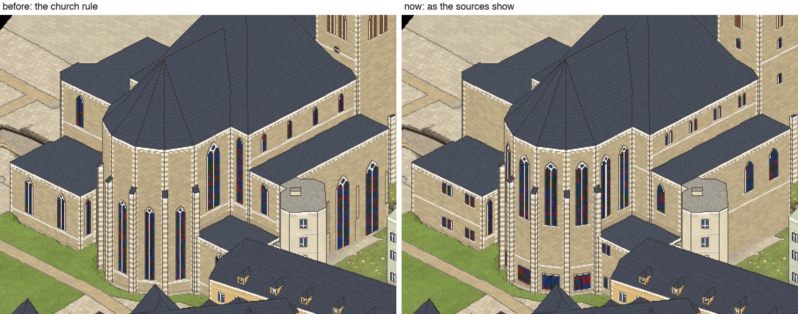
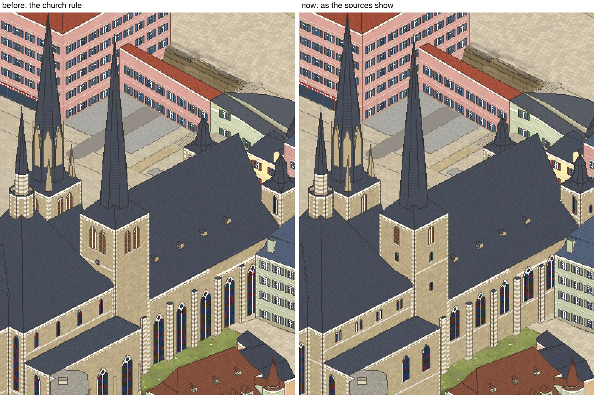

### 23.4 The build

`python -m v2.build test g3`, 50.3 minutes of stage time, run alone at low priority. The release is
`549133649c88`; `data/v2/test/release/current.json` points at it (`c46716ca4c9b` is still on disk).

- **57 of 57 stages pass. 277 gate entries pass, 0 fail.** No threshold was changed.
- **The two speed checks of section 22.2 pass again:** C2b 94 frames a second, X8b 93.7, against 60. Nothing
  in the viewer was changed between the two runs. I still do not know why the machine paced frames at about
  22 a second on 22 November.
- F28 passes (0 that do not fit). Lines: building edges 96.3%, window rows 99.8%, church tracery 99.6%,
  against 95%.

### 23.5 The six blocks and the viewer

Inputs, pictures and the viewer's copy were made again on the new release in the surfaces-only way. Even light
24 of 24 (worst 1.0%); window rows 99.8% to 99.9%; building edges 93.8% to 98.0% (the Bock's close up under
95%, as the code art is there); 0 of 24 fail the vehicle detector; one building in two paintings 0.0% apart at
the median. I looked at the cathedral in the viewer at 13:00 after this change: the new windows are there.

### 23.6 Limits, said plainly

- **Kinds are the rule's kinds.** A two-light window is drawn as the rule's two-light window, whatever its real
  tracery. A triple window is three lights side by side.
- **The south-west block's windows are approximate** (two pairs on each floor): trees and a tower hide part of
  that wall in every photograph I found. They are marked `photo` in the data.
- **Not described, because the map's camera does not see them:** the north front on rue Notre-Dame, the west
  side and the west portal. They keep the rule. They will need describing before other viewing angles
  (`PLAN_V2.md` section 10.1).
- **One hidden part left empty:** the south end of the east side block's wall stands behind the round stair
  turret in every source. Its third window is likely there; it is not entered.
- **The copper spire over the crossing is still drawn in slate and stone.** It is green in every photograph.
  Materials are set per building, not per part of one; this needs a small change of its own.
- **The west tower's spire** still shows the tan gable faces of the 3D model at its foot. Not a window fault;
  not touched.
- **The capture's licence** as a source to measure from was not looked into (the same open point as in section
  18 for using it as paint input). The data file holds only measurements read off it.

### 23.7 Open questions

44, 46 and 53 stand.

56. **Other landmarks the same way?** The Grand Ducal Palace and Neumünster Abbey are not churches: the house
    rule lays out their windows, and I have not checked them against photographs. Saint-Michel, Saint-Jean du
    Grund and Sainte-Cunégonde are on the church rule. Each takes about what the cathedral took.
57. **The copper spire in green** (a small code change, $0)?

## 24. The copper spire, and three more churches as they are (23 November, $0)

Branch `v2-phase3-landmarks-2`. **Spent: $0.** No pod. The owner's answers of 23 November to section 23: the
cathedral's windows "looks good"; merge PR #21 "yes" (merged as df67c6d, CI green); the copper spire "do it";
the other landmarks the same way "do it". That answers questions 56 and 57.

### 24.1 The cathedral's central spire, in copper

- The spire over the crossing and its lantern are copper gone green; the two tower spires stay slate, as every
  photograph shows them.
- **How:** a well-known building's entry in `v2/data/structures/landmark_styles.json` may now list `clad`
  parts: an upright cylinder (centre, radius, the altitude it starts at) and a palette colour. What the model
  has of the building inside it, walls and roofs alike, is that one colour (`v2/layers/art_a.py`,
  `v2/layers/render.py`; `v2/docs/specs/layer-05-buildings.md`). The palette has a new colour, `roof_copper`.
- It is a material of its own, so the shadow check compares it with itself, and a painting's colours do not
  reach it: in the surfaces-only pictures the spire stays green.

### 24.2 The other landmarks: what was done, and what was left and why

All five were laid over v1's aerial capture, wall by wall, and four of them looked up on Wikimedia Commons. 25 photographs
were fetched as reduced copies into a scratch folder outside the repository; the ones used are named in
`v2/data/structures/landmark_facades.json` with their authors and licences.

| Building | Result |
|---|---|
| **Saint-Michel** | 4 walls described, 13 openings. The south wall has a row of five round-headed windows under the eave and small windows below, where the rule drew three tall stained windows with buttresses; the wall east of it has small windows as on a house, where the rule drew one two-light window 9 m tall; the tower face has one belfry opening, where the rule drew a pair and a round window. |
| **Saint-Jean du Grund** (the abbey's church) | 2 walls described, 4 openings: each tower face has one round-headed belfry opening and a small square window under it, where the rule drew a pair of openings and two lancets. The wall onto the cloister keeps the rule: the capture shows its four tall windows where the rule put them. |
| **Sainte-Cunégonde** | 7 walls described, 22 openings. The nave has a plain lancet 1.3 m wide in each bay, where the rule drew two-light windows 1.9 m wide; the tower front has a tall lancet, a pair of small lights and a pair of belfry openings over the portal, where the rule drew a rose; the stair turrets have their two floors of small windows, where the rule left them blank. |
| **Grand Ducal Palace** | Not described, from the capture alone (no photograph was fetched: none would show what the camera sees). Its known front looks north-west onto the rue du Marché-aux-Herbes, away from the map's camera. What the camera sees of it is turret faces and short walls 3 to 6 m wide between its neighbours, in shade, where the capture is too soft to read a window; the house rule's stacked windows agree with what little shows. |
| **Neumünster Abbey, the wings** | Not described. The long east wing is seen at a grazing angle; the house rule's three rows agree with what shows. |

So the description of a wall by hand (facades.md rules 31 to 35) still takes a church's joined walls only. A
house-rule wall cannot be described yet. Nothing in the test area needs it for this camera; the palace's front
will need it before other viewing angles (`PLAN_V2.md` section 10.1).

In all, four buildings are now described: 34 walls, 91 openings (the cathedral's 21 and 52 among them).
Windows in the test area: 39,713 (39,701 before).

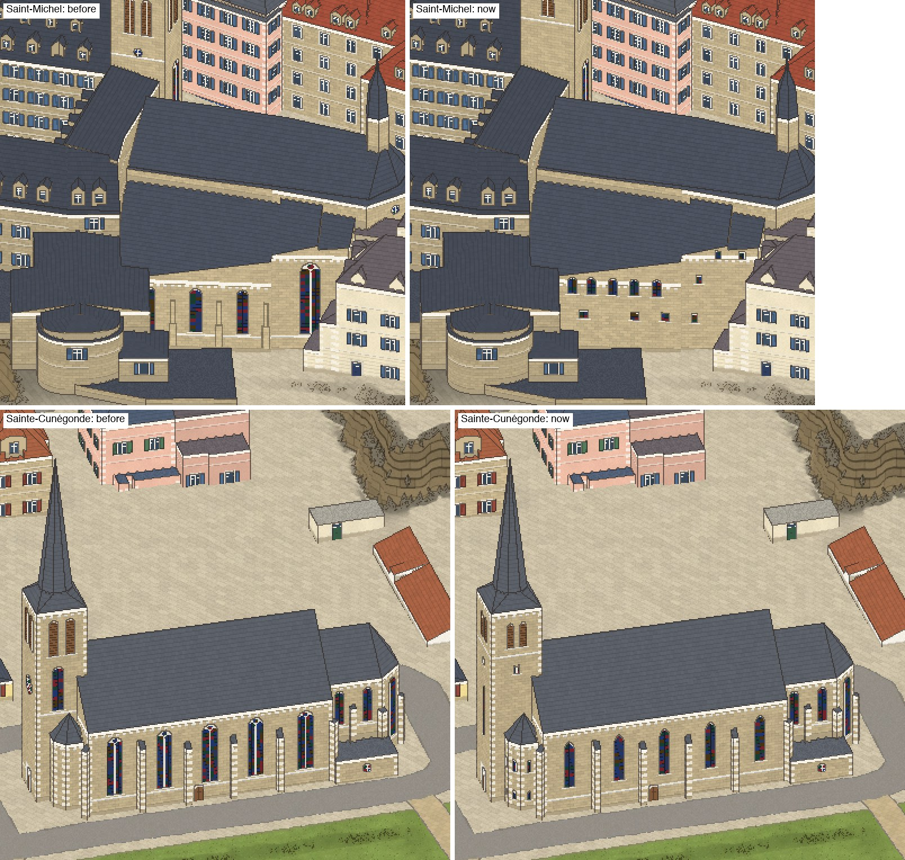
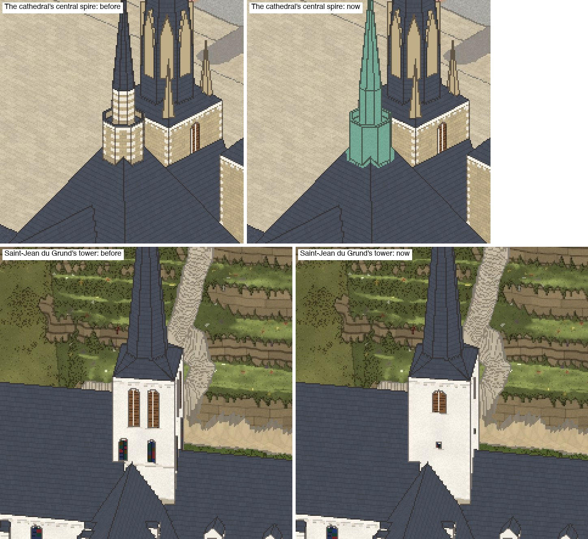

### 24.3 The build

`python -m v2.build test g3`, 48.7 minutes of stage time, run alone at low priority. The release is
`1747d34158bd`; `data/v2/test/release/current.json` points at it (`549133649c88` is still on disk).

- **The first run stopped at one check, and the fault was in the check.** F13 (windows clear of doors) read a
  window's whole record as a rectangle. A described window's record also carries its kind and its head, and
  Sainte-Cunégonde's tower front is the first described wall with a door. The check now reads the rectangle
  only (`v2/checks/data_checks.py`). The art was already built; the checks were run again (43 seconds).
- **57 of 57 stages pass. 280 gate entries pass, 0 fail.** No threshold was changed.
- F28 passes (34 of 34 descriptions on a wall, nothing outside its wall or over another). F13 passes.
- No baked light: 0 of 227 materials differ in the photo's shadow (worst 4.0% on buildings, against 5%).
- Lines: building edges 96.3%, window rows 99.8%, church tracery 99.5%, against 95%.
- Speed: C2b 94.2 frames a second, X8b 94.8, against 60.
- Tests: 1 new (154 in all, all pass).

### 24.4 The six blocks and the viewer

Inputs, pictures and the viewer's copy were made again on the new release in the surfaces-only way. Even light
24 of 24 (worst 1.0%); window rows 99.8% to 99.9%; building edges 93.8% to 98.0% (the Bock's close up under
95%, as the code art is there); 0 of 24 fail the vehicle detector. Saint-Michel and the abbey lie inside the
blocks; Sainte-Cunégonde lies east of them and shows as code art. I looked at the cathedral's block as painted:
the spire is green.

### 24.5 Limits, said plainly

- **Saint-Michel's row of five windows is drawn 1.3 m lower than it is.** The model's eave there slopes down to
  the left; the real one is level. An opening must lie inside the model's wall, so the row is set under the
  model's eave. Count and spacing are the capture's.
- **Saint-Michel's wall east of that row is approximate** (four small windows): the capture is soft there and
  another building hides its lower right. No ground photograph found shows the church's south side at all:
  other buildings stand in front of it.
- **The three churches are drawn in bare sandstone, and they are not.** Saint-Michel is rendered in cream with
  stone corners, Saint-Jean in ochre, Sainte-Cunégonde in white with a rubble-stone tower. The kind "place of
  worship" makes every church stone. This is a colour question, not a window one; not touched (question 58).
- **Kinds are the rule's kinds**, as for the cathedral: a small flat-headed window on a church wall is drawn
  with leaded glass like a lancet.
- **Not described, because the map's camera does not see them:** Saint-Michel's east end with its tall window
  and its front, Saint-Jean's river side, Sainte-Cunégonde's north-west side.
- **The cathedral's west tower spire** still shows the tan gable faces of the 3D model. Not touched.
- **The capture's licence** as a source to measure from is still not looked into (section 23.6).

### 24.6 Open questions

44, 46 and 53 stand. 56 and 57 are answered.

58. **The three churches' wall colours** (cream, ochre and white render in place of bare stone; a line each in
    `landmark_styles.json`, and Sainte-Cunégonde's stone tower would need the walls of one church in two
    materials; $0)?

## 25. The three churches' wall colours, and the whole test area's paint job (23 November, $0)

Branch `v2-phase3-church-colours`. **Spent: $0.** No pod. The owner's answers of 23 November to section 24: the
spire and the three churches are "good enough for v2"; merge PR #22 "yes" (merged as 501873a, CI green); the
churches' real wall colours "yes"; the quote for painting the whole test area as the next step "yes". That
answers question 58 and opens question 53.

### 25.1 The wall colours

| Building | Before | Now | From |
|---|---|---|---|
| **Saint-Michel** | bare sandstone | cream render, corner stones | the photographs named in `landmark_facades.json` |
| **Neumünster Abbey with Saint-Jean du Grund** | white render | ochre render, the wings and the church alike | the same |
| **Sainte-Cunégonde** | bare sandstone | white render; the tower stays coursed sandstone | the same |

- **A correction to section 24.5.** It said all three were drawn in bare sandstone. Saint-Jean du Grund was not:
  the abbey's entry already made the whole building white. White was wrong too; the photographs show ochre.
- **How.** A church whose own entry in `v2/data/structures/landmark_styles.json` gives a `facade` colour is
  rendered in it. Two new keys: `stone_parts` (a name and an outline on the ground: the building's walls
  standing in it stay sandstone, here Sainte-Cunégonde's tower) and `quoins` (true or false where the
  photographs show corner stones or none). `v2/layers/art_a.py`; `v2/docs/specs/layer-05-buildings.md`.
- **The colours are palette colours chosen by eye** from the photographs (`facade_cream`, `facade_ochre`,
  `facade_white`), not measured from them.
- **Not done:** Sainte-Cunégonde's buttresses and Saint-Michel's corner stones are stone-coloured in the
  photographs; here the buttresses are the wall's white with their outline, and the corner stones are the pale
  trim colour. Sainte-Cunégonde's tower has lighter corner stones on rubble; here it is plain coursed ashlar.

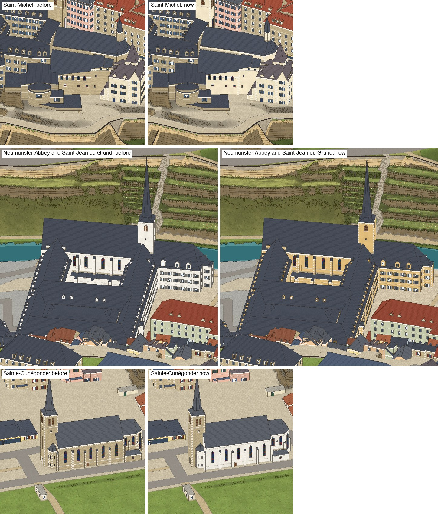

### 25.2 The build

`python -m v2.build test g3`, 50.9 minutes of stage time, run alone at low priority. The release is
`9de8d10933b1`; `data/v2/test/release/current.json` points at it (`1747d34158bd` is still on disk).

- **57 of 57 stages pass. 280 gate entries pass, 0 fail.** No threshold was changed.
- No baked light: 0 of 227 materials differ in the photo's shadow (worst 4.0% on buildings, against 5%).
- Lines: building edges 96.3%, window rows 99.8%, church tracery 99.5%, against 95%.
- Speed: C2b 93.0 frames a second, X8b 94.7, against 60.
- Tests: 1 new for the colours and 5 for section 25.3 (160 in all, all pass).

### 25.3 The whole test area's paint job: T4

The plan's step 5 (section 18.3): the six blocks' route on the whole test area. Everything but the paintings
is made and was run; the paintings are the paid part.

- **The grid.** Windows of 1024 px at v2's own scale (0.125 m a pixel), stride 768, over every tile with a
  building or a structure: 109 windows. 8 lie outside the area's outline and have nothing to paint; **101 are
  painted**, one painting each. v2's scale and not v1's half scale, because a painting sits closest to the
  model there (section 13.1) and its texture is at the map's pixel. The six blocks' own paintings are not
  reused: they are on another grid.
- **What a painting is given** is what T1's were: v1's aerial capture enlarged to v2's scale, v2's line
  layout, v1's own prompt, v1's style model (`python -m v2.bakeoff inputs area`; 202 files, 158 MB).
- **What is taken from a painting** is the owner's choice of 22 November: each building's colour and the fine
  texture of its plain surfaces. Every window, dormer, line and the light are the model's. A building takes
  one colour over all the windows that show it, and is drawn from the window that shows the most of it.
- **A fault found on the way, in the count.** The first count was 109: where a window reaches outside the
  area nothing is built, and those empty pixels were read as structures. `inputs.render_window` now leaves a
  pixel with nothing on it to no layer. Inside the area nothing changes.

Code: `v2/bakeoff/detail.py` (the grid, the inputs, and `targets`, `seams` and `variant_release` on it),
`jobs.py` (T4), `bundle.py`, `pod/run.sh`, `__main__.py`; 5 new tests.

### 25.4 The dry run, at $0

The whole route on the 101 windows with v1's finished art in the paintings' place
(`python -m v2.bakeoff targets --source area_free --mode surface --viewer`, 8.9 minutes at low priority).
v1's art is coarser than a fresh painting and has the sun in it, so this proves the route, not the look.

| Check | Result |
|---|---|
| Pictures made | 101 of 101 |
| Even light (5% per building) | 0 of 101 fail; the worst 0.9% |
| Window rows (95%) | 101 of 101; the least 98.4% |
| Building edges (95%) | 94 of 101; 7 between 89.9% and 94.5%. Not compared with the code art's own score on those windows; the six blocks' Bock close up was under 95% as code art too |
| One building in two neighbouring windows: difference of brightness (2,737 walls and roofs) | median 0.08%, worst tenth 0.9%, 1.1% of them over 5% |
| Tiles written for the viewer | 289, at every zoom of layers 5 and 6 |

- **Seams between neighbours are now measured on real neighbours.** Section 20.4 had only a forecast.
- **61% of the painted surface was not taken from v1's art** (windows, dormers, faces in two tones); there the
  code art shows in the building's painted colour. On T1's fresh paintings the same figure was 33.5%.
- I looked at one stretch of the old town two windows wide as the tiles have it: no line where two windows
  meet, one colour a building.
- **Not done in the dry run:** the vehicle detector (v1's art is not what will be painted); the build's own
  gates on the painted tiles; the far-zoom tiles (zoomed far out the view is still the code art).

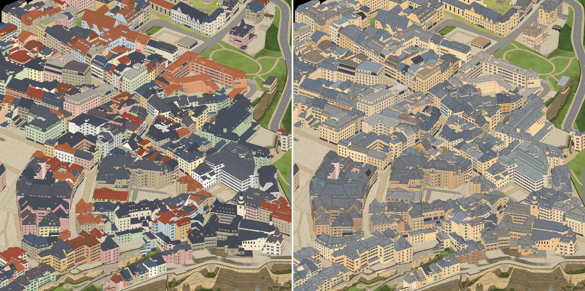

Sheets of the six windows with the most to paint (v1's art as placed, the surface taken, the picture, code
art): `v2/docs/img/test_detail_targets_area_free_1.jpg`, `_2.jpg`.

### 25.5 The quote

| Quote | GPU | Expected | Worst case | Phase 3 after it, worst case |
|---|---|---|---|---|
| q0019 | RunPod A100 SXM, secure, $2.19/h (read 23 Nov) | $1.73 (47 min) | $2.19 (60 min cap) | $2.82 of $8 left |

- **Time plan**, from T1 to T3 on the same machine: 669 s around the painting, 101 paintings at 21 s, 30 s
  for results: 2,820 s. The cap leaves 13 minutes. Paintings come back as they are made and the painter skips
  what exists, so a run cut by the cap keeps what it painted.
- **Why it is above section 18.3's estimate** ($1.60, worst case $2.15): that figure was Phase 2's, at 10 s a
  painting on another GPU. The three trial runs measured 17.7 to 20.9 s.
- Phase 3 has spent $2.99 of $8. No pod of ours is open; `luxembourgish-asr-pilot` not touched.
- **Not approved.** It needs the owner's OK (question 53).

### 25.6 After the paintings, at $0

Pictures, checks and the viewer's copy (`targets --source T4 --cars --viewer`); then what the dry run left out:
the vehicle detector on all 101, the build's own gates on the painted tiles, and the far-zoom tiles.

### 25.7 Limits, said plainly

- The art this makes is not method A. Gate G2 chose A for the whole city (question 44); T4 is the test area
  only and decides nothing for the city.
- The aerial capture's licence for this use is still not looked into.
- The cliffs and the trees stay code art (question 46).
- Windows reach outside the area at its edge: the model paints ground there that is never used.

### 25.8 Open questions

44 and 46 stand. 58 is answered.

53. **Approve q0019** (paint the whole test area: expected $1.73, worst case $2.19)?

## 26. The whole test area, painted (23 November, $1.69)

Branch `v2-phase3-test-area-paint`. The owner's answers of 23 November to section 25: "Approve q0019
(Recommended)" and, for PR #23, "Merge (Recommended)" (merged as 2690bfd, CI green). That answers question 53.

| | |
|---|---|
| Spent | **$1.6946** (quote q0019: expected $1.73, worst case $2.19). Pod `iilx3elqn8dkrw`, A100 SXM, secure cloud, $2.19/h, 46.0 minutes, finished, terminated. |
| Made | 101 of 101 paintings, 20.8 s each |
| Phase 3 | $4.6821 of $8 spent, $3.3179 left, nothing committed |
| Reconciled | By account balance: RunPod's fell by $8.3942 since before the first v2 pod, the ledger has $8.3981. The per-pod billing lines could not be read today. |
| Pods | None of ours left (`python -m v2.bakeoff pods`); `luxembourgish-asr-pilot` not touched |

### 26.1 The paintings, and the pictures made from them

The paintings are v1's look over the whole area. The model also painted things that are not there (two
waterfalls, cars on the roads). None of it is used: a painting gives each building its colour and the texture
of its plain surfaces, nothing else.

`python -m v2.bakeoff targets --source T4 --mode surface --cars --viewer` (10.9 minutes at low priority):

| Check | As painted | As pictures |
|---|---|---|
| Even light (5% per building) | 93 of 101 windows fail | **0 of 101 fail**; the worst 1.1% |
| Window rows (95%) | median 85.4% | **101 of 101**; the least 98.9% |
| Building edges (95%) | median 90.6% | 91 of 101; 10 between 89.9% and 95% (not compared with the code art's own score on those windows) |
| One building in two neighbouring windows: difference of brightness (2,737 walls and roofs) | | median 0.22%, worst tenth 1.1%, 0.84% over 5% |
| Vehicles (the build's detector) on the 101 pictures | | 0 |

- 2,052 walls and roofs take one colour each over all the windows that show them.
- **Two thirds of the painted surface (67.5%) is not the painting's**: where it drew a thing (a window, a
  dormer, a tree in front), the code art shows in the building's painted colour. The painting's own texture
  is on the other third.

### 26.2 Two faults found before the paintings were judged, both in the viewer's copy

- **What a layer holds behind another layer kept the code art's colour.** A picture is of the nearest surface.
  A wall behind a cliff or a bridge is in the buildings' tiles all the same, and it stayed as the code drew
  it: a patch of another colour with a layer switched off, and a difference the build's shadow detector reads
  as light. On the dry run 47 of 189 materials failed for it. Those pixels now take their own material's
  colour change (823,885 pixels here); the dry run went to 2 of 189.
- **The far-zoom tiles were not remade** (section 25.4). They now take the new colour wherever layer 5 or 6 is
  their nearest surface (34 tiles).

Both are in `variant_release` (`v2/bakeoff/detail.py`), each with a test.

### 26.3 The build's own checks, on the painted tiles

`python -m v2.bakeoff gates --source T4` runs the build's check functions on the viewer's copy, with the
build's parameters and thresholds (10.3 minutes).

| Check | Code art (section 25.2) | Painted tiles |
|---|---|---|
| Lines: building edges, window rows, church tracery (95%) | 96.3%, 99.8%, 99.5% | **pass**: 97.4%, 99.8%, 99.5% |
| Church glass, no shutters or shop fronts on churches | pass | **pass** |
| Baked light: materials that differ in the photo's shadow by more than 5% (of 227) | 0; worst 4.0% | **1: fails.** One small roof, 5.2% |
| Shadow direction at 08:00, 13:00, 19:00 | pass | pass (the light is the release's own) |
| Vehicles on every tile of every colour layer (966 tiles; score 0.10) | 0 | **1: fails.** "A bus", score 0.101 |
| v1's seam rule at tile borders, buildings: flagged at borders, and through the tiles' middles as a control (of 740) | 3, 3 | 6, 10 |
| The same, structures (of 55) | 3, 0 | 3, 0 |

- **The roof.** The detector reads every third tile; in the one it read, a strip of this roof 25 px wide lies
  at the tile's edge: 85 pixels in the model's shadow against 139 beside them. Over the whole roof the two
  differ by 0.7%. What it measures there is the painting's texture on a small sample, not a shadow. On the
  four windows I measured, what is left of a cast shadow inside a side is 0.5% at the median, 8% at the most
  (on 50 pixels).
- **The bus.** A storey on a flat roof with a row of windows, the 3D model's own shape. In the code art its
  roof is dark slate and the detector stays under 0.10; in the painted colours the roof is light and it reads
  0.101. No vehicle is painted there.
- **Both stand as failures.** No threshold was changed and nothing was listed as an exception: that is the
  owner's to decide (question 59).
- **Not run on the painted tiles, and why:** the build's seam gate and the independence check compare a tile
  with the code's own render, which a painted tile is not. The viewer's check (speed, layer toggles) reads no
  colour of layers 5 and 6; it was not run again.

### 26.4 In the viewer

`python -m v2.view test_painted --port 5175`. I looked at the whole area zoomed out and at the old town close
up at 17:00: the painted colours are there at both, the light and the shadows move over them, no line where
two windows meet. I did not look at night or at every part of the area.

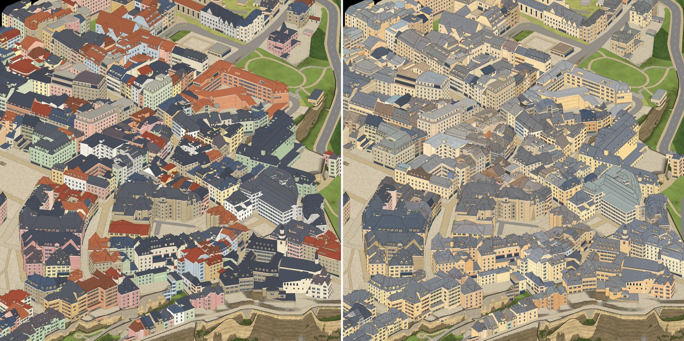
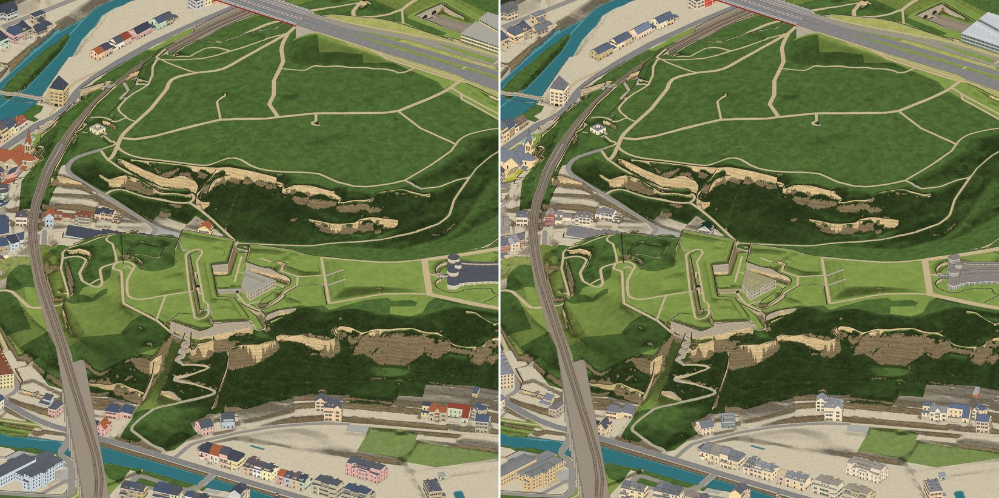
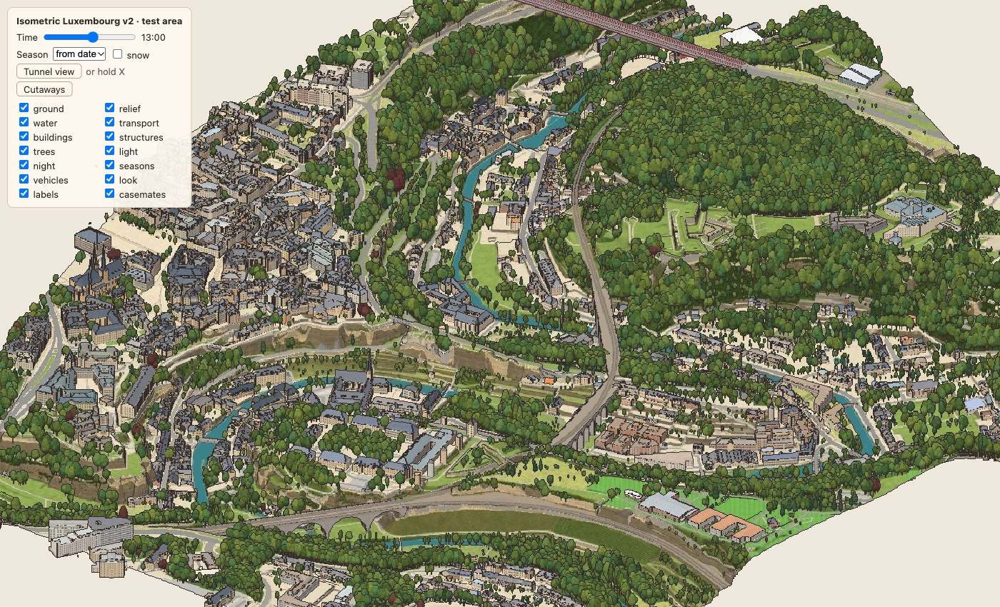
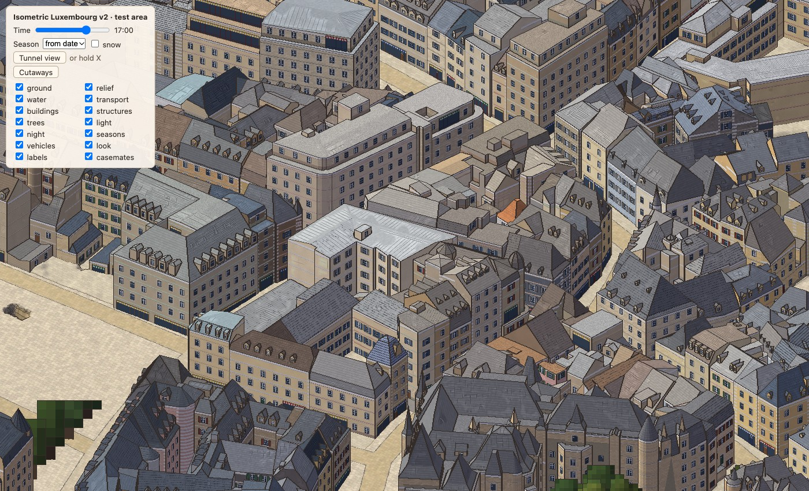
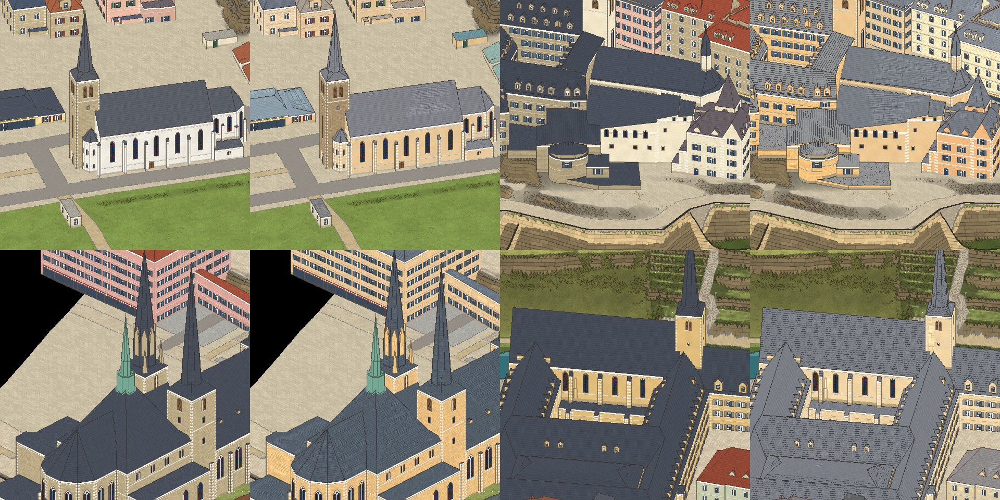

Sheets of the six windows with the most to paint: `v2/docs/img/test_detail_targets_t4_1.jpg`, `_2.jpg`.

### 26.5 Limits, said plainly

- **The painted area is cream walls and slate roofs, as v1 is.** The code art's house colours (pink, green,
  blue, red tile) are gone: a building's colour is the aerial photo's, through the painting.
- **Section 25.1's church colours do not show in the painted area.** There a church takes its painting's
  colour: Sainte-Cunégonde's nave is cream, not white. Its tower stays stone and the cathedral's spire stays
  copper green.
- **Texture is on a third of the surface** (section 26.1).
- Even light and one colour pass because levelling makes them pass; what the eye sees inside a side is not
  in those numbers. The build's shadow detector is the independent measure, and it finds one roof.
- The aerial capture's licence for this use is still not looked into. The cliffs and the trees stay code art.
- This is the test area. It decides nothing for the city: gate G2 chose method A (question 44).

### 26.6 What the city would cost this way (an estimate, not a quote)

The commune is about 33 times the test area: about 3,300 windows. At 21 s a painting on the same machine that
is about 19 hours, about $43 at today's price, in runs of a few hours each. Phase 4's line is $60. The 10%
pilot the plan asks for first would be about $4.50.

### 26.7 Open questions

44 and 46 stand. 53 is answered.

59. **The two narrow failures on the painted tiles** (one roof at 5.2% against 5%; one rooftop storey read as
    a bus at 0.101 against 0.10): list each as an exception with its reason, or have me look for a cause to
    fix in the method first?
60. **Which art for the city** (gate G2, question 44): the code art, or painted this way?

## 27. The two narrow failures fixed, and the painted area closer to v1's colour (23 November, $0)

Branch `v2-phase3-paint-gates`. **Spent: $0.** No pod. The owner's answers of 23 November to section 26: the
painted area "looks good"; merge PR #24 "do it" (merged as 31fe13e, CI green); the two narrow failures "fix
them"; which art for the city "show pictures side by side". Then, on seeing them: "the colors in v1 are more
alive, can we do something about it?"

### 27.1 The roof that failed the shadow detector

- **The cause.** The painting kept a shadow as a band about 5 px wide along that roof's foot. The texture is
  the painting's brightness against its local mean over 7 px, so a shadow wider than that falls out and one
  narrower does not. On the exact strip the detector read, the picture was 5.5% darker in the model's shadow
  than beside it; the painting itself is 4.2% darker there; with no painted texture the picture is 0.8%, as
  the code art is.
- **The fix.** The 3D model's shadow for the aerial photo's sun is known. The local mean is now taken on each
  side of that shadow line apart (`transfer`, `cast`; `v2/bakeoff/detail.py`). The strip: 0.9%.
- **Tried and taken out again:** levelling the shadow's pixels to the lit ones per building part (it moved
  nothing: the residue is local, not over the whole shadow), and bringing the kept texture to a mean of
  nothing per face (no effect on the strip, and none in a test made for it).
- **The build's shadow detector on the painted tiles: 0 of 227, the worst 4.3%** (it was 1 at 5.2%; the code
  art is 0, worst 4.0%).

### 27.2 The colour, against v1

Measured on the old town, the same ground in each (brightness and saturation from 0 to 1):

| | Buildings, brightness | Buildings, saturation a pixel | Darkest and lightest twentieth |
|---|---|---|---|
| v1's finished art | 0.47 | 0.25 | 0.13 to 0.85 |
| T4's painting, as painted | 0.44 | 0.27 | 0.10 to 0.86 |
| v2 painted in the viewer, before | 0.53 | 0.17 | 0.18 to 0.82 |
| v2 painted in the viewer, now | **0.46** | 0.20 | 0.18 to 0.75 |

- **The model paints as vividly as v1.** The colour was lost in making the picture.
- **The cause found: each part's colour was read at its highlights.** The upper band of a part's brightness
  (walls 70% to 95%) was taken as "the lit side". It read walls 38% brighter than the painting has them and
  roofs light grey for dark slate.
- **The fix.** A part's colour is read where the 3D model says the sun falls, over the middle of those pixels'
  brightness (walls 50% to 85%, roofs 30% to 70%): the tone the surface has. A part with too few pixels in the
  light is read as before (`part_colour`, `SURFACE`). No building came out dark on the window tried; a first
  try (the most common tone of all pixels) turned three walls black and was dropped.
- **What it does not close.** Averaged over an area the painted colours are as saturated as v1's (walls 0.27
  against 0.22). What v1 has more of is difference from pixel to pixel and a wider run from dark to light:
  ink, shading inside a face, deep street shadows. The darkest tone in v2 is its ink line (0.18).
- **Not the light.** The viewer's daylight already tints the shade blue and has about v1's contrast between
  lit and shaded faces (the painting: walls 144 lit against 122 in the model's shadow, roofs 114 against 82).
  It was not changed.

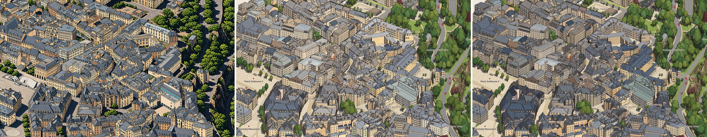
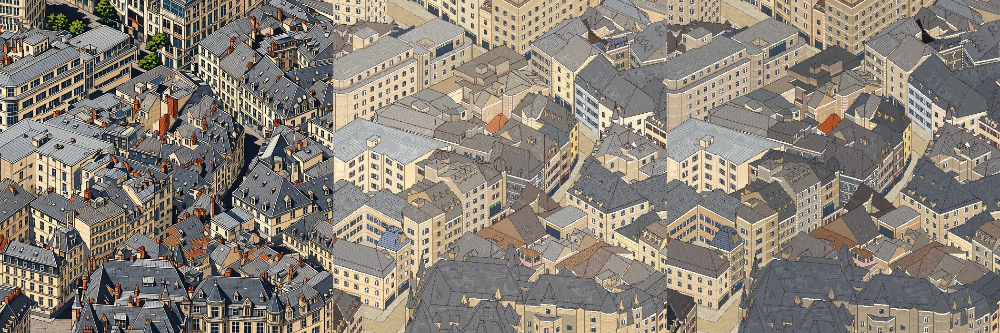

### 27.3 The whole area made again, and its checks

| Check | Section 26 | Now |
|---|---|---|
| Pictures: even light (5% per building) | 0 of 101 fail, worst 1.1% | 0 of 101 fail, worst 1.4% |
| Pictures: window rows (95%) | least 98.9% | least 96.3% |
| Pictures: building edges (95%) | 91 of 101 | 86 of 101; the least 79.9%, the median 96.7% |
| Pictures: one building in two neighbouring windows, median | 0.22% | 0.17%; 0.84% over 5% |
| Pictures: vehicles (the build's detector on each picture) | 0 of 101 | **3 of 101**, see below |
| Build: lines (edges, window rows, tracery; 95%) | 97.4%, 99.8%, 99.5% | **pass**: 96.5%, 99.8%, 99.5% |
| Build: baked light (of 227) | 1 fails, 5.2% | **pass**: 0, worst 4.3% |
| Build: vehicles on every tile of every colour layer | 1 fails, 0.101 | **pass**: 0 |

- **The rooftop storey read as a bus is gone.** Its roof had been read too pale; at its own tone the detector
  stays under 0.10. This is the same cause as section 27.2, not a change made for the detector.
- **The three pictures the detector marks are not the gate**, and none is a vehicle: a strip of wall at one
  picture's edge (0.106), and one small building in two pictures (0.124, 0.136). That building is a dark blue
  shelter beside the railway; the aerial photo shows it dark blue, the code art drew it pink, and at its own
  colour, whole in a picture with the road beside it, it reads as a bus. On the tiles, where the gate reads
  each layer by itself, the detector finds nothing.
- **Edges on dark roofs.** With roofs at their own tone the ink line stands out less from them, and the line
  score falls on some pictures. The build's score over the whole area passes (96.5% against 95%; the code art
  96.3%).
- Tests: 2 new (164 in all, all pass).

### 27.4 The side-by-side pictures

Eight views of the test area photographed in the viewer, code art beside painted, and the old town against
v1's art, on one private page for the owner (not in the repository). The viewers: painted
`python -m v2.view test_painted --port 5175`, code art `python -m v2.view test --port 5176`.

### 27.5 Limits, said plainly

- v1 still has the wider run from dark to light (section 27.2). Closing it means either deeper darks in the
  ink and the windows, more of the painting's own shading inside a face (against the even-light rule), or a
  change to the look's grade. None was tried.
- The ground, the cliffs and the trees are the code art's in both; in v1's art they are darker and greener.
- The pictures against v1 are not framed to the pixel alike.
- I looked at the old town and at the eight views; not at every part of the area at the new colours.

### 27.6 Open questions

44 and 46 stand. 59 is answered (both fixed by a cause; nothing listed as an exception).

60. **Which art for the city** (gate G2): the code art, or painted this way?
61. **More of v1's contrast** (deeper darks, a wider run from dark to light): try it, or is the painted area
    alive enough now?

## 28. v1's ground: step 1 of three (23 November, $0)

Branch `v2-phase3-ground`. **Spent: $0.** No pod. Shown the painted area against v1's art, the owner said on 23
November: "in the v1 I like the texture of the ground, asphalt and also the trees". Asked where to start, the
owner chose "Ground, then asphalt, then trees (Recommended)", each step shown before the next, and "Merge
(Recommended)" for PR #25 (merged as acaaeea, CI green).

### 28.1 What was tried first, and did not work

Lifting the ground, the roads and the trees out of the 101 paintings, as the buildings' surfaces are (two
windows, in a scratch tool, nothing kept):

- **Texture alone hardly shows.** The ground stays pale.
- **Colour too goes wrong where the painting and the map disagree.** One meadow came out teal: the model had
  painted water there (and a waterfall beside it).
- **Trees came out flat lime green.**

What it showed is that three different things make v1's ground and trees, and one of them is texture:
what the ground is, its tone, and how it is drawn.

### 28.2 What the ground is: lawns and gardens where OSM is silent

- **The fault.** Land OSM does not class was drawn as paving inside the built-up area: 21% of the ground seen.
  Gardens and planted slopes were bare beige.
- **The rule** (`v2/data/scene/groundcover.py`, a new scene part; `v2/docs/specs/scene.md` "Ground cover";
  layer-01 rule 1). The orthophoto classes the land on a 0.5 m grid and is never a colour, as layer 1's own
  spec allowed for from the start. A cell is vegetated where the green share of the readable land within about
  5 m is 35% or more; land under buildings, within 1.5 m of a surveyed crown or in deep shadow is not read and
  takes its surroundings' answer. So a street tree does not turn its pavement into lawn, and a lawn keeps its
  dry patches.
- **The thresholds were set on the land OSM does class**, and three new data checks measure the same on every
  build: GC1 the photo covers the area (100%); GC2 of OSM's squares, car parks and rail ground, 5.3% come out
  vegetated (limit 15%); GC3 of OSM's gardens, 79.9% (limit 70%).
- **A quarter of the unclassed land (25.6%) becomes lawn.**
- **Limit: the photo is of a dry summer.** A straw-coloured lawn is not told from paving and stays paved: of
  OSM's own lawns only 40% come out vegetated. A second photo from another season would be a new download;
  not asked for.
- **Limit: the photo on disk covers v1's extent**, not the whole commune. GC1 would fail where it does not.

### 28.3 Its tone and its drawing

Measured class by class, in the model's light and with no tree in front, on v1's art and on the T4 paintings,
which agree with each other:

| Class | v1 against v2's palette | Now |
|---|---|---|
| Paving, squares | 0.67 to 0.72 of its brightness, warmer | set to v1's tone |
| Grass, pitch | 0.82 to 0.83, more olive | set between v2's green and v1's |
| Meadow, garden, wood, scrub | 0.58 to 0.89 | darkened |
| Roads | 0.95 to 1.05, warmer | not changed (step 2) |

- The palette's ground colours, and the pedestrian, path and steps colours that lie in the same plane, were
  changed (`v2/config/palette.json`, each with its source).
- Paving flags are 2.2 m by 1.1 m (they were 1.5 by 0.75) and square setts 1.4 m, as v1 drew paving; lawns keep
  their patches and lose half their flecks (`v2/layers/detail.py`).
- **Chosen by measurement, then by eye.** The measured tone of unclassed "paving" was olive, because much of it
  was vegetation; I set paving from the squares' tone instead.

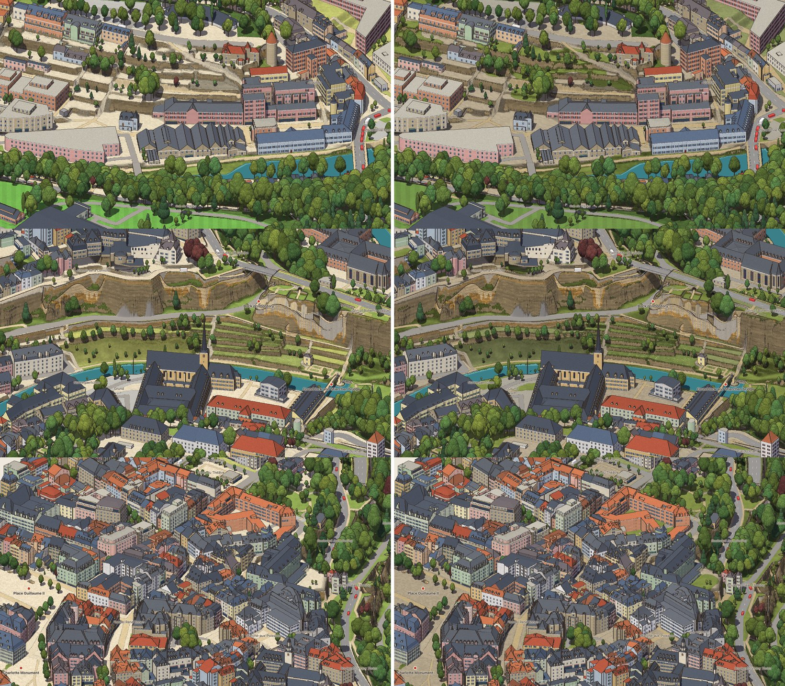
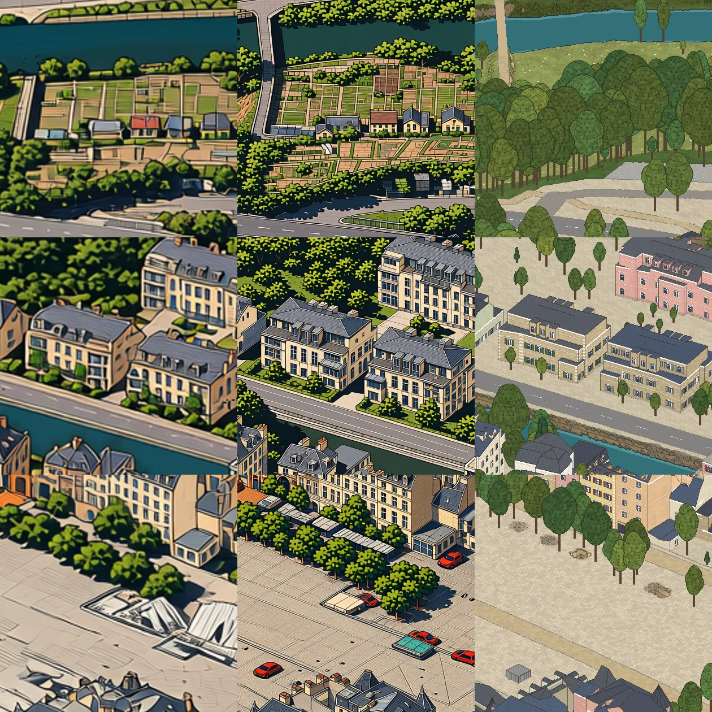

### 28.4 The builds

| | Ground cover | Ground cover and tones |
|---|---|---|
| Release | `6a8e21900358` | `66735929c193` (current) |
| Stages | 59 of 59 (two new) | 59 of 59 |
| Stage time, alone at low priority | 53.4 min | 49.7 min |
| Gate entries | pass, 0 fail | 283 pass, 0 fail |

- No threshold was changed. No shading on the ground: 0.8% between north and south slopes (limit 2%). No baked
  light: 0 of 227, worst 4.0% on buildings, 1.8% on the ground.
- Lines and speed as before: edges 96.3%, window rows 99.8%; 90 and 94 frames a second.
- Tests: 4 new (168 in all, all pass).

**The painted area on the new ground** (`targets --source T4`, `gates --source T4`): 101 pictures, even light 0
fail; the build's line, shadow and vehicle checks pass (edges 96.5%, 0 of 227 at worst 4.3%, 0 vehicles); the
detector on each whole picture now marks none of the 101 (it marked 3 in section 27.3).

### 28.5 Not done

- Asphalt (step 2) and trees (step 3). The close ups show the trees are the largest difference left: v1's are
  bushy clumps with bright tops, dark undersides and heavy outlines, with no trunk showing; v2's are tall ovals
  on trunks.
- The dry lawns (section 28.2).
- I looked at three views before and after; not at every part of the area.

### 28.6 Open questions

44, 46, 60 and 61 stand.

62. **Is the ground right now**, and shall I go on to the asphalt?

## 29. v1's asphalt: step 2 of three (23 November, $0)

Branch `v2-phase3-asphalt`. **Spent: $0.** No pod. Shown the ground (section 28), the owner answered on 23
November: "1- looks good 2- do it 3- go ahead". PR #26 was merged (d8debab); this is the asphalt.

### 29.1 What v1's roads have that v2's did not

Measured on v1's art at v2's road surfaces, by road style, with no tree in front and out of the model's shadow
(51 of the 101 windows), and looked at close up:

- **The colour is the same.** v1's clean, lit asphalt on main roads is [132, 128, 130] at its most common tone;
  the palette's `road` is [132, 130, 128]. Section 28.3 called v1's roads "warmer": that figure pooled paths,
  pavements and shadows with the asphalt, and was wrong for the asphalt itself. The colour was not changed.
- **The grain.** v2 gave asphalt a grain from pixel to pixel (6%). v1's is smooth from pixel to pixel (1.4% of its
  luminance) and its tone drifts over a few metres (7%, a part of which is markings and lane patches).
- **The markings.** v1's lane lines are bold; v2's were one pixel wide.
- **The edge.** v1's roads have a pale edge (kerb and pavement) inside a dark outline; v2's had the outline only.
- **Crossings.** v1 has zebra crossings (painted from the photo); v2 had none.

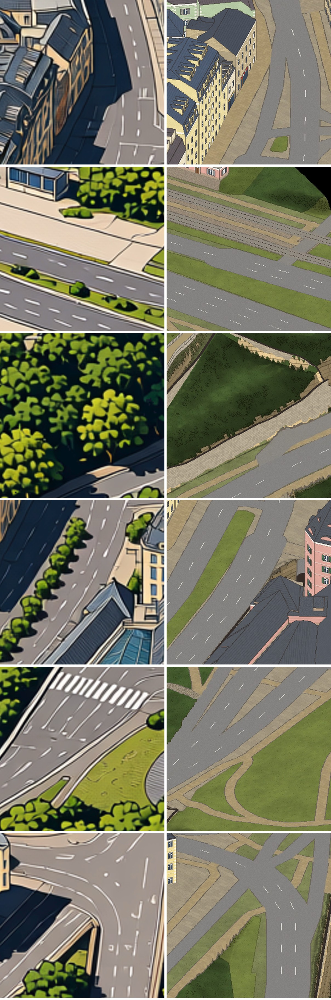

### 29.2 What changed

| | Before | Now |
|---|---|---|
| Asphalt surface | pixel grain, 6% | a soft wash: 3.5% over 3 m and 8% over 11 m, no grain (`detail.asphalt`); on decks too |
| Lane dashes | 0.15 m (1 px) | 0.25 m (2 px) |
| Kerb | none | 0.3 m of `transport.kerb` outside the carriageway of every street; not on OSM service roads and tracks |
| Crossings | none | bars of 0.5 m every metre where OSM says the crossing is marked, on the carriageway only |
| Road colour | [132, 130, 128] | the same |

- **Crossings come from the data.** A new field of the transport graph, `crossing`, from OSM's `crossing:markings`
  and `crossing` tags (`transport-graph.md`, "Marked crossings"). In the test area 96 edges are crossing ways: 22
  are marked, 3 are unmarked, **71 carry no word either way and get no stripes**. Nearly all of those 71 are
  probably zebra crossings in fact; I left them unstriped rather than draw a marking the data does not give.
- **The carriageway keeps the width the graph gives it**: the kerb is outside it.
- **A new gate, L4.7**: every marked crossing with 2 m or more on a carriageway is striped there. 9 crossings in
  the area qualify (the other marked edges are outside the area or shorter), 0 fail; 39.7% of their 37.8 m is
  striped (bars and gaps are equal; the rest is where a bar meets a kerb or a lane line's gap).

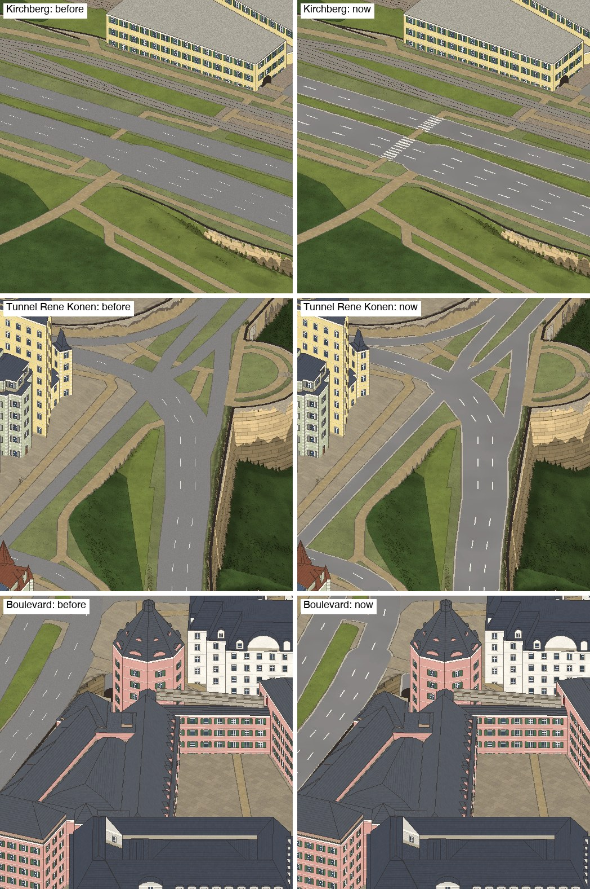

### 29.3 The build and the painted area

| | |
|---|---|
| Release | `21b51c727efe` (current) |
| Stages | 59 of 59 |
| Gate entries | 284 pass, 0 fail (283 and the new L4.7) |

- No threshold was changed. No baked light: 0 of 227, worst 4.0% on buildings, 2.9% on the transport layer, 1.8%
  on the ground. Vehicle detector on the ground and transport tiles: 0. Centre lines inside their surface: 100%.
  Lines: edges 96.3%, window rows 99.8%. 92 and 95 frames a second.
- Tests: 4 new (172 in all, all pass).

**The painted area on the new roads** (`inputs area`, `targets --source T4`, `gates --source T4`): 101 pictures,
even light 0 fail; the build's line, shadow and vehicle checks pass on the painted tiles (edges 96.5%, window rows
99.8%, 0 of 227 at worst 4.3%, 0 vehicles on buildings and structures); seams between neighbouring windows median
0.17%.

**One figure got worse.** The detector run on each whole picture (not a gate: section 26) marks 2 of the 101 as
"a bus", at 0.115 and 0.107 against the 0.10 line; it marked none in section 28. I looked at both: one is a row
of facades at a picture's top edge beside a kerbed street, the other a red and white shop front. Neither is a
vehicle, and neither is on a road. My reading, not tested: a street that reads more clearly as a street raises
the detector's score for whatever stands beside it.

### 29.4 Not done

- Trees (step 3).
- The 71 crossings OSM says nothing about.
- v1's stop lines, edge lines and arrows: OSM does not carry them.
- The tram's track bed. v1 paints it pale ([224, 203, 181], concrete); v2's is a grey between road and paving. Not
  asphalt, so not touched in this step.
- I looked at four views before and after, not at every road.

### 29.5 Open questions

44, 46, 60 and 61 stand. 62 is answered (the ground looks good).

63. **Are the roads right now**, and shall I go on to the trees?
64. **The 71 crossings without a word in OSM**: leave them unstriped (as now), or stripe every mapped crossing
    that OSM does not call unmarked?

## 30. The crossings, fixed (24 November, $0)

Branch `v2-phase3-crossings`. **Spent: $0.** No pod. Shown the asphalt (section 29) and asked about the 71
crossings OSM says nothing about, the owner answered on 23 November: "1- good enough 2- we have to fix crossings
3- do it 4- go ahead". PR #27 was merged (13b9165).

### 30.1 The rule, and what it rests on

**A mapped crossing is striped unless OSM says it is unmarked** (`crossing:markings` = no, or `crossing` =
unmarked, no or informal). Before, only a crossing OSM called marked was striped.

Two things I tried to decide the undescribed ones better than by a blanket rule:

| | Result |
|---|---|
| The road crossed, on the 1,147 crossing ways of the fetch | Of those OSM describes: over a primary, secondary or tertiary road 288 of 290 are marked (99%); over a residential street 334 of 418 (80%) |
| The 2023 orthophoto: how much brighter the crossing is than the asphalt 4.5 to 6 m to either side (591 crossings read) | Marked ones 24% brighter at the median, unmarked 4%, **undescribed 24%**: as a group they look like the marked ones. One by one the photo is right for 81% on minor roads against 77% for "always marked": not enough to decide each one, so it is not used |

So the rule is right for nearly every undescribed crossing on a main road, and wrong for about one in five on a
residential street (stripes where there are none). That is the stated limit.

### 30.2 The build

| | |
|---|---|
| Release | `cce0dd0cb290` (current) |
| Stages | 59 of 59 |
| Gate entries | 284 pass, 0 fail |
| Crossing edges striped | 93 of 96 (22 before); 3 are unmarked in OSM |
| L4.7 | 41 crossings with 2 m or more on a carriageway in the area, 0 unstriped; 45.3% of their 162 m striped |

- No threshold was changed. Vehicle detector on the ground and transport tiles: 0. No baked light: 0 of 227,
  worst 4.0%. 94 and 96 frames a second. 172 tests pass.
- **The painted area was not remade** for this change: it has the same road layer, and its own checks read
  buildings and structures only. It is remade with the trees (step 3); until then the painted viewer shows the
  roads of section 29.

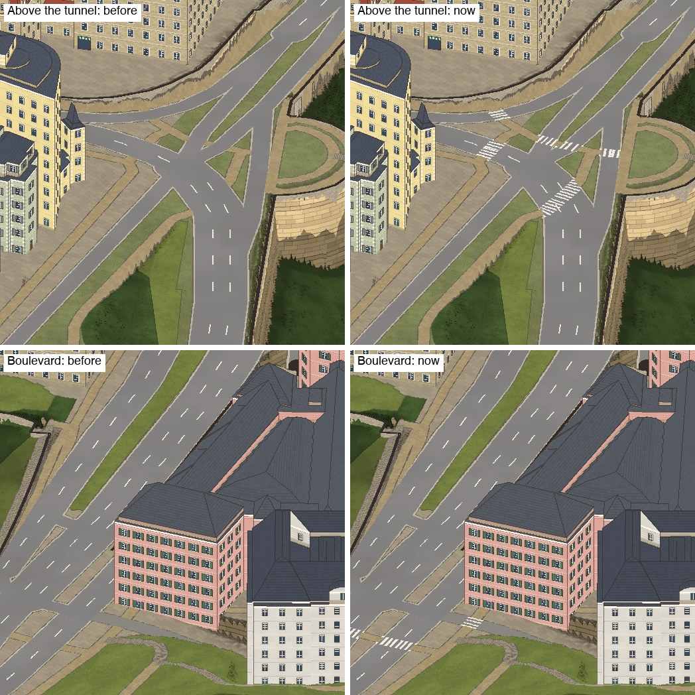

### 30.3 Open questions

44, 46, 60 and 61 stand. 63 is answered (the roads are good enough). 64 is answered (this section).

## 31. v1's trees: step 3 of three (24 November, $0)

Branch `v2-phase3-trees`, on top of `v2-phase3-crossings` (PR #28, open). **Spent: $0.** No pod. The owner's
"4- go ahead" of 23 November (section 30) asked for this step.

### 31.1 What v1's trees have that v2's did not

Measured on v1's art and on v2's tree layer, lit as the viewer lights it at 11:00 on 15 June (the hour of v1's
aerial photo), at three places (the park by the boulevard, the Bock, Rue Vauban; 0.9 million tree pixels):

| | Brightness of 255: 5th, 50th, 95th percentile | Darkest 5%, lightest 5% (mean colour) |
|---|---|---|
| v1's foliage (foliage only, as measured for `layer-07-trees.md`) | about 18 and 150 (5th, 95th) | [10,23,17], [156,176,43] |
| v2 before (`cce0dd0cb290`) | 35, 88, 126 | [29,33,23], [125,150,71] |
| v2 now (`1be22d28fd55`) | 14, 70, 158 | [9,13,8], [163,189,52] |

v1 paints foliage as dark masses with bright yellow-green leaf highlights and heavy dark lines. v2 drew each
crown as a few smooth, pale domes with a fine scale pattern: half of v1's range from dark to light, and a
greyer green.

### 31.2 What changed

| | Before | Now |
|---|---|---|
| A broadleaf crown of 1.2 m radius or more | A few large lobes | A dark core (0.8 of the crown) covered in 8 to 120 leaf clumps on the measured crown's surface, the top one at the measured top |
| A clump | – | A spheroid of 0.6 to 2.4 m radius (0.6 of the crown's radius at most), light on top, dark underneath, its tone ±11% of the tree's |
| Lines | Fine, 0.32 and 0.5 | Heavy and dark green: 0.8 between the clumps of one crown, 0.9 around the crown |
| Lit greens (palette) | [150,178,84], warm [176,186,76], cool [112,166,96] | [130,155,44], warm [150,163,40], cool [100,150,54]; the dark [28,44,24] is unchanged |
| Small crowns and conifers | – | Shape unchanged; they take the new lines and the dark underside |

- **Kept from the data:** every tree's place, measured height, crown width and trunk. A clump never reaches
  outside the measured crown (unit test; TE6 and TE7 pass).
- **No light is baked in.** The bright side of a clump is the viewer's sun on the clump's own normal, so it
  moves with the hour. The dark underside and core follow "up", never the sun, and are a fixed colour. The
  check that reads the tree layer for baked light (L5.1/L9.2) passes: 0 of 229, worst 4.0%.
- Two trials that only repainted the old lobes' surface (a cracked mosaic, then dark dots) were dropped: the
  crown still read as a smooth dome. The clumps are real shapes with their own depth and normals.

### 31.3 The build and the painted area

| | |
|---|---|
| Release | `1be22d28fd55` (current) |
| Stages | 59 of 59 |
| Gate entries | 284 pass, 0 fail |
| Tree layer | 106.4 MB (96.8 before); the release 17.75 MB (17.63) |
| Speed | 120 frames a second over the whole area, 95 at zoom 1 |
| Painted area (`1be22d28fd55_t4_0`) | 101 pictures, even light fails on 0; edges 96.5%, window rows 99.8%; no baked light 0 of 229, worst 4.3%; vehicle gates 0 |

- No threshold was changed. 173 tests pass. Tree checks TE1 to TE7, S-trees (seams: 0.0), D-trees (vehicle
  detector: 0), V1-trees and V5 (season) pass.
- The painted area is remade on this release, so it now has the striped crossings of section 30 as well.
- The per-picture vehicle detector (not a gate) still marks the same 2 of 101 paintings as in section 29
  (highest score 0.15): a row of house fronts and a shop front, not vehicles.

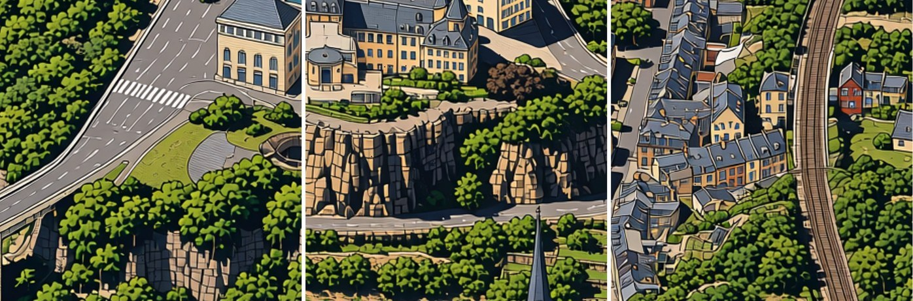

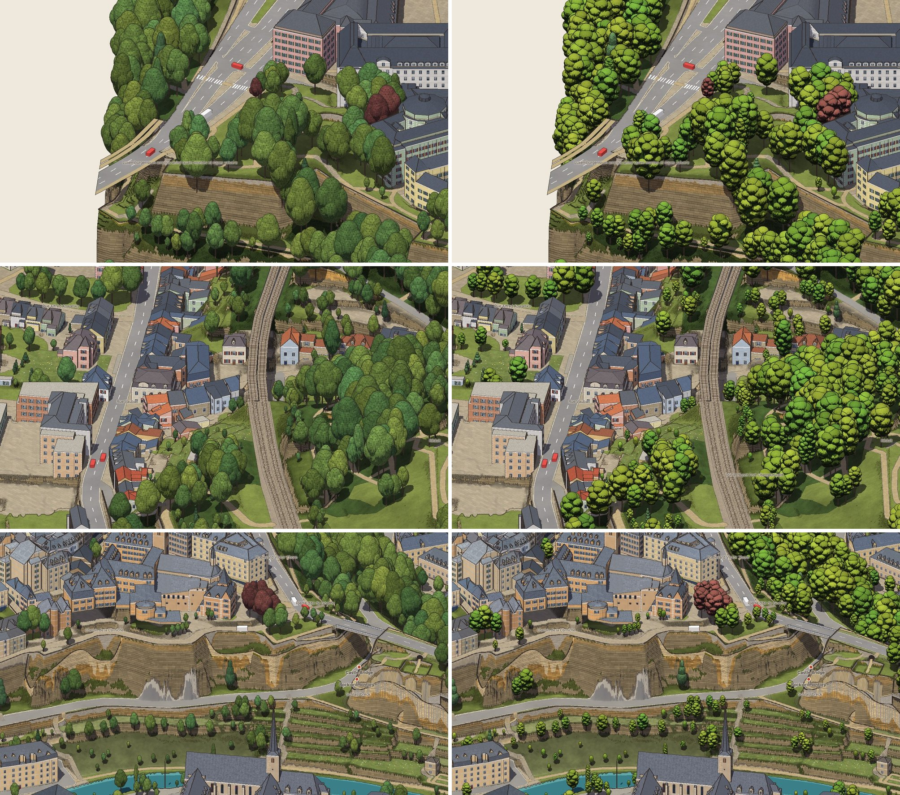

### 31.4 Not done

- **A wood is still many round trees.** v1 paints a wood as one mass of foliage; v2 draws every surveyed tree
  as its own crown, so from close up the clumps read as bunches of balls. Zoomed out the woods read much closer to v1's.
- The clumps are all much the same size within a crown. No branches show, and no gaps to the sky.
- The trunks, the autumn, winter and blossom colours and the conifers' shape were not touched. Only the summer
  greens were measured against v1.
- Looked at: the eight views of both viewers at 13:00, evening and night, and three close views. Not looked at:
  other seasons, and the far north and south of the test area.

### 31.5 Open questions

44, 46, 60 and 61 stand.

| # | Question |
|---|---|
| 65 | Are the trees right? If the clumps read as too round or too regular, the next thing to try is clumps of more varied size and a ragged outline. |

## 32. The trees, second round: closer to v1, and 70% as tall (24 November, $0)

Shown section 31's trees, the owner said they were better, could be more like v1's, and were too big beside the
buildings. Both are done, built and checked. No money was spent; Phase 3 stands at $4.68 of $8.

### 32.1 Too big: what was measured, and what was decided

The trees were drawn at the height the 2024 LiDAR tree survey gives. Those heights were checked against the
LiDAR surface itself (surface less terrain at each tree): they agree to 1.67 m at the median. The trees of the
test area really are tall:

| | 5th | 25th | 50th | 75th | 95th percentile |
|---|---|---|---|---|---|
| Trees, measured height (12,414) | 4.8 | 10.1 | 16.8 | 22.6 | 29.0 m |
| Buildings, ridge height | 3.7 | 10.9 | 13.4 | 17.2 | 24.3 m |
| Trees, as drawn now | 3.3 | 7.1 | 11.8 | 15.8 | 20.3 m |

64% of the trees are measured taller than the median building. So "smaller" could only mean drawn smaller than
measured, which is the owner's call. Three sizes were shown beside v1 as trial drawings: as measured, 80% of
height and width, and 70% of height with the width kept. **The owner chose 70% of height, width kept
(24 November).**

- `trees.drawn_height_scale` = 0.7 in `params.json`. Every tree is drawn at 70% of its measured height. Its
  place and its crown width are unchanged, so the woods stay closed.
- The measured height is kept in the data (`height_measured`) and still decides which trees are kept and the
  crown's shape by age. The shadows come from the trees as drawn, so they are shorter too.
- New gate **TE9**: trees not drawn at 0.7 of their measured height, within 1 cm: 0 of 12,414.
- 40% of the trees are still drawn taller than the median building (64% before).
- This is a departure from the measurement, recorded in `DECISIONS.md` and in `layer-07-trees.md`.

Tried and not applied: narrowing each crown to the LiDAR canopy around it. It would narrow 2,754 trees (7.1 to
4.1 m at the median) and made the trees thinner and taller-looking, the opposite of what was asked.

### 32.2 Closer to v1: what changed in the drawing

| | Section 31 | Now |
|---|---|---|
| A leaf clump | One spheroid | A cluster of five leaf tufts inside the clump's shape: one facing out, four around it, so the outline is lobed |
| A tuft's colour | Smooth from light to dark | Three flat tones: light on top, a mid green on the side, dark underneath, as v1's foliage is drawn |
| Depth inside a crown | – | A tuft that sees less sky (low on the crown, or on the underside of its clump) is darker |
| Lines | 0.8 between clumps, 0.9 around each crown | 0.15 between the tufts of a clump, 0.75 between clumps, 0.9 around the foliage as a whole |
| Between two neighbouring trees | The heavy outline | The same line as between two clumps of one tree, so a wood reads as one mass of leaves |

- **No light is baked in.** The tones and the darkening by sky follow "up" and the tuft's place on the crown,
  never the sun; the sunlit side still comes from the viewer's sun on each tuft's own normal. L5.1/L9.2 passes:
  0 of 255 compared.
- Three earlier trials (smaller tufts, smooth shading) read duller and finer than v1 and were dropped.
- Lit as the viewer lights them at 11:00 on 15 June, at the same three places as section 31: brightness
  13, 71, 165 (5th, 50th, 95th percentile of 255) against 14, 70, 158 in section 31; the lightest 5% is
  [170,199,56]. The trees cover 20% fewer pixels there (0.72 million against 0.90).

### 32.3 The build and the painted area

| | |
|---|---|
| Release | `8e04abbcca4d` (current) |
| Stages | 59 of 59 |
| Gate entries | 285 pass, 0 fail (284 and the new TE9) |
| Tree layer | 99.7 MB (106.4 in section 31); the release 17.54 MB (17.75) |
| Speed | 120 frames a second over the whole area, 94 at zoom 1 |
| Painted area (`8e04abbcca4d_t4_0`) | 101 pictures, even light fails on 0; edges 96.5%, window rows 99.8%; no baked light 0 of 255, worst 4.0%; vehicle gates 0 |

- No threshold was changed. 174 tests pass. Tree checks TE1 to TE9, S-trees (seams: 0.0), D-trees (vehicle
  detector: 0) pass. TE8 (report): drawn height over crown width 1.53 at the median.
- The per-picture vehicle detector (not a gate) marks the same 2 of 101 paintings as before (highest score
  0.15): house fronts and a shop front.

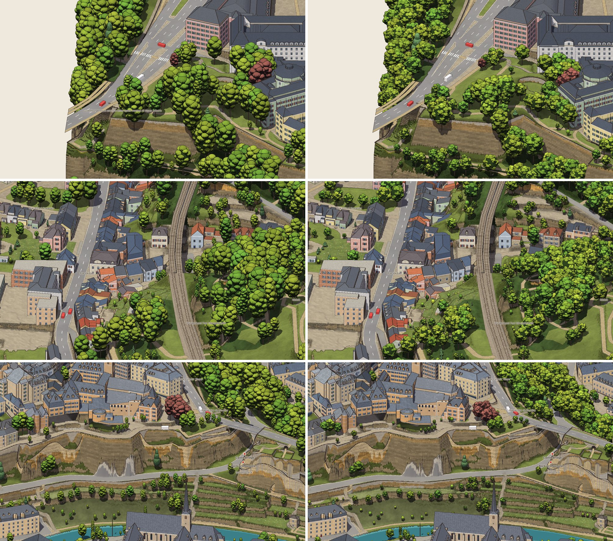

### 32.4 Not done

- Every surveyed tree is still its own crown. A wood now reads as one mass because no heavy line parts its
  trees, but it is not painted as one shape the way v1's is.
- The crown widths are as before: the drawn canopy still covers 8.7 ha of open ground and leaves 28% of the
  LiDAR canopy bare (42.0 ha drawn against 46.1 ha measured).
- With the width kept and the height at 70%, tall narrow trees are squatter than they are.
- The trunks, the conifers' shape and the autumn, winter and blossom colours were not touched or looked at.
- Looked at: the eight views of both viewers at 13:00, evening and night, and three close views.

### 32.5 Open questions

44, 46, 60 and 61 stand. 65 stands, on these trees:

| # | Question |
|---|---|
| 65 | Are the trees right now, in drawing and in size? |

## 33. The trees by species (24 and 25 November, $0)

Shown section 32's trees, the owner said they were not that good and asked whether the trees that grow in
Luxembourg could be researched and modelled. They are: built and checked. No money was spent; Phase 3 stands at
$4.68 of $8.

### 33.1 What grows in the city, and what data says so

| Source | What it has | Licence | Used |
|---|---|---|---|
| ACT LiDAR 2024 tree survey (the trees we draw) | Place, height, crown; green broadleaf, red-leaved, conifer or other. No species | CC0 | Yes, as before |
| The city's tree register (Ville de Luxembourg, Service Parcs) | 23,940 trees: Latin name, cultivar, height, crown, street or park | None stated | Yes, by the owner's decision of 25 Nov |
| OpenStreetMap | 88 trees with a species or genus in the commune | ODbL | Yes |
| Remarkable trees (ANF) | 238 trees nationally, about 14 in the commune | CC0 | No (too few; OSM has most) |

The register's count by genus: Acer 16.5%, Tilia 10.8%, Quercus 8.6%, Fraxinus 6.4%, Platanus 5.6%, Carpinus
4.5%, Aesculus 4.2%, Ulmus 4.2%, Prunus 3.6%, Pinus 3.2%, Fagus 3.0%, Betula 3.0%; 102 genera in all.

### 33.2 The 23 species

Each has its own outline, bare trunk, width, leaf texture, greens and bark (`v2/config/tree_species.json`,
`layer-07-trees.md` "Species"): maple, columnar maple, lime, oak, columnar oak, ash, plane, hornbeam, columnar
hornbeam, horse chestnut, elm, cherry, purple cherry plum, beech, copper beech, birch, robinia, Lombardy poplar,
weeping willow, ginkgo, pine, spruce, yew.

- Ten outlines: round, egg, flame, column, spire, cone, pyramid, dome, vase, weeping. A conifer is no longer
  three stacked tiers: a spruce is a cone of tufts, a pine a crown on a bare red-brown trunk, a yew a dark dome.
- Crown widths are the species' (the register's mean height and crown width by genus): a maple 0.50 to 0.58 of its
  measured height, an oak up to 0.64, a columnar oak 0.31, a spruce 0.33.
- The drawing of a crown (clumps of five tufts in flat tones) is section 32's; a round maple's tufts are the same
  shapes as before.
- A species not among the 23 is drawn as the nearest one (an alder as a hornbeam, a pear as a columnar hornbeam,
  a cedar as a pine): 23,749 of the register's 23,940 trees map to one.

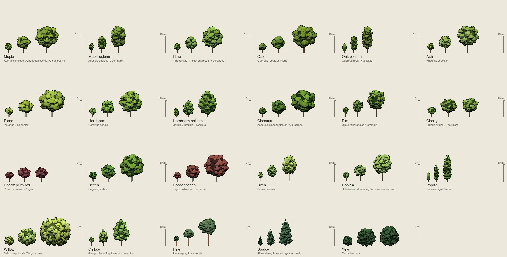

### 33.3 Which tree is which species

The first rule that applies decides (`scene.md`, "Tree species"). In the test area (12,414 trees):

| Rule | Trees | Known or by rule |
|---|---|---|
| The city's register, within 4 m | 736 | Known |
| OpenStreetMap species, within 3 m | 4 | Known |
| A street or square whose trees are known | 66 | Known |
| The survey's type (conifer: pine, spruce or yew; red: copper beech or cherry plum) | 666 | By rule |
| By the water | 632 | By rule |
| A street's own species | 732 | By rule |
| Woods and dense stands, in patches | 7,081 | By rule |
| Parks and gardens, in groups | 2,497 | By rule |

- **6.5% of the trees have a known species; 93.5% are plausible, not true tree by tree.** The register covers
  the trees the city looks after, on streets and in parks. The wooded slopes and private gardens that fill most
  of the test area are not in it. (Before the download I told the owner the register would name about four
  trees in ten in the centre; that was wrong.)
- Of the register's 1,062 trees in the area, 736 name a surveyed tree. 267 have no surveyed tree within 4 m,
  about 100 of them under 5 m tall: the LiDAR survey missed them. They are not drawn.
- 43 trees changed type because the register knows better (a pine the survey called a broadleaf, and the like).
- The wood mix (sycamore and ash first, then oak, hornbeam, beech) rests on the city's forest service points in
  the centre; the reading of their codes is ours, not the city's.

### 33.4 The build and the painted area

| | |
|---|---|
| Release | `9ebcda41bae8` (current) |
| Stages | 60 of 60 (the register's download is the new one) |
| Gate entries | 286 pass, 0 fail (285 and the new TE10) |
| Tree layer | 103.4 MB (99.7 in section 32); the release 17.66 MB (17.54) |
| Speed | 120 frames a second over the whole area, 94 at zoom 1 |
| Painted area (`9ebcda41bae8_t4_0`) | 101 pictures, even light fails on 0; edges 96.5%, window rows 99.8%; no baked light 0 of 252, worst 4.0%; vehicle gates 0 |

- No threshold was changed. 181 tests pass (6 new on the species rules, 1 on the species' shapes). Tree checks
  TE1 to TE10, S-trees (seams: 0.0), D-trees (vehicle detector: 0) pass; no baked light in the code art: 0 of 252,
  worst 3.2%.
- New: TE10 (gate) no tree drawn as a species of another kind than its type; TE11 and TE12 (reports) the trees by
  rule and by species.
- The per-picture vehicle detector (not a gate) marks the same 2 of 101 paintings as before (highest score 0.15).

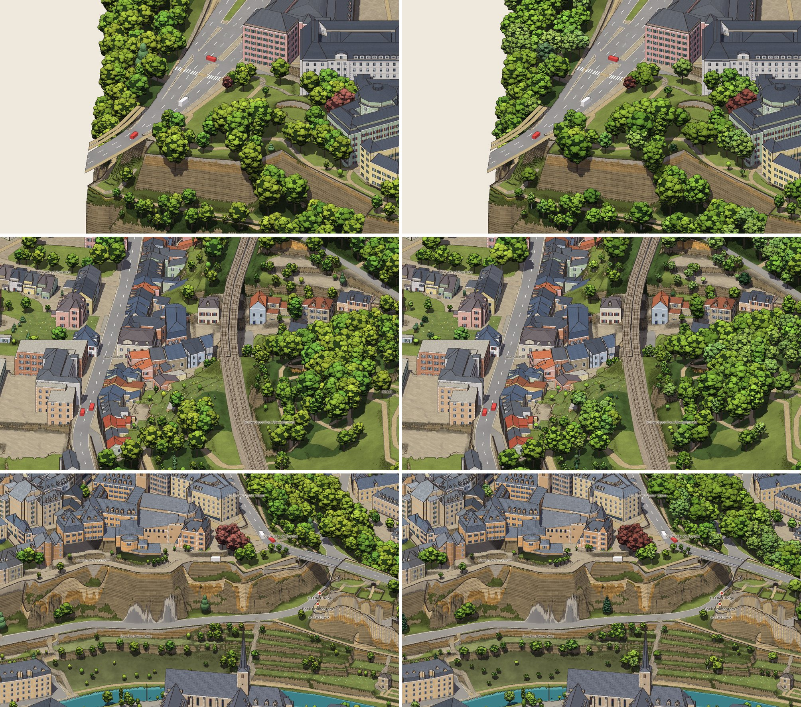

### 33.5 Not done

- **Autumn colour and blossom by species.** The viewer still tints every tree alike by season; a horse
  chestnut's candles, a cherry's blossom and a ginkgo's yellow are not drawn.
- The weeping willow's hanging branches barely read.
- The register's trees that the survey missed are not added.
- The register states no licence. If the city objects, its rule is removed and those trees fall back to the
  other rules (`DECISIONS.md`).
- Only the test area is built. The register covers the whole commune and is already downloaded for it.
- Looked at: the species sheet, four places as trials, and from the build the eight views of both viewers at
  13:00, evening and night, and four close views. Not looked at: other seasons.

### 33.6 Open questions

44, 46, 60 and 61 stand. 65 stands, on these trees:

| # | Question |
|---|---|
| 65 | Are the trees right now, drawn by species? |
| 66 | Should the city's trees that the LiDAR survey missed (267 in the test area) be added from the register, at the register's height? |
| 67 | Should autumn colour and blossom follow the species? |

## 34. The owner's review of the species build, and what is fixed (25 and 26 November, $0)

The owner looked at section 33's build and listed eleven points. Three were bugs and are fixed here; the others
are answers or their own steps. Release `f65f00199984` (all 60 stages ran; 287 gate entries pass, 0 fail, 380
entries in all). No threshold was changed.

### 34.1 The eleven points

| # | The owner's point | What it was | State |
|---|---|---|---|
| 1 | Trees where they should not be | 488 trunks stood on the face of a wall or a cliff: the survey gives a tree by its crown's top, which can hang over a drop | Fixed |
| 2 | Are trees as tall as the buildings? | Yes, there. The trees in the picture are measured at 21 to 30 m and drawn at 15 to 21 m (70%); the houses' eaves are 8 to 12 m up and their ridges 21 to 32 m; the green house's ground is 6 m lower | Answer |
| 3 | The cliffs | The look of the rock itself | Not done: its own step (question 46) |
| 4 | Weird patches | A road at a cliff's foot painted metres up the rock | Fixed |
| 5 | Is this the same in reality? | The picture did not arrive | Open |
| 6 | Weird pattern on some buildings | The same bug as 10 | Fixed |
| 7 | Things on cliffs | The picture did not arrive | Open |
| 8 | What happens to the trees when the leaves fall? | Today a crown only turns brown in winter. Bare branches are not drawn | Not done: its own step (question 68) |
| 9 | Rivers | The picture did not arrive | Open |
| 10 | Shadows are not smooth | Shadows were worked out on a grid of 0.5 m cells | Fixed |
| 11 | (empty) | | |

Of the pictures only the ones for points 1 and 2 arrived; the others came as copies of the second.

### 34.2 The three fixes

- **Trunks off faces (point 1).** A trunk on a cliff cell is put on the nearest ground that is not a face, within
  its crown's radius plus 1 m (1.5 m at least, 4 m at most); with none in reach the tree is left out
  (`trees.off_faces`, `scene.md`). 480 moved, 8 left out. New check TE13 (gate): no trunk on a cliff cell, 0.
- **Smooth shadows (points 6 and 10).** The height map is read between its cells (`hmAt` in the shader, `hm_at`
  in `light.py`), and the march starts 0.5 m off the surface along the level part of its normal, so a wall no
  longer catches lines from its own cells and a shadow's edge has no steps (`layer-09-light.md`).
- **No way up a cliff face (point 4).** A way's surface on a cliff cell is drawn only where the ground is within
  1 m of the ground under the nearest point of its centre line (`layer-04-transport.md` rule 1).

### 34.3 The first rebuild failed three checks, each from these fixes

Release `6001bad621ed` did not pass. The causes and what was done:

| Check | Result | Cause | Fix |
|---|---|---|---|
| L4.1 centre lines drawn | 182 of 88,462 samples not drawn | The cut compared the ground with the way's profile, which is 2 to 6 m off the terrain where a few ways cross a cliff cell | Compare with the ground under the centre line; never cut within 0.5 m of any centre line |
| V2 shadows, buildings off | 0.9677 (needs 0.97) | The check's reference had no normals for this view, the viewer does | The check reads the nearest surface's normal per pixel, as for the other views |
| C2b and X8b pan speed | 46 fps (needs 60) | Reading between cells is 8 reads per step of the march | Per block of 4 × 4 cells the viewer keeps a height nothing in the block reaches, and whether it holds a tree or a structure; cells are read only below that height (`heightmap.ts`). The shadows are the same |

Blocks of 16 cells gave 64.8 fps only, because 71 of the march's 110 steps fall within 16 m; blocks of 4 with the
tree and structure flag gave 83.

### 34.4 The build

| Check | Species build | Now |
|---|---|---|
| Gate entries passing | 286 | 287 (TE13 new) |
| L4.1 centre-line samples drawn | 1.0 | 1.0 |
| V3 viewer shadows against the reference (three views) | | 0.9923, 0.9881, 0.9981 |
| V2 the same, buildings off | | 0.9923 |
| L9.1 shadow direction, median error at 08:00, 13:00, 19:00 | | 7.51°, 9.5°, 7.66° |
| L5.1 no baked light, code art | 0 of 252, worst 3.2% | 0 of 201, worst 2.7% |
| C2b pan at 1:1, and the whole area | 94 and 120 fps | 82.9 and 91.6 fps |
| X8b pan in the tunnel view | | 94.2 fps |
| Tree layer | | 102.76 MB |

The viewer pans slower than before and passes with room: the price of the smooth shadows. 184 Python tests (3 new, on the
fixes) and 27 web tests (2 new, on the block tops) pass.

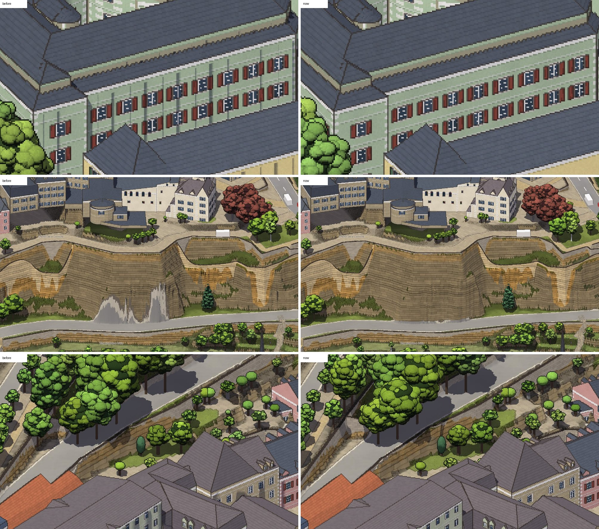

### 34.5 The painted area does not pass on this build

Painted release `f65f00199984_t4_0`, from the same 101 paintings ($0). Lines, seams and the vehicle detector
pass as before. **L5.1/L9.2 (no baked light) fails on 1 of 201 materials**: building 684's roof reads 9.25%
darker in shadow than lit (limit 5%); the other layers' worst is 2.1%.

The cause is how the roof is now measured, and the paint under it. The same 93 shadow pixels (a small sunken
flat piece of the roof, painted at 137, no darker than the roof around it at 136 to 139) used to be compared
with 2,074 lit pixels spread over the whole roof, because the old shadows scattered specks of self-shadow
everywhere; that gave 3.0%. With clean shadows the lit pixels beside it are 531, a lighter strip along the upper
roof (149). The paint on that roof is uneven by about 9%, and the check now sees it.

Tried: the painted method's own shadow line now uses the surfaces' normals, as the check and the viewer do
(`detail.py`); the result did not change. Not done: the limit is not raised and the roof is not excepted. If the
painted art is chosen (question 60), this roof needs evening out or a new painting before the painted area can
pass.

### 34.6 Not done

- The cliffs (points 3 and 7), the rivers (point 9) and bare winter trees (point 8): each its own step, none
  started.
- Point 5 is not answered.
- A short wavy patch of path on a cliff face at the right of the Bock view was seen and left.
- Looked at: the three places of the fixes before and now, the eight views of both viewers. Not looked at: other
  seasons, other hours than 13:00, evening and night.

### 34.7 Open questions

44, 46, 60, 61, 65, 66 and 67 stand. New:

| # | Question |
|---|---|
| 68 | Should broadleaved trees be drawn bare in winter (branches, no crown), with evergreens kept green? |
| 69 | Is the cliffs' look the next step? |

## 35. v1's cartoon look in the code art (26 November, $0)

The owner set the painted version aside ("don't need the painted version for now"), asked whether the code art can
move toward v1's cartoon style, and asked for samples of the cathedral to confirm the point. Four samples were
shown (today's colours as a cartoon; the same in v1's colours; that drawn harder, the closest to v1; a bright
toy-like one). The owner chose the third, C, and asked for the test area in it. This section is that build.

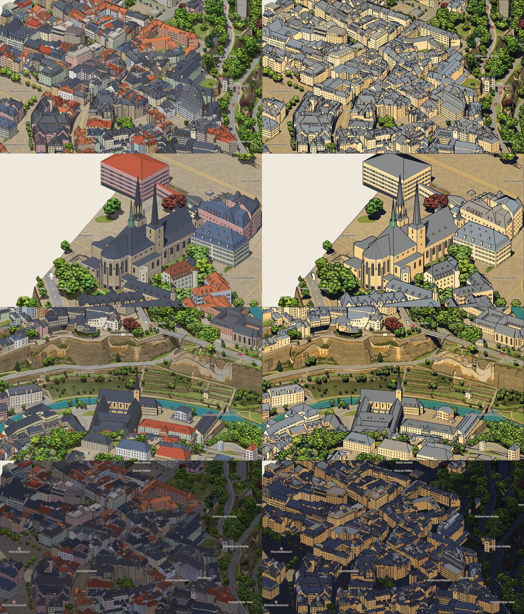

### 35.1 What changed

| Part | Before | Now |
|---|---|---|
| Houses by rule | many colours (pink, green, blue, ochre), red tile and slate | v1's family: honey, ivory, sand, gold, tan, a little chalk and brick, by fixed shares; every roof by rule is slate. A building with a known colour or roof keeps it (the cathedral's copper spire stays green) |
| Fills | grain, mottle and toned slabs on walls, roofs and stone | clean (`GRAIN` 0); stone joints stay |
| Roofs | courses and staggered joints | a light stroke down the slope every 0.9 m, and the courses |
| Windows, trim, plinth | grey-blue glass (59, 74, 90), near-white trim | v1's dark glass (38, 48, 70), cream trim, tan plinth |
| Light | soft Lambert, a near-white sun, a cast shadow keeping 0.42 of the sun | in steps: a face is lit, half lit (0.7) or not; a cast shadow on ground, roofs and trees is v1's deep blue (0.17, 0.20, 0.34 of white); an upright wall out of the sun stays warm (0.72, 0.62, 0.50); a roof or a crown never gets less than 0.22 of the sun |
| Line | 1 px, the palette's line colour | blue-black (22, 24, 40); from scale 0.4 one more pixel on the far side of a silhouette, from 0.75 a second on the near side |

Nothing of the light is in any tile: the layers stay evenly lit, shadows move with the hour, windows and lines
stay where the model has them, and no vehicle is in the art. The constants are in `palette.json` and `light.json`;
the rules in `art_a.py`, the light and look shaders, and the specs of layers 5, 9 and 14.

### 35.2 The first build, and the lemon walls

The first build (release `8b3cb3971729`) matched the approved sample at 16:30. At 13:00 it showed a flaw the sample
could not: walls in full sun were lemon (247, 247, 178), not v1's cream (246, 216, 166 to 251, 230, 187, measured
in v1's art of the old town). The cause: a cream wall lit by a warm sun goes past the screen's white, red first,
then green, and each channel was cut off on its own, so the hue moved towards yellow-green.

The fix is in the light pass: a colour lit past white keeps its hue. It is scaled back to white's level and mixed
towards white by `sun.toon.pale` (1.8) times how far over it was. Sunlit walls are now 247, 231, 183; half-lit
walls 247, 206, 136. A new gate keeps it so: V8 (L9.6), of the coloured pixels lit to the top at 13:00, at most
0.1% may be more than 6° of hue from the surface's own colour. A unit test shows the measure sees the old
behaviour (a turn of 16° on honey) and passes the new (under 4°).

### 35.3 The build

Release `cb3a620877b9`. 56 of 60 stages ran and passed: 157 gate entries pass, none fails.

| Check | Result | Limit |
|---|---|---|
| L5.1 / L9.2 no baked light (201 materials) | 0 fail; worst: buildings 4.7%, transport 2.1%, ground 1.3% | 5% |
| L5.2 building edges within 1 px | 97.3% | 95% |
| L5.2 window rows within 1 px | 99.7% | 95% |
| L5.8 church tracery within 1 px | 99.5% | 95% |
| V2 shadows without buildings match the reference | 99.2% | 97% |
| V7 look pass applied twice | 0 of 255 | 1 |
| V8 hue of what is lit to the top (62,475 px) | 0.0%; largest turn 4.4° | 0.1% over 6° |
| C2b panning, desktop | 76.5 fps | 60 |
| X8b panning in tunnel view | 93.6 fps | 60 |

186 Python tests (2 new: the houses' colours by rule, the hue measure) and 27 web tests pass.

### 35.4 Two checks did not run: gates G1 and G3 are not passed for this release

`check_no_cars` (brief 9, no vehicle painted into the art) and `check_cutaways` (its detector part) stopped with an
error, in both builds: the detector's model, `google/owlv2-base-patch16-ensemble`, is no longer in the laptop's
Hugging Face cache. The cache folder was emptied at 00:44 on 26 November, before the first build started; no
command of this work did it. The checks run offline on purpose and download nothing. With them not run, G1 and G3
are skipped, so this release has no gate result. Nothing was worked around. The model has to be downloaded again
(about 620 MB, free), which needs the owner's word; then the two checks and the gates run in a few minutes, with
no rebuild.

There is no reason to expect a painted car: the art code draws none. That is an expectation, not a result.

### 35.5 Seen, and left for the owner

- At 20:30 most of the ground lies in long cast shadows and is almost black-blue; squares and streets are hard to
  read. This is the cost of C's deep shadow, as the samples page said. Not changed.
- L5.1's worst figure for buildings is 4.7% against a limit of 5%: close.
- Cliffs, ground, roads, water and trees are drawn as before; only the light and the line changed on them.

### 35.6 Not done

- The two detector checks and the gates (35.4).
- The painted area was not remade and is not in this style.
- Looked at: eight views (the whole area, the old town, the cathedral, the Grund, Clausen, streets close up, all
  at 13:00; the old town at 20:30; the Grund at 23:00) and the cathedral at 16:30, in summer. Not looked at: other
  seasons, a phone.

### 35.7 Open questions

44, 46, 65, 66, 67, 68 and 69 stand. 60 (which art for the city) is set aside with the painted version; 61 (more
of v1's contrast) is answered by this style. New:

| # | Question |
|---|---|
| 70 | May the detector's model be downloaded again, so the two checks and the gates can run? |
| 71 | Should cast shadows be lighter when the sun is low, so the evening stays readable? |

## 36. The colours in the cartoon look: real roofs, the houses' colours back (26 November, $0)

Shown section 35's build, the owner asked: "why all roofs are gray? was it like this before?". Told that sample C
makes every roof slate as v1 does, and that the build before had about 23% tile by a rule and not from data, the
owner chose the real roofs from the photo and v1's darker, bluer slate, then said: "also other colors can be more
cartoonish not just the gray", "not just the roof, bring back diffrent bulding colors as well" and "but the art
style remains, remember that". The art style is unchanged in this section: clean fills, light in steps, deep blue
shadows, the bold line, the strokes down the roofs. Only colours changed.

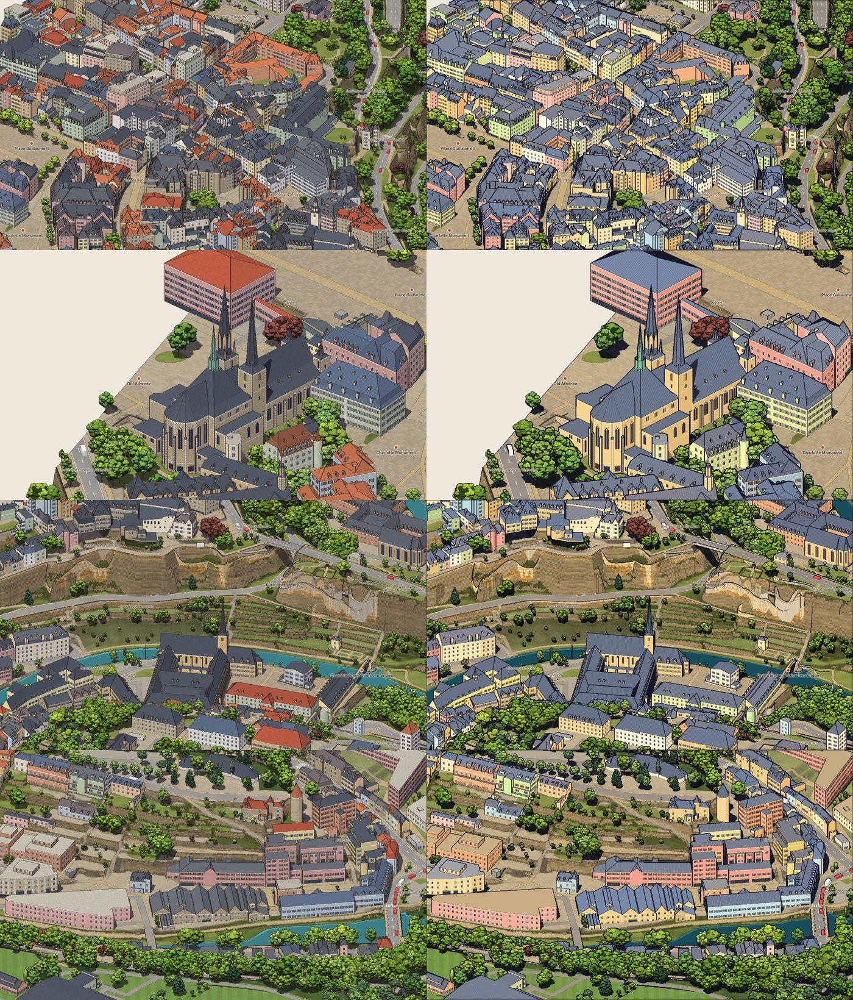

### 36.1 Roofs from the orthophoto

A new part of the scene, `scene_roofs` (`v2/data/scene/roofs.py`; spec: scene.md, "Roofs"), reads each building's
roof covering from the 2023 orthophoto. The photo classes the roof and never colours it. Result on the test area:

| | Roofs |
|---|---|
| Buildings | 1,135 |
| Read by the photo | 1,111 (97.9%) |
| Slate (plain 407, warm grey 240, dark 233, blue 116) | 996 |
| Tile (brown 2, bright 1) | 3 |
| Flat: grey 84, under gravel 25, planted 3 | 112 |
| Not read (too small, under trees, in shadow): slate by rule | 24 |

So the real pitched roofs of the test area are slate: tile is 0.3% of those read. Asked whether some tile should
come back by rule all the same, the owner said "yes show me results"; shown the old town with the real roofs, with
12% and with 23% of roofs in tile, the owner chose "Real roofs only". There is no tile rule.

Not known: whether the photo moves a tall building's roof off its footprint. The inset of 1.2 m and the median
guard against it; on the 40 warmest roofs looked at, the footprint's centre lay on the roof.

### 36.2 Colours measured in v1's art

v1's own colour of each surface was measured in v1's art over five windows, by the built release's surface kinds:

| Surface (its commonest colour) | v1 | Section 35's build | This build |
|---|---|---|---|
| Slate roof | 106, 115, 129 | 148, 152, 149 | 115, 125, 144 (lit), 102, 112, 132 (half lit) |
| River | 24, 78, 92 | 61, 125, 116 | 24, 78, 92 |
| Asphalt | 146, 136, 131 | 163, 151, 125 | 151, 144, 133 |
| Sunlit wall | 247, 211, 152 | 247, 214, 148 | by the house's colour |
| Lawn | 142, 148, 57 | 137, 143, 62 | 136, 146, 68 |

The river is v1's exactly. The slate is a little lighter and bluer than v1's and the asphalt a little lighter;
neither was tuned further.

The cause of the grey slate, the beige asphalt and the pale river was one thing: the sun of section 35 was yellow
(a white surface lit 1.18, 1.12, 0.97), and it took the blue out of everything. v1 keeps each surface's own
colour. Now the sun is nearly white (`grade.day_tint` 1.0, 0.95, 0.84: a white surface lit 1.20, 1.17, 1.10), and
the palette holds v1's slate, river and asphalt. An upright wall out of the sun is a little warm only
(`sun.wall_shade` 1.15, 1.07, 0.96), so a blue or a green house keeps its colour in shade. The most saturation a
pixel may have went from 0.68 to 0.76 (`look.sat_max`): v1's river is 0.74.

### 36.3 The houses' colours

The 13 facade colours by the building's id are back, as before the cartoon look, each stronger (saturation about
1.3 times and a little more; pink and rose kept pink). No data says what colour a house is (the photo is from
above), so this stays a rule. Section 35's family of seven creams is gone.

### 36.4 A seam in the ground, found by the darker river and fixed at its cause

The first build of these colours failed S-ground: a step of 3.18 against a limit of 3.0, at one tile border on a
riverbank (2.64 in every build before, just under the limit). It was not the tile's coding (that leaves about 1.0
there at any quality). The ground's classes are rasterised per tile, and the image library's polygon fill rounds
each vertex to a whole pixel, a negative one (a vertex left of or above the tile's canvas) towards zero. So an
edge that leaves the canvas moved by up to a pixel with the tile, and on a steep bank the border between water
and rock moved by several screen pixels: 738 pixels differed between the two tiles and one render across their
border. The darker river made the old difference larger in colour.

Fixed in `render.py` (`fill_mask`): an even-odd scanline fill on the pixels' centres, every crossing worked out
from the polygon's own edges. On 2,000 random polygons it gives the same pixels after any whole-pixel shift and
the same as the exact test of each centre; a unit test holds it. At the failing border 0 pixels now differ.
S-ground is 1.17, S-water 0.0 (0.98 before: the water's areas had the same fault), S-transport 1.11. The limit was
not touched.

Not done: the transport layer's lines (rails, lane dashes) are still drawn by the image library's line; its seam
figure is 1.11.

### 36.5 The build

Release `d81df90323dd`. All 62 stages ran and passed (2 new: `scene_roofs`, `check_roofs`): 293 gate entries
pass, none fails; gates G1 and G3 pass. The detector's model was downloaded again with the owner's word ("do it":
`google/owlv2-base-patch16-ensemble`, 620 MB, to the local cache, with no account token sent), so the two checks
that could not run in section 35 ran here.

| Check | Result | Limit |
|---|---|---|
| No painted vehicles (detector, 951 tiles, 7 layers) | 0 detections | 0 |
| L5.1 / L9.2 no baked light (201 materials) | 0 fail; worst: transport 3.0%, buildings 1.6%, ground 1.3% | 5% |
| L5.2 building edges within 1 px | 96.9% | 95% |
| L5.2 window rows within 1 px | 99.7% | 95% |
| L5.8 church tracery within 1 px | 99.3% | 95% |
| S seams: ground, water, transport | 1.17, 0.0, 1.11 | 3.0 |
| RF1 roofs read by the photo | 97.9% | 85% |
| V2 shadows without buildings match the reference | 99.2% | 97% |
| V8 hue of what is lit to the top (49,592 px) | 0.0%; largest turn 4.6° | 0.1% over 6° |
| C2b panning, desktop | 73.9 fps | 60 |
| X8b panning in tunnel view | 83.4 fps | 60 |

191 Python tests (5 new: four on the roofs' classing, one on the fill) and 27 web tests pass.

The building edges' score fell from 97.3% to 96.9%. Not looked into: the limit is 95%.

### 36.6 Seen, and left for the owner

- At 20:30 most of the ground still lies in long, almost black-blue shadow (question 71).
- The riverbank where the seam was has a jagged edge of rock into the water. It is the same in every build; it
  belongs to the rivers' step (point 9 of the review).

### 36.7 Not done

- Cliffs, the rivers' edges, bare winter trees: each its own step. For the cliffs the owner said: "I have so much
  input so at that point ask me questions".
- The painted area is not remade.
- Looked at: the eight views and the cathedral at 16:30, in summer. Not looked at: other seasons, a phone.

### 36.8 Open questions

44, 46, 65, 66, 67, 68, 69 and 71 stand. 70 (the detector's model) is answered: downloaded, the checks ran.

## 37. The cliffs: rock drawn from a photo of the Bock (26 November, $0)

The cliffs were point 3 of the owner's review ("I don't like the cliffs at all"), and the owner had said: "about
the cliffs I have so much input so at that point ask me questions". So the step began with questions, and each
build was shown before the next. The art style is unchanged: flat colour, no light painted in, the map's own line.

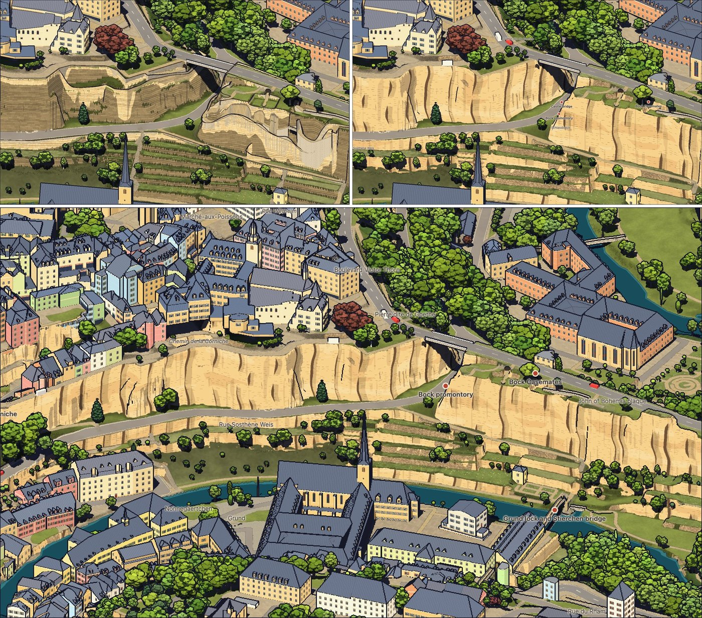

### 37.1 What the owner said, in order

1. Asked first, the owner disliked the horizontal stripes, the colour, the green patches on the rock, and the
   shape and edges; wanted built walls told apart from natural rock; and said: "first you need to do research to
   see how luxembourg city cliffs and walls from the old castles looks likes" and "remember we want to retain the
   cartoonish style".
2. Shown the research, the owner asked for samples in v1's manner on a small cliff. Of four: "no, too unified and
   repeated". Of three uneven ones the owner chose E (uneven pillars of stacked blocks), then: "but the green
   patches are not good" and "the walls merging into cliffs are not good as well".
3. Built with E, and with every built wall on a face drawn as a band of grey stonework from the wall data. The
   owner: "nope not good at all. probably you need to simplify it and not stick to reality because you don't have
   enough data on the realityt", and of the bands, sheets and lines over the Bock: "I am talking about these
   things which does not make sense".
4. With those gone, of the Bock still drawn in E's blocks: "no noo, what is this? find a real photo of this cliff
   and compare".
5. Shown the rock redrawn from the photo: "what about the rough edges". With the edges smooth: "looks good".

### 37.2 The photo, and the rock drawn from it

The photo is the Bock's south-east face seen from Neumünster Abbey (Paul Braun, Wikimedia Commons, CC BY 4.0). It
was used to look at, on a private comparison page with its credit; it is not in the repository and no pixel of it
is in the art.

| In the photo | In E's blocks | Drawn now |
|---|---|---|
| One massive face, pale gold, nearly one colour | Four tones in stripes | One pale colour in three near tones, in broad patches |
| Five or six big dark clefts across the face | A thin black cleft every 3 m | A big cleft about every 11 m, wandering, opening and closing up the face, its right side a tone darker |
| No blocks: fine rough bedding | Blocks with black joints, like bricks | Short faint level strokes; no joints, no ink |
| Dark stains running down | None that read | Faint stains |

The rock's colour at a pixel comes from the pixel's place in the world only (`v2/layers/cliffs.py`, `rock`), so a
tile and its neighbour agree and the light is still added by the viewer. Low faces (under 3.5 m: a terrace's or a
garden's wall) are dry stone in the rock's colours.

### 37.3 A rock face is one thing

- **Where rock is.** The scene's cliff cells, the steep cells within 2.5 m of them, and the enclosed gaps between
  them under 60 m²: no patch of lawn inside a face.
- **Walls.** On or within 5 m of a rock face no wall is drawn; the face is drawn, as rock. The rule is applied
  along each wall, and a piece under 15 m left over between or beside such stretches is not drawn either.
- **Ways.** A path or steps lying on a high face along 30% or more of its length is not drawn, nor is the side of
  a raised way hanging down a face. In the map's ground model the paths on the walls' tops fell down the face.
- **No form shading and no slope hatching on rock.** The hatching was the speckle along the rim.

### 37.4 The rough edges

The saw teeth were the ground model's half-metre cells: the rock's border was read cell by cell. A yes/no grid is
now turned into a smooth field and read between the cells, cut at one half (`grid.soft_mask`, `grid.read_soft`).
A plain blur would wipe out a narrow upright face, so parts narrower than three cells keep their full value. The
answer at a place is the same in any tile. Lawn borders had the same teeth and take the same reading
(`groundcover.vegetated`), which changes the lawns' edges across the whole area. How far they moved was not
measured.

### 37.5 The first build of this version failed three checks

Release `3c7dc05be562`: 57 of 62 stages. Each failure was looked into and fixed at its cause; no limit was
changed.

| Check | What it said | Cause | Fix |
|---|---|---|---|
| D-relief, no painted vehicles | One "bus", score 0.162 (limit 0.1), tile 117_69 | An 8 m piece of a long wall along the Corniche, left over by the 5 m rule, with its coping and foot line | The rule along each wall with the 15 m leftover rule; the coping and foot line drawn along a wall removed. That tile now has no wall pixel and scores 0.009 |
| L4.6, bridge ends | 377 samples with a gap | The check counted the paths on rock faces that are left out on purpose | The check counts them apart (408 of 5,249 in the final build) and reports the number; 0 gaps |
| L5.1 / L9.2, no baked light | Rock 8.0% brighter in the photo sun's shadow (limit 5%) | The check compares medians of "inside" pixels, and took a change of the surface's direction for an edge. On a cliff that left 0.9% of the rock's pixels, and the median of a surface drawn in three flat tones jumped a tone. Over all inside pixels (1.74 million in shadow, 1.58 million lit) the medians differ by 0.16% and the means by 0.64% | On the ground layer a change of direction is no longer an edge: the ground's colour does not depend on it (L1.2 checks that). Other layers are sampled as before |

The third fix changes how the check samples every ground class. In the final build the ground's worst figure is
1.0% (it was 1.3% in section 36's build).

### 37.6 The build

Release `e679f79eb121`. All 62 stages ran and passed: 293 gate entries pass, none fails; gates G1 and G3 pass.

| Check | Result | Limit |
|---|---|---|
| No painted vehicles (detector, 7 layers) | 0 detections | 0 |
| L5.1 / L9.2 no baked light (200 materials) | 0 fail; worst: transport 3.0%, buildings 1.6%, ground 1.0% | 5% |
| L1.2 ground not shaded: rock, north against south slopes | 0.6% | 2% |
| L2.2 walls drawn along under 90% of their length (of 340) | 0 | 0 |
| L4.6 gaps at bridge ends (of 5,249 samples) | 0; 408 on rock faces counted apart | 0 |
| L5.2 building edges within 1 px | 96.9% | 95% |
| L5.2 window rows within 1 px | 99.7% | 95% |
| S seams: ground, relief, transport | 1.16, 0.0, 1.11 | 3.0 |
| L8.4 depth steps at tile borders against the tiles' middles | 0.94 | 1.5 |
| V2 shadows without buildings match the reference | 99.2% | 97% |
| C2b panning, desktop | 78.6 fps | 60 |
| X8b panning in tunnel view | 95.7 fps | 60 |

199 Python tests (8 new, on the rock, the two stoneworks, the rock zone, the smooth border and the leftover piece
of wall) and 27 web tests pass.

### 37.7 Seen, and left for the owner

- The grey wall on top of the Bock and the casemates' dark openings are in the photo and not on the map. No data
  says where they are. They could be placed by rule (question 72).
- The terraces' dry-stone walls below the Bock read darker and busier than the rock above them.
- At 20:30 the faces lie in near-black shadow, as the rest of the ground does (question 71).

### 37.8 Not done

- The rivers' edges and bare winter trees: each its own step.
- The painted area is not remade.
- Looked at: the Bock, the Corniche cliff, the Grund and the whole area at 13:00, the Bock at 20:30 and 23:00, in
  summer. Not looked at: the cliffs of Clausen and Pfaffenthal close up, other seasons, a phone.

### 37.9 Open questions

44, 46, 65, 66, 67, 68, 69 and 71 stand. New:

| # | Question |
|---|---|
| 72 | Should the grey wall on top of the Bock and the casemates' openings be drawn, placed by rule? |

## 38. The rivers' edges, riverside trees and the casemates' openings (26 November, $0)

The rivers were point 9 of the owner's review ("the rivers are not good"; the picture sent with it did not
arrive). The Bock's top wall and openings were question 72. Each was shown as a small sample first, and the owner
chose. The art style is unchanged.

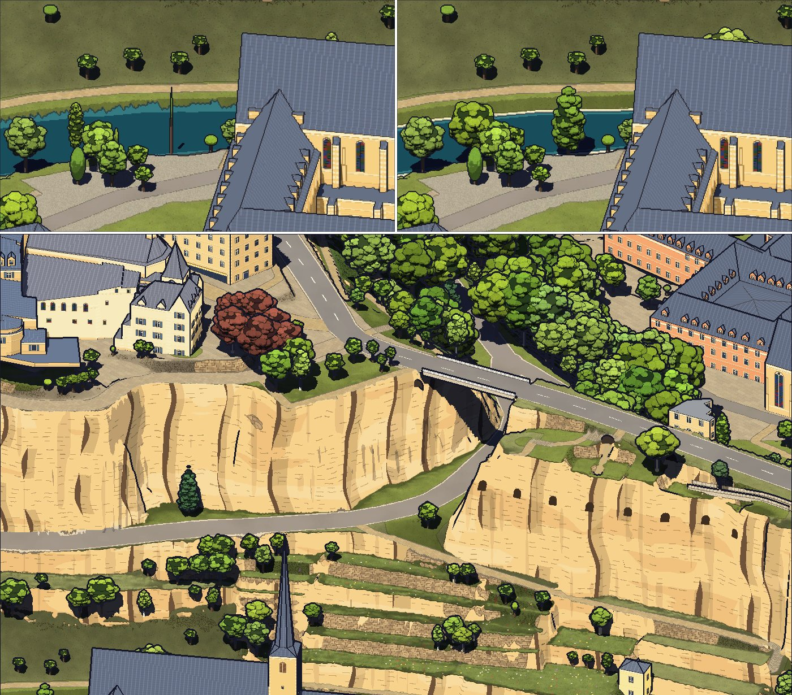

### 38.1 What the owner chose, in order

1. To merge pull requests 28 to 31 (crossings, trees, the cartoon look and its colours, the cliffs) into `v2`.
   Done.
2. For the Bock's wall and openings: "Show a small sample first". Of two samples, the openings without the wall.
3. For the next step: the rivers' edges. Of two samples, the one with a pale stone edge along every bank, as v1's
   river has.

### 38.2 Two faults in the rivers

Looked at close, the river had two faults.

| Fault | Cause | Fix |
|---|---|---|
| The far bank was saw-toothed | The terrain held the water's level only on the 0.5 m cells whose centre is in the water. Read between the cells, the bank's rise began inside the water area, and the water drawn up it showed the cells as teeth | The level is held on every cell in the water or within a cell's diagonal of it, each taking the level of the nearest water cell (`render.hold_water`). The ground is flat at every point of the water area and the bank rises outside it. The water's edge is the area's own line |
| Trees by the water were bare poles | A crown was narrowed until at most 30% of its disc lay over buildings or water, with no least width. In the test area 265 crowns were narrowed, 222 of them by the water; 51 were under 0.6 m in radius and 131 under 45% of their shape. A poplar at E 77659, N 75100 was drawn 0.18 m in radius for a shape of 2.6 m: a pole in the Alzette | Water no longer narrows a crown (a crown hangs over a river). Over buildings a crown is never narrowed under half its shaped radius (`trees.thin`, `min_thin_share`). 44 crowns are narrowed now, 24 of them held at half width. New check TE3c (gate): no crown under half its shape, 0 |

The flat ground reaches 0.71 m outside the water's line. In the test area that lowers the ground under 41
half-metre samples of paths' centre lines and near 5 bridge ends; the bridge-end check (L4.6) finds no gap and no
step over 1.28 px.

### 38.3 The stone edge

The outer 0.7 m of a river's own area is drawn as plain pale stone on the water's level (ground class `quay`,
`ground.quay`); the water is the area drawn in by that much, with its paler shallows inside. In the test area
that is 5,360 m² of stone along 7.6 km of bank, of 53,200 m² of river.

- **Why inside the river's area.** The bank's line stays where OSM has it. The other way, flat stone 1.5 m outside
  the water, was measured and turned down: it would sink 672 samples of riverside paths and 22 bridge ends (the
  bank rises a median of 0.64 m over 1.5 m; a tenth of it more than 2.14 m).
- **Every bank of a river gets it.** The data does not say which bank is walled and which is a meadow's. On the
  meadow banks there is no stone in reality.
- **Ponds, pools, basins and the fish pass get none.** They are water to their own line.

### 38.4 The casemates' openings

The photo of the Bock shows a row of dark openings under the top wall. An opening is drawn where the line of a
gun branch of the casemates' hand model (`v2/data/structures/casemates.json`: 25 branches, 13 facing south)
comes out of the rock: an arch 1.8 m wide and 2.1 m high, its sill 0.4 m over the branch's floor, in one dark
brown (`relief.casemate_opening`; `cliffs.gun_branches`, `cliffs.openings`). Eight show in the view of the
south-east face. The model is placed by hand, not surveyed, so an opening is about where a real one is.

The grey wall on top of the Bock is not drawn: placed by rule it came out thin and uneven, and the owner chose
the sample without it.

### 38.5 The first build failed one check

Release `a77edb715d81`: 59 of 62 stages. No limit was changed.

| Check | What it said | Cause | Fix |
|---|---|---|---|
| D-water, no painted vehicles | One "boat", score 0.108 (limit 0.1), tile 123_69 | Nothing is drawn there. At E 78017, N 74870 the end of a 3 m bank stands in front of the river and hides 4.6 m of it, which cuts a gap in the water layer. The detector looked at the layer alone on black, where the gap reads as a dark hull. The gap was in the last build too (score under 0.03); the water's line 0.7 m further in makes it stand out more | The detector looks at the water in its bed, over the ground layer (`owl_detect.py`, `under`). The layer's own pixels are unchanged, so anything painted in it is seen as before. The same tile then scores under 0.03 |

### 38.6 The build

Release `a77edb715d81` (the same layers; the checks run again with the fix). All 62 stages ran and passed: 294
gate entries pass (TE3c new), none fails; gates G1 and G3 pass.

| Check | Result | Limit |
|---|---|---|
| No painted vehicles (detector, 7 layers; the water in its bed) | 0 detections | 0 |
| L3.1 drawn water against its area (1,335,821 water pixels) | 0 off | 0 |
| L4.6 gaps at bridge ends (of 5,249 samples) | 0; largest step 1.28 px | 0; 2 px |
| TE3 largest share of a crown over buildings | 0.30 | 0.32 |
| TE3c crowns under half their shape | 0 | 0 |
| L5.1 / L9.2 no baked light (201 materials) | 0 fail; worst: transport 3.0%, buildings 1.6%, ground 1.0% | 5% |
| L1.2 ground not shaded, north against south slopes (worst class: dry stone) | 0.8% | 2% |
| L5.2 building edges within 1 px | 96.9% | 95% |
| L5.2 window rows within 1 px | 99.7% | 95% |
| S seams: ground, relief, water, transport | 0.86, 0.0, 0.0, 1.11 | 3.0 |
| L8.4 depth steps at tile borders against the tiles' middles | 0.95 | 1.5 |
| V2 shadows without buildings match the reference | 99.3% | 97% |
| C2b panning, desktop | 81.2 fps | 60 |
| X8b panning in tunnel view | 95.9 fps | 60 |

TE3b (report only): 23 crowns held at half width still lie over a building by more than 30% of their disc.

203 Python tests (4 new: a crown over a building is narrowed but never to a pole; no blockers, no narrowing; an
opening is an arch on its branch's line at its floor; water is flat up to its own edge and the bank rises outside
it) and 27 web tests pass.

### 38.7 Seen, and left for the owner

- The stone edge runs along the meadow banks too, where there is none in reality.
- At the map's overview scales the stone edge is a thin pale line, hardly seen.
- Eight openings show on the Bock's south-east face. At night they are dark holes; nothing lights them.
- Looked at: the Alzette by the abbey close up and wide, the lock, Clausen, the Bock, the Corniche stretch and
  twelve overviews of the whole area at 13:00; the abbey, the Bock and the stretch at 23:00; in summer. Not looked
  at: every reach close up, other seasons, a phone.

### 38.8 Not done

- The grey wall on top of the Bock (the owner's choice).
- Walled banks told from meadow banks: no data.
- Bare winter trees (question 68) and the evening's shadows (question 71): each its own step.
- The painted area is not remade.

### 38.9 Open questions

Question 72 is answered: the openings, without the wall. 44, 46, 65, 66, 67, 68, 69 and 71 stand. No new
question.

## 39. The evening's light: the golden hour begins earlier; winter trees chosen (26 November, $0)

Questions 71 (the evening is too dark) and 68 (trees in winter) were shown as small trial pictures, made without
a build: the viewer with trial light settings, and a trial drawing of the trees in a preview window.

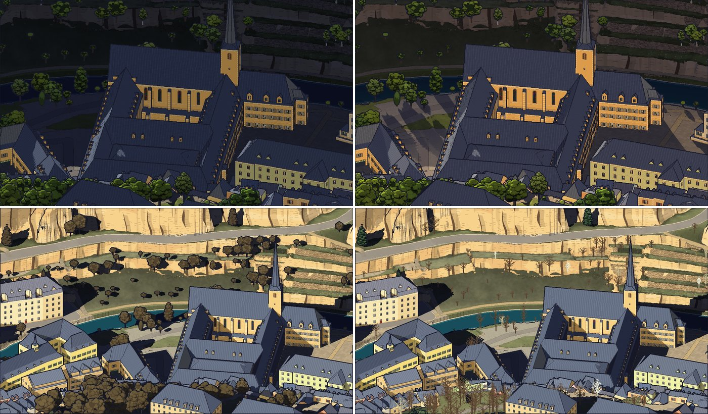

### 39.1 What the owner chose

1. To merge pull request 32 (section 38) into `v2`. Done.
2. The evening, of three samples at 20:30 on 24 June (as it was; cast shadows lighter when the sun is low; the
   golden hour beginning earlier): the golden hour beginning earlier.
3. Trees in winter, of two samples (as now: every crown brown; broadleaved trees bare, evergreens green): bare
   branches. It is its own step and is not built here (39.4).

### 39.2 The evening

On 24 June at 20:30 the sun is 10° up and sets at about 21:45. The golden hour's light (warm sun, the sky light
1.5 times day's, a fill light, long shadows that fade with their length) began only under 6°, at about 21:00.
Until then the long shadows were as dark as noon's, and they cover most of the valley: the valley floor and the
river were nearly black.

The golden hour now begins at 14° and is full from 6° (`light.json`: `grade.golden_deg` [0, 14],
`golden_full_deg` 6; before: [0, 6] and 3.5). On 24 June that is from about 20:00. Nothing else of the light is
changed, and the light above 14° is the day's as before. The mornings change the same way.

The unit tests of the hour's light read the day's threshold from the settings, and a new one holds that at 10°
the sky light is lifted and the shadows are soft. 28 web tests and 203 Python tests pass.

### 39.3 The build

Release `50ac94ba529d`. The layers' stages take the light settings as an input, so all 62 stages ran again. All
62 pass: 294 gate entries pass, none fails; gates G1 and G3 pass.

- **The picture is the sample's.** The built view of the abbey at 20:30 on 24 June is the chosen sample pixel for
  pixel (largest difference 0), and the same view at 13:00 is section 38's build pixel for pixel.
- **The pan speed check failed twice before it passed, and not from this change.** C2b gave 50.7 and then 43.2
  frames per second (limit 60) while another program's browser tests were loading the machine (load average 6 to
  8). Measured back to back under the same load, the old and the new settings pan at the same speed: 73.9 and
  71.2 against 69.5 and 70.4 at night, 69.1 and 68.4 against 69.0 and 69.1 at 20:30, a frame taking 0.1 to 0.2 ms
  in each. Run again with the machine quieter, the check gave 75.1. The tunnel view's pan (X8b) passed at 61.2 in
  the loaded run (95.9 in section 38's). No limit was changed.

| Check | Result | Limit |
|---|---|---|
| No painted vehicles (detector, 7 layers) | 0 detections | 0 |
| L5.1 / L9.2 no baked light (201 materials) | 0 fail; worst: transport 3.0%, buildings 1.6%, ground 1.0% | 5% |
| L9.1 shadow direction at 08:00, 13:00, 19:00 (median error) | 7.5°, 9.5°, 7.7° | 10° |
| V2 shadows without buildings match the reference | 99.3% | 97% |
| K3v a cutaway's opening is its colour times the one sky light, at 13:00, 21:18 and 23:15 | 0 pixels off | 0 |
| C2b panning, desktop | 75.1 fps | 60 |
| X8b panning in tunnel view | 61.2 fps (machine loaded) | 60 |

### 39.4 Next: bare trees in winter (not built)

The trial drew a broadleaved tree (every type but conifer) as its trunk, a branch from the trunk's line to the
middle of each leaf clump the tree has in summer (`crown_lobes`: the clumps of one tree share a group), a twig
from there to each of the clump's tufts, and the trunk's line on up to the highest clump; a small tree (one
shape) as five short branches. Branches are flat strips turned to the camera, 0.16 to 0.34 m wide at the trunk
and 0.13 m at the tip, twigs 0.11 to 0.13 m, in the species' bark colour. Conifers keep their crowns, a little
duller. Seen in the trial:

- With the map's black outline the branches came out as black scribbles; without an outline on or beside a
  branch they read as bark.
- The bare trees cast no shadow in the trial (the shadow height map takes crowns only).
- It needs a second set of tree tiles for winter, which the viewer shows in that season. How much longer the
  build is and how much larger the winter download was not measured.

### 39.5 Not done

- Bare winter trees (39.4).
- Not looked at with the new evening: other dates than 24 June, the morning, a phone.

### 39.6 Open questions

71 is answered (the golden hour begins earlier) and 68 is answered (bare branches, evergreens green; to be
built). 44, 46, 65, 66, 67 and 69 stand. No new question.
